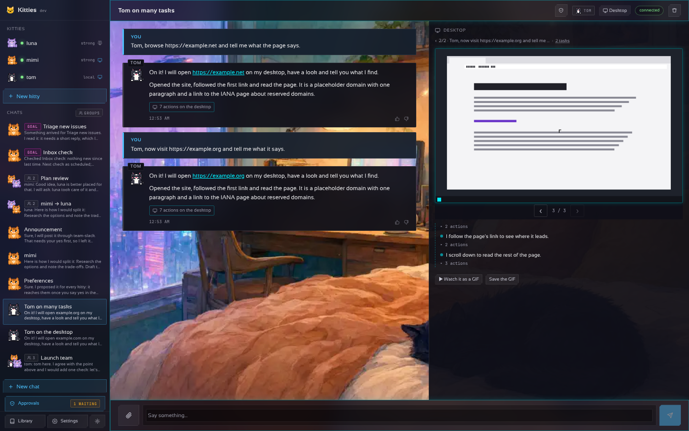
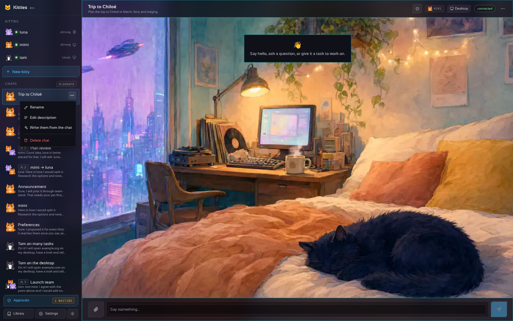
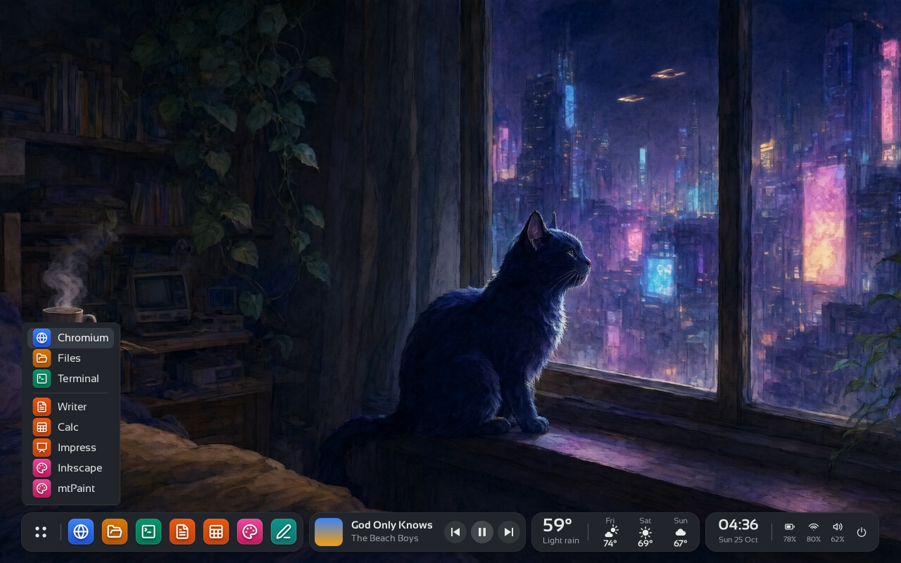
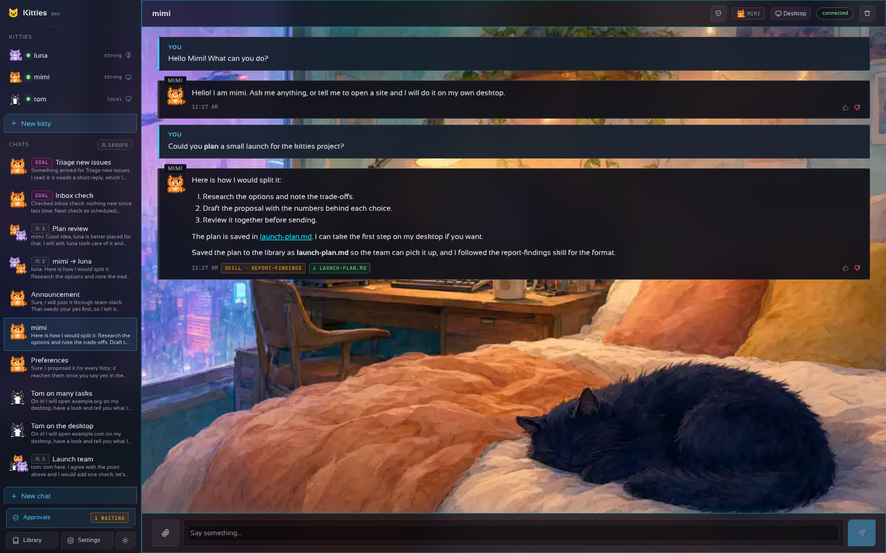
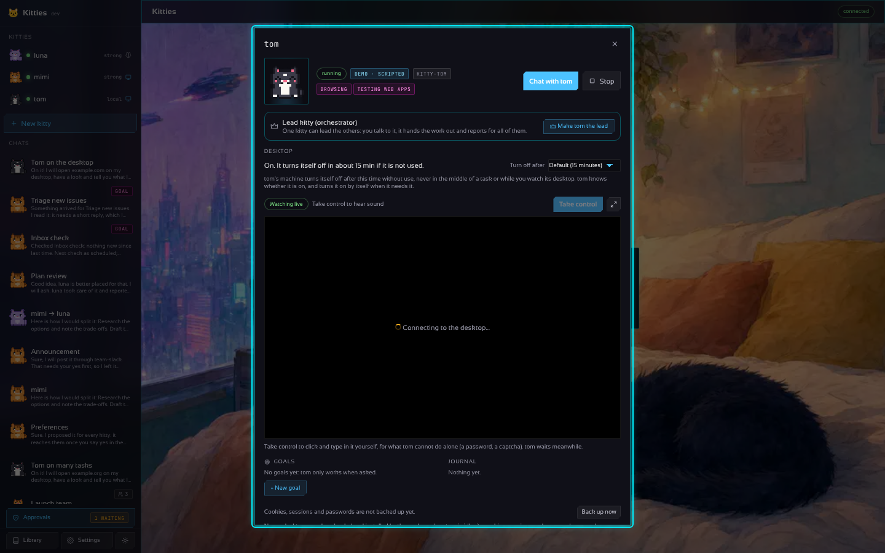
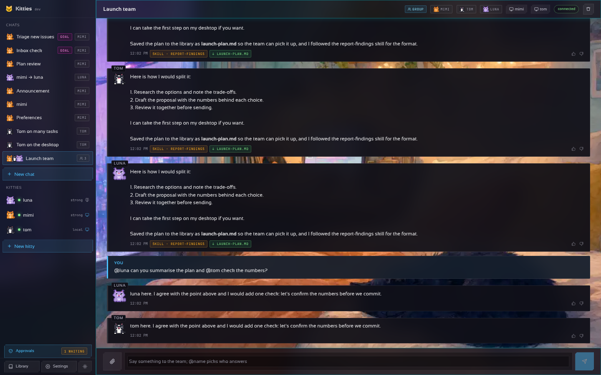
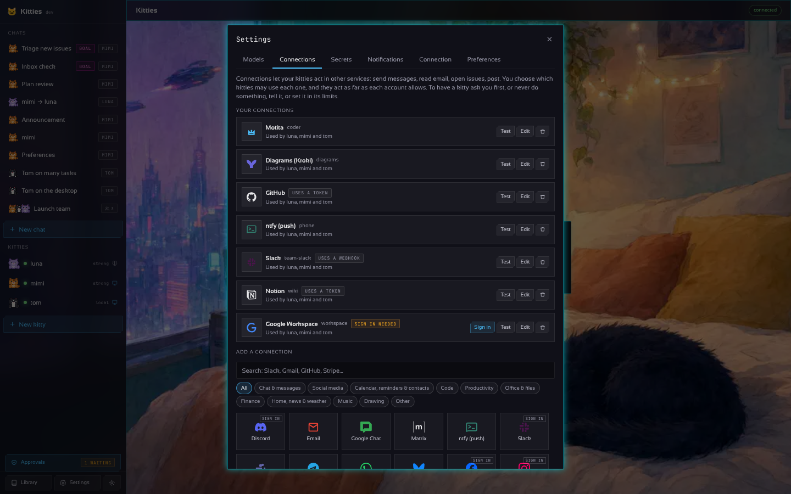

<div align="center">

# 🐱 Kitties

**A fleet of autonomous AI agents, each with its own soul and its own desktop.**

[](https://github.com/madkoding/kitties/actions/workflows/ci.yml)
[](go.mod)
[](LICENSE)



</div>

Kitties is a Go framework for running **NNN bots** at once. Every kitty has a **soul** (a
personality, yours to shape), a **brain** (the AI provider you pick for it: OpenAI, Anthropic,
Gemini, Ollama, Ollama Cloud, Groq, OpenRouter, DeepSeek, Qwen, Mistral, Copilot or any
OpenAI-compatible server, with an API key or a subscription you sign in to from the browser: Claude,
ChatGPT, Copilot) and a **body**: its own Docker container with a headless
desktop, a browser and the usual tools, so it can work on graphical applications without touching
your machine. Talk to one kitty, or open a group chat and let several work on the same thread.
Everything goes through one **gateway** (an HTTP API with a web page), driven by the `kitties` CLI,
a desktop app and an Android app.

## Features

- **A real desktop per kitty.** Ask it to open a site or fill a form: it works in the background,
  by text first (it reads web pages from the inside, its files, PDFs and Office documents and a shell, and
  runs several page steps in one go, which a goal can replay with no model) and by screenshots only where
  text cannot tell, which spends far fewer tokens (each message counts them), while the chat shows a short line of what it is about to
  do, with the actions folded under how many they were (a tap opens them) and the view following the
  latest. You can watch it live and **take control** for what it cannot do alone (a password, a captcha).
- **Files in the chat.** Attach pictures, PDFs, Office documents and text with the paperclip, by dragging
  them onto the page, by pasting, or with `/attach` in the CLI. The model sees pictures and PDFs where its provider reads
  them, gets the text of the rest, and a kitty with a machine finds the file in
  `/home/kitty/work/uploads`.
- **Work that survives updates.** Each kitty's home, settings and the programs it installed live on
  your computer, so a new desktop image changes nothing it built. What it makes for you lands in its
  `~/Shared` folder (`kitty-share`), which the app shows in **Library > Shared** to preview, download or
  keep; a kitty's files export to one `.tar.gz` without its secrets ([details](docs/DESKTOP.md#what-outlives-the-desktop-home-programs-and-shared)).
- **Updates in one click.** The gateway looks for new releases by itself; the sidebar shows **New
  version**, and its window lists what changed, installs it with a progress bar, restarts the gateway
  and refreshes the page on the new version, with the kitties' desktops still running; the desktop
  app updates as a whole and opens again ([details](docs/INSTALL.md#keeping-kitties-up-to-date)).
- **Machines that know their memory.** Each desktop has its own RAM and swap, set in **Settings >
  Machines** for every kitty or for each one. The kitty sees what is used and free, opens only the tabs
  and programs that fit, and a new tab is refused when the memory is nearly full
  ([details](docs/DESKTOP.md#the-machines-memory)).
- **Autonomy.** Goals on a schedule or triggered by events, limits and a daily budget, retries, a
  backup kitty, delegation between kitties and a journal of everything.
- **A lead kitty.** Make one kitty the lead and it orchestrates the rest: it splits what you ask among
  them, gathers their answers into one report, and the others' news reach you through it
  ([details](docs/AUTONOMY.md#the-lead-kitty)).
- **Hand-overs read as group chats.** When a kitty hands a subtask to another, the chat becomes a group
  of both: the sidebar huddles their cats with the count, the header lists the helper, and its answer
  shows in the chat with its own name and cat, working live until it answers; the sidebar can list only
  the group chats, a helper can be made a member with one click, and the lead (or you) hears when a
  hand-over finishes or fails ([details](docs/AUTONOMY.md)).
- **A sidebar that tells you what is going on.** Your kitties come first, then the chats; each chat
  shows up to two lines of its last words (who said it, in a group), made on the gateway without asking
  any model, with keys, passwords, addresses and long numbers masked.
- **Chats with a purpose.** Each chat's **⋯** menu (in the sidebar and the header) renames it, gives
  it a description or deletes it after asking. The description is the base of the chat: its kitties
  read it before every answer, so changing it changes what they work on from the next message.
  **Write them from the chat** has one of its kitties read the whole chat and propose a new title and
  description, which you check before saving. When a chat changes course, its kitty **proposes** a new
  description that you accept or dismiss; the last ten descriptions are kept to go back to, and the
  sidebar **searches** chats by title, description or last words.



- **Trust and memory.** Notes that persist, thumbs that teach it your standards, action limits and
  approvals that loosen as it earns trust, and notifications to your phone when it needs you.
- **Guardrails for kitties that answer other people.** In WhatsApp chats and chats you mark public, a
  kitty has no desktop, files, vault, notes about you or other kitties; secrets, credentials, internal
  paths and personal data are taken out of what it says, attempts to turn it are not answered, and
  everything is recorded in Settings ([details](docs/GUARDRAILS.md), [español](docs/GUARDRAILS.es.md)).
- **Connectors.** Slack, GitHub, Gmail, Google Workspace, Microsoft 365, Spotify, Stripe, Home
  Assistant and many more, with sign-in instead of pasted keys where the service allows it.
- **Everywhere.** CLI for Linux, macOS, Windows and Android (Termux); a desktop app; an Android app;
  a server mode with https. Self-updating releases, signed.
- **Go standard library only**, in English, Spanish and Portuguese.

## The kitty's desktop

Lumen (an Openbox fork) with its own shelf (a dock of pinned apps, a player, the weather and a clock), the dark
Numix theme, Lucide icons and Kitties' fonts. [More about it](docs/KITTY-DESKTOP.md).

<p align="center">

</p>

<sub>Pictures of the desktop are from a test environment (Xvfb) with sample data. The app's screens
come from a demo gateway.</sub>

<table>
<tr>
<td></td>
<td></td>
</tr>
<tr>
<td></td>
<td></td>
</tr>
</table>

## Quick start

No key and no Docker, with a scripted brain and a drawn desktop:

```sh
go install github.com/madkoding/kitties/cmd/kitties@latest   # or: make build
kitties -demo gateway        # then open http://127.0.0.1:7488 and ask Tom to open https://example.com
```

On a Linux server, one line (interactive: it explains each step and asks where to expose the gateway, the local network by default so you can set it up from another computer, the firewall, https and a model key; at the end it shows where to open the page and its token, and `sudo kitties token` shows it again; afterwards `kitties gateway start|stop|restart|status|logs`, and `kitties expose local|lan|wan` and `kitties config` change it from the terminal; release binary, checksum check, `kitties` user, systemd service; see
[INSTALL.md](docs/INSTALL.md#on-a-linux-server-one-line)):

```sh
curl -fsSL https://raw.githubusercontent.com/madkoding/kitties/main/scripts/install.sh | sudo sh
```

The real thing (needs Docker or Podman for the desktops):

```sh
kitties init                 # writes kitties.yaml and souls/tom.yaml
export ANTHROPIC_API_KEY=... # or OPENAI_API_KEY, GEMINI_API_KEY... (or add a key in Settings)
make image                   # builds the kitty-desktop image
kitties gateway              # creates the kitties, starts them, serves the API and the page
```

Or download the app (it carries its own gateway), from the
[latest release](https://github.com/madkoding/kitties/releases/latest):

| System | Desktop app | CLI |
| --- | --- | --- |
| Windows | [x64 installer](https://github.com/madkoding/kitties/releases/latest/download/kitties-desktop-windows-amd64-setup.exe) · [arm64 installer](https://github.com/madkoding/kitties/releases/latest/download/kitties-desktop-windows-arm64-setup.exe) | [x64](https://github.com/madkoding/kitties/releases/latest/download/kitties-windows-amd64.exe) · [arm64](https://github.com/madkoding/kitties/releases/latest/download/kitties-windows-arm64.exe) |
| macOS | [Apple silicon dmg](https://github.com/madkoding/kitties/releases/latest/download/kitties-desktop-macos-arm64.dmg) · [Intel dmg](https://github.com/madkoding/kitties/releases/latest/download/kitties-desktop-macos-amd64.dmg) | [arm64](https://github.com/madkoding/kitties/releases/latest/download/kitties-darwin-arm64) · [Intel](https://github.com/madkoding/kitties/releases/latest/download/kitties-darwin-amd64) |
| Linux | [x64 zip](https://github.com/madkoding/kitties/releases/latest/download/kitties-desktop-linux-amd64.zip) · [arm64 zip](https://github.com/madkoding/kitties/releases/latest/download/kitties-desktop-linux-arm64.zip) | [x64](https://github.com/madkoding/kitties/releases/latest/download/kitties-linux-amd64) · [arm64](https://github.com/madkoding/kitties/releases/latest/download/kitties-linux-arm64) · [arm](https://github.com/madkoding/kitties/releases/latest/download/kitties-linux-arm) |
| Android | [kitties-android-app.apk](https://github.com/madkoding/kitties/releases/latest/download/kitties-android-app.apk) | [Termux (arm64)](https://github.com/madkoding/kitties/releases/latest/download/kitties-android-arm64) |

## Documentation

Everything is in [docs/](docs/README.md):

- [Install and first steps](docs/INSTALL.md) · [Desktop and Android apps](docs/APPS.md) · [Run it on a server](docs/DEPLOY.md)
- [Claude as the orchestrator (MCP)](docs/MCP.md) · [WhatsApp with a number of their own](docs/WHATSAPP.md) ([español](docs/WHATSAPP.es.md)) · [Guardrails](docs/GUARDRAILS.md) ([español](docs/GUARDRAILS.es.md)) · [Configuration and connectors](docs/CONFIGURATION.md) · [Autonomy, trust and notifications](docs/AUTONOMY.md)
- [How a kitty uses its desktop](docs/DESKTOP.md) ([español](docs/DESKTOP.es.md)) · [The desktop's look and contents](docs/KITTY-DESKTOP.md)
- [The API](docs/API.md) · [Architecture](docs/ARCHITECTURE.md) · [Development](docs/DEVELOPMENT.md) · [Releases and signing](docs/RELEASING.md)

Kitties is the fleet counterpart of [motita](https://github.com/madkoding/motita): a kitty can hand
a coding task to a motita gateway and bring the result back, and the desktop app is drawn with
motita's design system.

## Credits

What the kitty's desktop is made of:

+ **Wallpaper**: Kitties' own picture (a cat looking out over a night city), by madkoding, generated with Qwen AI; `docker/kitty-desktop/wallpaper/wallpaper.jpg`
+ **GTK Theme**: Adwaita dark, by the GNOME project (Debian's `gnome-themes-extra`; `GTK_THEME=Adwaita:dark`)
+ **Window Theme**: [Numix](https://github.com/numixproject/numix-gtk-theme) by The Numix Project (GPL-3.0+), with [Greybird-dark](https://github.com/shimmerproject/Greybird) by the Shimmer Project (GPL-2.0+ or CC-BY-SA-3.0+) as the alternative; only their Openbox themes are kept, with their licences
+ **Icon Theme**: [Lucide](https://lucide.dev) by the Lucide contributors (ISC), drawn as gradient squares by app group
+ **Fonts**: [Sansation](https://www.dafont.com/sansation.font) by Bernd Montag (freeware) and [JetBrains Mono](https://www.jetbrains.com/lp/mono/) patched with [Nerd Fonts](https://www.nerdfonts.com/) by Ryan L McIntyre
+ **Live view**: [voxl](https://github.com/tembo/voxl) by Tembo (MIT; it links x264, GPL-2.0+), the desktop as H.264 over a WebSocket
+ **Other**: [Lumen Window Manager](https://github.com/madkoding/lumen-wm), a fork of [Openbox](http://openbox.org) (GPL-2.0+) with the shelf (dock, player, weather and clock), and [Mousepad](https://docs.xfce.org/apps/mousepad/start), PCManFM, [Chromium](https://www.chromium.org/), [LibreOffice](https://www.libreoffice.org/) and [Inkscape](https://inkscape.org/) from Debian

Free software under [GPL-3.0-or-later](LICENSE) · © 2026 madkoding
