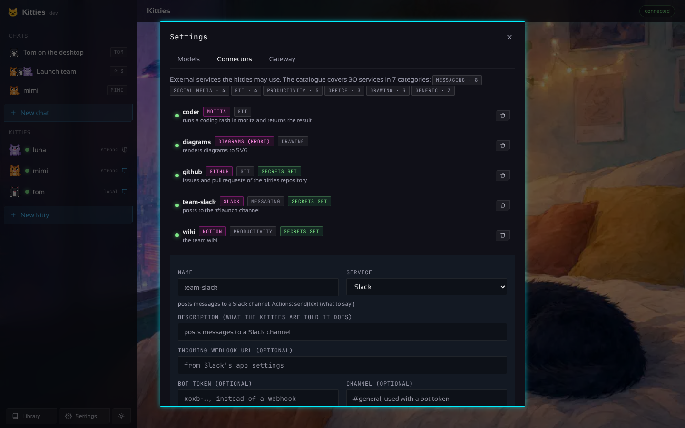

<div align="center">

# 🐱 Kitties

**A fleet of autonomous AI agents, each with its own soul and its own desktop.**

[](https://github.com/madkoding/kitties/actions/workflows/ci.yml)
[](go.mod)
[](LICENSE)

</div>

Kitties is a Go framework for running **NNN bots** at once. Every kitty has a **soul** (a
personality: helpful, kind and adaptable by default, yours to shape), a **brain** (the AI provider
you pick for it: OpenAI, Anthropic, Gemini, Ollama, Groq, OpenRouter, DeepSeek, Qwen, Mistral,
Copilot or any OpenAI-compatible server) and a **body** (its own Docker container with a headless
X display on Xvfb, a browser and the usual tools, so it can work on graphical applications without
touching your machine).

Talk to one kitty on its own, or open a **group chat**, add the kitties you want in it, and let
them work on the same thread as a team. Everything goes through one **gateway**: an HTTP API with
a small browser page, driven by the `kitties` CLI on Linux, macOS, Windows and Android (Termux).

A kitty does not just talk: ask it to open a site, fill a form or check an app and it **works on
its desktop in the background**, looking at a screenshot after every action (click, type, key,
scroll, open, run) until it is done, while the chat shows each step and its picture.

Kitties is the fleet counterpart of [motita](https://github.com/madkoding/motita): a kitty can
hand a coding task to a motita gateway through the `motita` connector and bring the result back
to the conversation, and the desktop app is drawn with motita's design system.

<p align="center">

</p>

## Try it in two minutes, no key and no Docker

```sh
go install github.com/madkoding/kitties/cmd/kitties@latest   # or: make build
kitties -demo gateway        # three kitties with a scripted brain and a drawn desktop
```

Open `http://127.0.0.1:7488` (on the same machine no token is typed: the page gets it from the
gateway) or run the desktop app, then ask Tom to *open https://example.com*.

## The real thing

```sh
kitties init                 # writes kitties.yaml and souls/tom.yaml
export ANTHROPIC_API_KEY=... # or OPENAI_API_KEY, GEMINI_API_KEY, GROQ_API_KEY... (or type keys in Settings)
make image                   # builds the kitty-desktop image (needs Docker or Podman)
kitties gateway              # creates the kitties of the file, starts them, serves the API
```

Then open the desktop app or `http://127.0.0.1:7488`, or stay in the terminal:

```sh
kitties ls                                  # the fleet and its state
kitties chat mimi                           # one kitty
kitties chat mimi,tom-1,tom-2               # a group: @name picks who answers
kitties create luna -persona "a planner"    # a new kitty, started at once
kitties scale tom 5                         # tom-1 ... tom-5
kitties exec mimi kitty-open https://example.com
kitties shot mimi desk.png                  # what is on its display right now
```

Without a container runtime the kitties still run, brain-only.

## The desktop app

`desktop/` is a [Wails](https://wails.io) application (Linux, macOS, Windows) with a Preact page
that uses the Motita design system: dark ground, neon edges, cut corners, frosted panels,
Sansation and JetBrains Mono. It talks to a gateway, local by default, and needs no token on the
machine the gateway runs on: the gateway leaves its token in `~/.kitties/gateway.token` and the
app picks it up. **Settings** holds the models (AI profiles, with their keys kept on the gateway),
the connectors and the gateway address.

```sh
make frontend     # builds the page (node 22)
make desktop      # wails build, with the Wails CLI installed
cd desktop && wails dev   # live reload while working on it
```

| | |
| --- | --- |
|  |  |
|  |  |
|  |  |
|  |  |
|  |  |

More in [docs/screenshots](docs/screenshots): the new chat and new kitty dialogs, the gateway
page, the phone layout and a kitty's own display.

## How it fits together

```
          kitties CLI / browser page / your program
                          │  HTTP + bearer token
                          ▼
                 ┌──────────────────┐
                 │     gateway      │  /v1/kitties  /v1/chats  /v1/providers
                 └────────┬─────────┘
                          ▼
                 ┌──────────────────┐      ┌───────────────┐
                 │   orchestrator   │──────│   providers   │ openai · anthropic · gemini
                 │  create · start  │      │ (one per name)│ ollama · groq · ... (motita-style)
                 │  stop · scale    │      └───────────────┘
                 └───┬─────────┬────┘
                     │         │
          ┌──────────┘         └──────────┐
          ▼                               ▼
 ┌─────────────────┐             ┌─────────────────┐
 │ kitty "mimi"    │             │ kitty "tom-1"   │   ... × NNN
 │ soul + brain    │             │ soul + brain    │
 │ container:      │             │ container:      │
 │  Xvfb :99       │             │  Xvfb :99       │
 │  chromium, …    │             │  chromium, …    │
 │  /home/kitty/work             │  /home/kitty/work
 └─────────────────┘             └─────────────────┘
          │  connectors: slack · discord · telegram · webhook · shell · motita
          ▼
     the outside world
```

- **Soul** (`internal/soul`): a YAML document (`persona`, `tone`, `traits`, `skills`, `language`,
  `instructions`) rendered into the system prompt. The default is helpful, kind and adaptable.
- **Providers** (`internal/provider`): dependency-free clients for the four API families
  (chat completions, responses, Anthropic messages, Gemini), with retries. Profiles are named in
  the configuration and each kitty picks one.
- **Containers** (`internal/container`): one container per kitty from `docker/kitty-desktop`
  (Debian, Xvfb, Chromium, xdotool, scrot). Nothing is published on the host; the orchestrator
  reaches a kitty with `docker exec`, and `kitty-shot` returns a PNG of its display.
- **Orchestrator** (`internal/orchestrator`): the fleet, persisted in `~/.kitties/kitties.json`.
  Creates the kitties the configuration lists (`replicas: n` gives `name-1 … name-n`) and scales
  them on demand.
- **Chat** (`internal/chat`): one-to-one and group threads, persisted as JSON. In a group every
  kitty sees the others' turns labelled by name and answers in turn; `@name` addresses one.
- **Desktop tasks** (`internal/desktop`): a kitty with a container writes `@tool click {"x": 640,
  "y": 420}` lines; the runtime executes them (xdotool, the browser, a program), takes a
  screenshot, shows it to the model and continues in the background until `@tool done`. Every
  step and picture lands in the thread; the chat can be cancelled.
- **Settings** (`internal/orchestrator/settings.go`): models and connectors edited from the app
  are kept in `settings.json` on top of the YAML, keys included and never shown again.
- **Demo** (`internal/demo`): a scripted brain and a drawn desktop, for `kitties -demo`.
- **Connectors** (`internal/connector`): a catalogue of services by category, each with its
  settings and actions. A kitty writes `@connector github {"action": "create_issue", "title":
  "..."}` in a reply; the runtime runs it and feeds the result back before the kitty answers.
  A connector that answers with a file (a rendered diagram) lands in the artifacts library.
- **Skills and artifacts** (`internal/skills`, `internal/artifacts`): a library like motita's.
  Skills are markdown procedures the kitties read with `@skill read <name>` and propose with
  `@skill save` (a person accepts them in the Library); three ship built in. Artifacts are the
  files they keep for later with `@artifact save` and read with `@artifact read`, shared by
  every kitty and every chat, downloadable from the page.
- **Avatars**: every kitty is an animated pixel cat (five breeds, ten coats) that reacts as a bot
  would: idle, thinking, talking, working, happy, error, sleeping.
- **Gateway** (`internal/gateway`): the HTTP API and the browser page.

## Configuration

`kitties init` writes a commented file; the full one is
[`configs/kitties.example.yaml`](configs/kitties.example.yaml). The essentials:

```yaml
providers:
  strong: { kind: anthropic, model: claude-sonnet-5-5 }
  local:  { kind: ollama, model: qwen3:8b }
default_provider: strong

kitties:
  - name: mimi
    soul: { persona: a patient researcher, traits: [curious, thorough] }
    connectors: [team-slack]
  - name: tom
    provider: local
    soul_file: souls/tom.yaml
    replicas: 3

containers: { runtime: auto, image: ghcr.io/madkoding/kitty-desktop:latest, memory_mb: 2048, cpus: 2 }
gateway:    { listen: 127.0.0.1:7488, token: "" }
motita:     { url: http://127.0.0.1:7477 }

connectors:
  team-slack: { kind: slack, url: https://hooks.slack.com/services/XXX }
  coder:      { kind: motita, description: runs a coding task in motita }
```

### The connector catalogue

| Category | Services |
| --- | --- |
| Messaging | Slack, Discord, Telegram, WhatsApp (Cloud API), Email (SMTP), Matrix, Google Chat, Microsoft Teams |
| Social media | Mastodon, Bluesky, X, LinkedIn |
| Git | GitHub (issues, comments, pull requests, files), GitLab, Gitea/Forgejo, motita (coding tasks) |
| Productivity | Notion, Trello, Todoist, Linear, Jira |
| Office | Airtable, Nextcloud (WebDAV files), Google Sheets (Apps Script) |
| Drawing | Diagrams through Kroki (mermaid, plantuml, graphviz, d2…) rendered to SVG artifacts, Figma, Excalidraw scenes |
| Generic | Webhook, any HTTP API with a bearer token, a program on the gateway's machine |

Each one is configured from **Settings → Connectors** (the form shows the fields the service
needs; secrets are kept on the gateway) or in the YAML with `kind` and `settings`. Inside its
container a kitty also has LibreOffice, Inkscape, ImageMagick and mtPaint for office documents
and drawing on its own display.

Keys come from the provider's usual variable (`OPENAI_API_KEY`, `ANTHROPIC_API_KEY`,
`GEMINI_API_KEY`, `GROQ_API_KEY`, `OPENROUTER_API_KEY`, `DEEPSEEK_API_KEY`, `DASHSCOPE_API_KEY`,
`MISTRAL_API_KEY`, `OLLAMA_API_KEY`) unless `api_key` or `api_key_env` says otherwise.

## The API

| Method and path                           | What it does                                   |
| ----------------------------------------- | ---------------------------------------------- |
| `GET /v1/health`                          | version, uptime, whether containers are available |
| `GET /v1/providers` · `GET /v1/connectors`| what the kitties can think with and reach      |
| `GET /v1/kitties` · `POST /v1/kitties`    | the fleet; create `{name, provider, soul, connectors, desktop, start}` |
| `POST /v1/kitties/{ref}/start` · `/stop` · `DELETE /v1/kitties/{ref}` | lifecycle, by id or name |
| `POST /v1/kitties/{ref}/exec` `{argv}`    | run a command in its container                 |
| `GET /v1/kitties/{ref}/screenshot`        | a PNG of its display                           |
| `POST /v1/scale/{name}` `{replicas}`      | run n replicas of a configured kitty           |
| `GET/POST /v1/chats`                      | threads; create `{title, members: [names]}`    |
| `POST /v1/chats/{id}/members` · `DELETE /v1/chats/{id}/members/{ref}` | who is in the group |
| `POST /v1/chats/{id}/messages` `{text}`   | send a message; returns the kitties' turns (a desktop task goes on in the background: poll the chat) |
| `POST /v1/chats/{id}/cancel` · `GET /v1/chats/{id}/shots/{name}` | stop a task; a step's screenshot |
| `GET /v1/settings` · `PUT/DELETE /v1/settings/providers/{name}` · `POST …/test` · `PUT/DELETE /v1/settings/connectors/{name}` | the models and the connectors |
| `GET /v1/local-token`                     | the token, handed only to a client on the same machine |
| `PATCH /v1/kitties/{ref}` `{avatar, soul}` · `GET /v1/avatars` | change a kitty's looks; the breeds and coats |
| `GET/PUT/DELETE /v1/skills/{name}` · `POST …/accept` | the skills library and its proposals |
| `GET/PUT/DELETE /v1/artifacts/{name}`     | the artifacts library (raw file bodies) |

Every other call needs `Authorization: Bearer <token>`; `/` and `/v1/health` are open.

## Development

```sh
make check    # gofmt, go vet, go test -race
make cover    # coverage per package (gate: 90 %)
make dist     # linux, macOS, windows and android binaries
make image    # the kitty-desktop container image
make desktop-check   # the Wails module and its page
```

The project builds with the Go standard library only. Commits follow
[Conventional Commits](https://www.conventionalcommits.org/); releases are cut from tags.
See [docs/ARCHITECTURE.md](docs/ARCHITECTURE.md) for the design in more depth.

Free software under [GPL-3.0-or-later](LICENSE) · © 2026 madkoding
