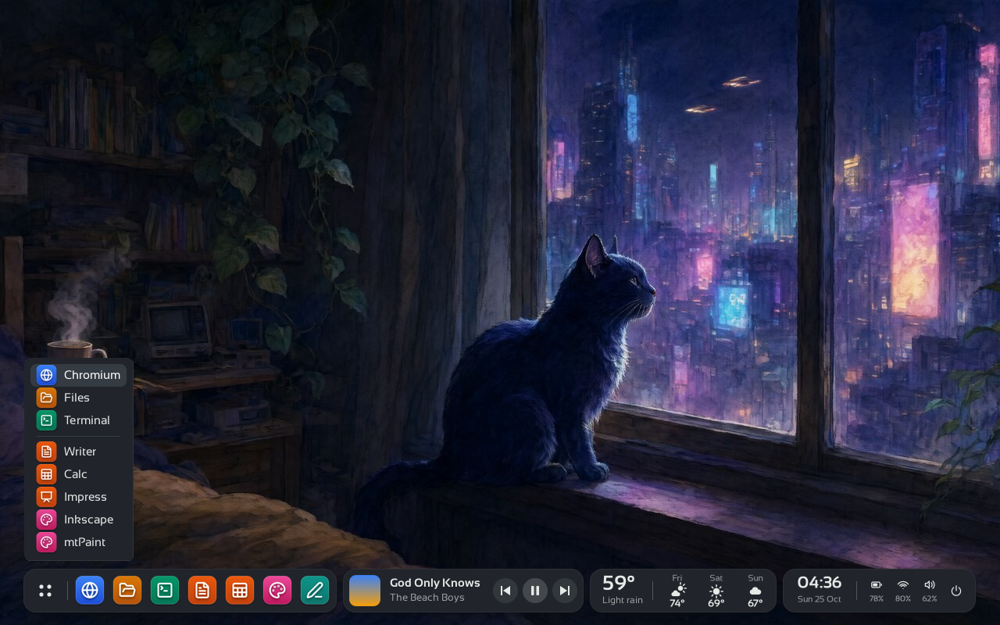

<div align="center">

# 🐱 Kitties

**A fleet of autonomous AI agents, each with its own soul and its own desktop.**

[](https://github.com/madkoding/kitties/actions/workflows/ci.yml)
[](go.mod)
[](LICENSE)


</div>

Kitties is a Go framework for running **NNN bots** at once. Every kitty has a **soul** (a
personality, yours to shape), a **brain** (the AI provider you pick for it: OpenAI, Anthropic,
Gemini, Ollama, Groq, OpenRouter, DeepSeek, Qwen, Mistral, Copilot or any OpenAI-compatible server,
with an API key or a subscription) and a **body**: its own Docker container with a headless
desktop, a browser and the usual tools, so it can work on graphical applications without touching
your machine. Talk to one kitty, or open a group chat and let several work on the same thread.
Everything goes through one **gateway** (an HTTP API with a web page), driven by the `kitties` CLI,
a desktop app and an Android app.

## Features

- **A real desktop per kitty.** Ask it to open a site or fill a form: it works in the background,
  looking at a screenshot after every action, while the chat shows each step. You can watch it live
  and **take control** for what it cannot do alone (a password, a captcha).
- **Autonomy.** Goals on a schedule or triggered by events, limits and a daily budget, retries, a
  backup kitty, delegation between kitties and a journal of everything.
- **Trust and memory.** Notes that persist, thumbs that teach it your standards, action limits and
  approvals that loosen as it earns trust, and notifications to your phone when it needs you.
- **Connectors.** Slack, GitHub, Gmail, Google Workspace, Microsoft 365, Spotify, Stripe, Home
  Assistant and many more, with sign-in instead of pasted keys where the service allows it.
- **Everywhere.** CLI for Linux, macOS, Windows and Android (Termux); a desktop app; an Android app;
  a server mode with https. Self-updating releases, signed.
- **Go standard library only**, in English, Spanish and Portuguese.

## The kitty's desktop

Lumen (an Openbox fork) with its own shelf (a dock of pinned apps, a player, the weather and a clock), the dark
Numix theme, Lucide icons and Kitties' fonts. [More about it](docs/KITTY-DESKTOP.md).

<p align="center">

</p>

<sub>Pictures of the desktop are from a test environment (Xvfb) with sample data. The app's screens
come from a demo gateway.</sub>

<table>
<tr>
<td></td>
<td></td>
</tr>
<tr>
<td></td>
<td></td>
</tr>
</table>

## Quick start

No key and no Docker, with a scripted brain and a drawn desktop:

```sh
go install github.com/madkoding/kitties/cmd/kitties@latest   # or: make build
kitties -demo gateway        # then open http://127.0.0.1:7488 and ask Tom to open https://example.com
```

On a Linux server, one line (release binary, checksum check, `kitties` user, systemd service; see
[INSTALL.md](docs/INSTALL.md#on-a-linux-server-one-line)):

```sh
curl -fsSL https://raw.githubusercontent.com/madkoding/kitties/main/scripts/install.sh | sudo sh
```

The real thing (needs Docker or Podman for the desktops):

```sh
kitties init                 # writes kitties.yaml and souls/tom.yaml
export ANTHROPIC_API_KEY=... # or OPENAI_API_KEY, GEMINI_API_KEY... (or add a key in Settings)
make image                   # builds the kitty-desktop image
kitties gateway              # creates the kitties, starts them, serves the API and the page
```

Or download the app (it carries its own gateway), from the
[latest release](https://github.com/madkoding/kitties/releases/latest):

| System | Desktop app | CLI |
| --- | --- | --- |
| Windows | [x64 installer](https://github.com/madkoding/kitties/releases/latest/download/kitties-desktop-windows-amd64-setup.exe) · [arm64 installer](https://github.com/madkoding/kitties/releases/latest/download/kitties-desktop-windows-arm64-setup.exe) | [x64](https://github.com/madkoding/kitties/releases/latest/download/kitties-windows-amd64.exe) · [arm64](https://github.com/madkoding/kitties/releases/latest/download/kitties-windows-arm64.exe) |
| macOS | [Apple silicon dmg](https://github.com/madkoding/kitties/releases/latest/download/kitties-desktop-macos-arm64.dmg) · [Intel dmg](https://github.com/madkoding/kitties/releases/latest/download/kitties-desktop-macos-amd64.dmg) | [arm64](https://github.com/madkoding/kitties/releases/latest/download/kitties-darwin-arm64) · [Intel](https://github.com/madkoding/kitties/releases/latest/download/kitties-darwin-amd64) |
| Linux | [x64 zip](https://github.com/madkoding/kitties/releases/latest/download/kitties-desktop-linux-amd64.zip) · [arm64 zip](https://github.com/madkoding/kitties/releases/latest/download/kitties-desktop-linux-arm64.zip) | [x64](https://github.com/madkoding/kitties/releases/latest/download/kitties-linux-amd64) · [arm64](https://github.com/madkoding/kitties/releases/latest/download/kitties-linux-arm64) · [arm](https://github.com/madkoding/kitties/releases/latest/download/kitties-linux-arm) |
| Android | [kitties-android-app.apk](https://github.com/madkoding/kitties/releases/latest/download/kitties-android-app.apk) | [Termux (arm64)](https://github.com/madkoding/kitties/releases/latest/download/kitties-android-arm64) |

## Documentation

Everything is in [docs/](docs/README.md):

- [Install and first steps](docs/INSTALL.md) · [Desktop and Android apps](docs/APPS.md) · [Run it on a server](docs/DEPLOY.md)
- [Configuration and connectors](docs/CONFIGURATION.md) · [Autonomy, trust and notifications](docs/AUTONOMY.md)
- [How a kitty uses its desktop](docs/DESKTOP.md) ([español](docs/DESKTOP.es.md)) · [The desktop's look and contents](docs/KITTY-DESKTOP.md)
- [The API](docs/API.md) · [Architecture](docs/ARCHITECTURE.md) · [Development](docs/DEVELOPMENT.md) · [Releases and signing](docs/RELEASING.md)

Kitties is the fleet counterpart of [motita](https://github.com/madkoding/motita): a kitty can hand
a coding task to a motita gateway and bring the result back, and the desktop app is drawn with
motita's design system.

## Credits

What the kitty's desktop is made of:

+ **Wallpaper**: Kitties' own picture (a cat looking out over a night city), by madkoding, generated with Qwen AI; `docker/kitty-desktop/wallpaper/wallpaper.jpg`
+ **GTK Theme**: Adwaita dark, by the GNOME project (Debian's `gnome-themes-extra`; `GTK_THEME=Adwaita:dark`)
+ **Window Theme**: [Numix](https://github.com/numixproject/numix-gtk-theme) by The Numix Project (GPL-3.0+), with [Greybird-dark](https://github.com/shimmerproject/Greybird) by the Shimmer Project (GPL-2.0+ or CC-BY-SA-3.0+) as the alternative; only their Openbox themes are kept, with their licences
+ **Icon Theme**: [Lucide](https://lucide.dev) by the Lucide contributors (ISC), drawn as gradient squares by app group
+ **Fonts**: [Sansation](https://www.dafont.com/sansation.font) by Bernd Montag (freeware) and [JetBrains Mono](https://www.jetbrains.com/lp/mono/) patched with [Nerd Fonts](https://www.nerdfonts.com/) by Ryan L McIntyre
+ **Other**: [Lumen Window Manager](https://github.com/madkoding/lumen-wm), a fork of [Openbox](http://openbox.org) (GPL-2.0+) with the shelf (dock, player, weather and clock), and [Mousepad](https://docs.xfce.org/apps/mousepad/start), PCManFM, [Chromium](https://www.chromium.org/), [LibreOffice](https://www.libreoffice.org/) and [Inkscape](https://inkscape.org/) from Debian

Free software under [GPL-3.0-or-later](LICENSE) · © 2026 madkoding
