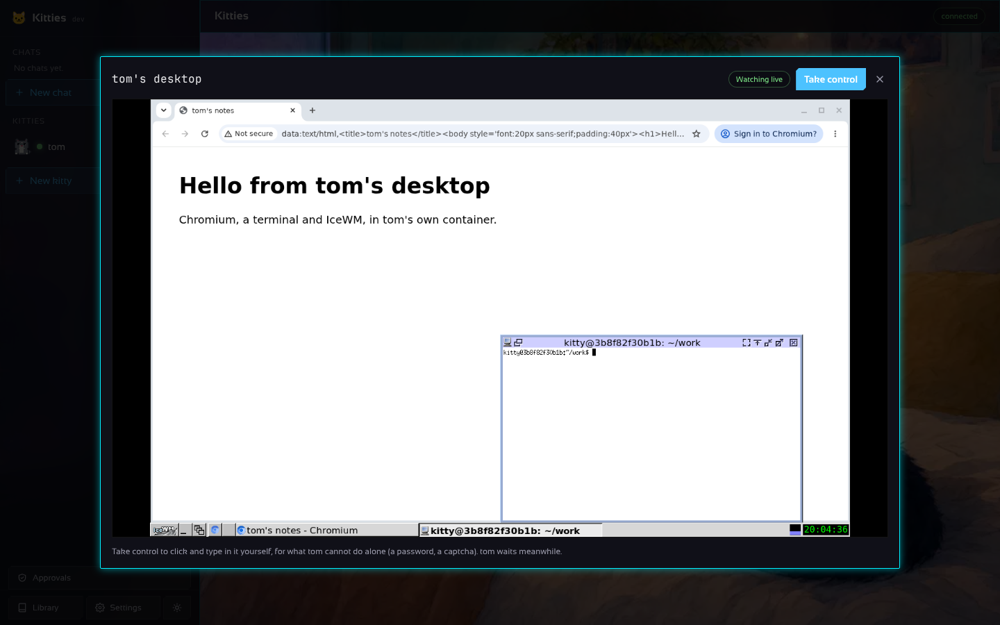

# The desktop app and the Android app

## The desktop app

`desktop/` is a [Wails](https://wails.io) application (Linux, macOS, Windows) with a Preact page
that uses the Motita design system: dark ground, neon edges, cut corners, frosted panels,
Sansation and JetBrains Mono. It talks to a gateway, local by default (the downloads carry one and start it for you), and
needs no token on the machine the gateway runs on: the gateway leaves its token in `~/.kitties/gateway.token` and the
app picks it up. **Settings** holds the models (pick a provider, paste its key: it is tested on save), the
connections (with the kitties that may use each one), notifications and the gateway address.
A first run is a short checklist: a model, a kitty, a chat.

```sh
make frontend     # builds the page (node 24)
make desktop      # wails build, with the Wails CLI installed
(cd desktop/frontend && npm run icon)   # redraw the app icon and the macOS disk image's background
cd desktop && wails dev   # live reload while working on it
```

| | |
| --- | --- |
|  |  |
|  |  |
|  |  |
|  |  |
|  |  |
|  |  |
|  |  |
|  |  |
|  |  |
|  |  |
|  |  |
|  |  |

More in [docs/screenshots](screenshots): the new chat and new kitty dialogs, the gateway
page, the phone layout and a kitty's own display.

## The Android app

`kitties-android-app.apk` is the desktop app's page on the phone: a remote for a gateway that runs
on your computer or server (the kitties and their desktops stay there). Install it (Android asks to
allow installs from the browser or the file manager once), then type the gateway's address and
token:

```sh
KITTIES_LISTEN=0.0.0.0:7488 kitties gateway   # on the computer: listen on the home network
cat ~/.kitties/gateway.token                   # the token the app asks for
```

The address is the computer's on the network, like `http://192.168.1.20:7488`; over the internet,
put the gateway behind HTTPS ([DEPLOY.md](DEPLOY.md)). The gateway lets the app's page
call it with the token, and nothing else from other sites. `android/` is a plain WebView project:
`make android` builds the APK (Android SDK and JDK 17+). Releases are signed with the
`KITTIES_KEYSTORE_BASE64`, `KITTIES_KEYSTORE_PASSWORD` and `KITTIES_KEY_ALIAS` secrets when they
are set; without them each release gets a debug key, and updating means uninstalling first.
