# Autonomy, trust and being told

## On their own

A kitty is not only something you talk to. Each one has an agenda:

- **Goals.** Standing tasks it pursues without being asked: on a schedule (cron, or
  *hourly*, *daily*, *weekdays at nine*), when a service reports something, or when you press
  *run now*. Each goal works in a thread of its own, so you can read along and chime in.
- **Incoming events.** GitHub, Slack, Discord, Jira and any service that can POST send their
  events to `POST /v1/hooks/<connector>`, signed with the connector's incoming events secret
  (GitHub's HMAC signature, or an `X-Kitties-Secret` header). The goals that listen to that
  connector run with the event.
- **Unattended by default.** A kitty sees a task through: told to check twelve groups, it
  lists them, ticks them off and does all twelve instead of stopping at two to ask "shall I
  continue?". It only asks when something truly blocks it (a login, a code only you get), and
  keeps working on the rest meanwhile. Past its rounds it goes on by itself, writing a
  checkpoint of what is done and left (it also keeps its list of pending items in `TODO.md` in its workspace, so a cut-off task resumes from it) (no cap on windows of `max_rounds` on the desktop, and no cap on rounds of
  connector calls per answer). `limits.attended: true` (Settings → Limits → *Work on its own*
  off) brings back the old way: stop at the end of the rounds and wait for a "continue".
- **Limits.** Per kitty: tokens, seconds and rounds per task, and how many times a failed
  attempt is tried another way. Unattended, there is no per-task token limit by default (nor a daily one) nor time limit; set `max_tokens`/`max_seconds` to cap one, and `day_tokens` caps the whole day. They are the safety net of unattended work: a task that hits
  one stops, says so (and can be resumed) instead of running on. A **daily budget** caps what a kitty spends around the clock: out of tokens it rests until
  tomorrow (and tells you once), then goes on by itself from where it stopped (right away if you
  raise or remove the limit); past its actions for the day, every post, reply or refund waits
  for your yes even if it normally acts alone.
- **Recovery.** A brain that is down for a while (busy, failing, unreachable) is waited for,
  up to half an hour, ever longer between tries, instead of failing the attempt; each wait shows
  in the chat. A failed attempt is retried with a different approach. When a kitty gives up,
  its **backup** kitty takes the task over; without one, the free kitty of the fleet most like it
  (a desktop if the task needs one, not in error, not at work; then the connectors it uses and
  the skills of its soul) stands in, up to `stand_ins` tasks a day (3 by default); when none is
  free (or the kitty is *attended*), the kitty asks you (the chat is
  marked *help* until you answer). A watchdog brings a stopped container back and retries a
  kitty in error.
- **Follow-ups.** A goal whose run did not finish (blocked, escalated to you, or it could not
  even start) is picked up again by itself: after 10 minutes, then 30, then 2 hours, in the same
  thread, told to go on from where it stopped, with its `TODO.md` (what it wrote down as done
  and left) right in the call. A run that finishes starts the count again; past
  the third the goal waits for its schedule, an event or you. The journal says when the next one
  is due, and the goal shows *tries again …*. Both waits are set in *Settings → Preferences →
  Working on their own* (or `autonomy:` in the YAML).
- **A spare brain.** A model profile can name a `fallback`: while it is down the kitties think
  with the spare instead of waiting ([Configuration](CONFIGURATION.md#a-spare-brain)).
- **Delegation.** A kitty can hand a subtask to another (`@delegate luna {"task": "..."}`,
  or the native `delegate` tool), waits for the answer and goes on. Hand-overs are bounded in
  depth so two kitties cannot bounce a task back and forth.
- **A journal.** Every run, event, retry, hand-over, cry for help and recovery is a line in the
  kitty's journal, in its drawer.

| | |
| --- | --- |
| 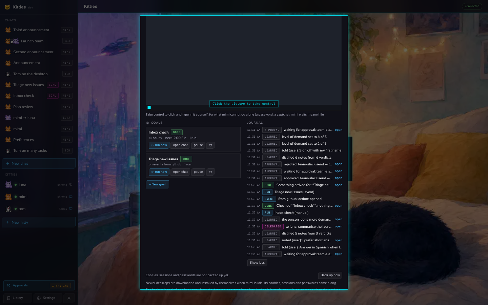 | 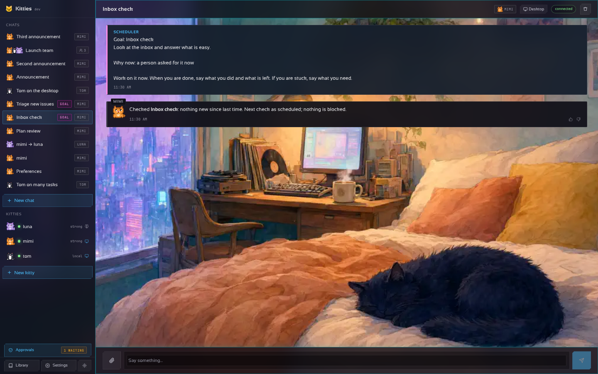 |
| 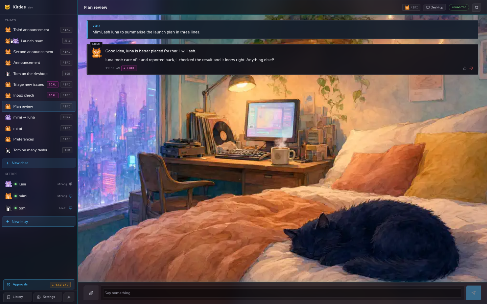 | 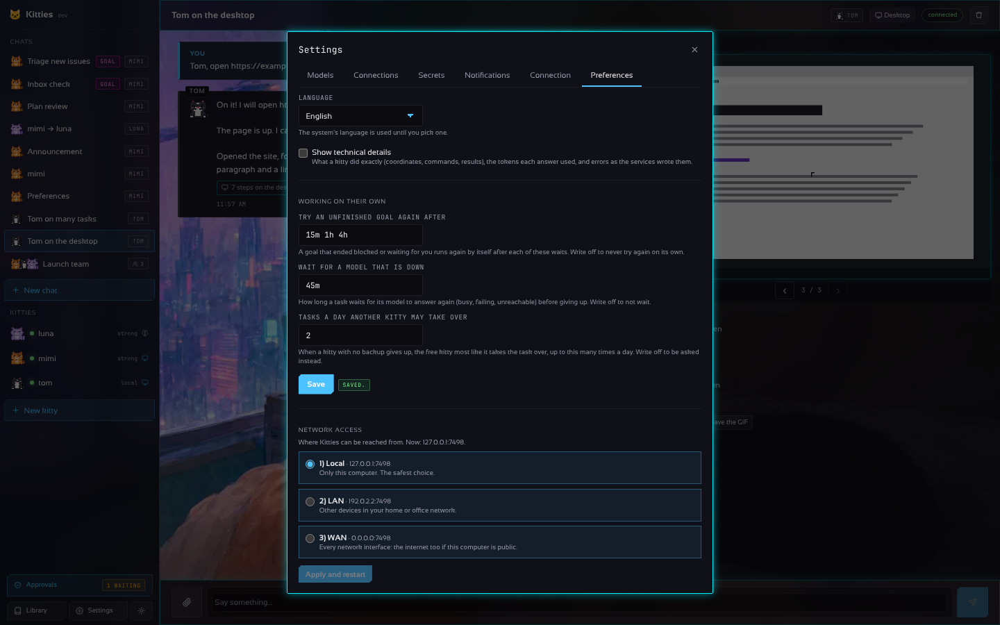 |

In the YAML, under a kitty:

```yaml
autonomy:                        # Settings → Preferences → Working on their own
  follow_ups: 10m 30m 2h         # waits before an unfinished goal runs again; off: never
  brain_wait: 30m                # how long a task waits for a model that is down; off: not at all
  stand_ins: 3                   # tasks a day a kitty without a backup hands to a free one; off: none
kitties:
  - name: mimi
    backup: luna                 # takes over what mimi gives up on
    limits: {max_tokens: 200000, max_seconds: 900, retries: 2, day_tokens: 2000000, day_actions: 20}
    goals:
      - title: Inbox check
        text: Look at the inbox and answer what is easy.
        every: "@hourly"
      - title: Triage new issues
        on: [github]             # the github connector's inbound_secret signs the hook
```

## Learning, trust and being told

Autonomy needs a memory, a leash that loosens with trust, and a way to reach you.

- **Memory.** Each kitty keeps what it knows about you and the work: notes in three scopes
  (*you*, *work* and one per project), plus *shared* notes that every kitty knows (kept once, in
  `memory/_shared.json`; a kitty's distillation never rewrites them and removing a kitty keeps
  them; Settings → Shared memory lists them), pinned notes of your own, and a level of how demanding you
  are (1 relaxed to 5 strict) that it learns from the thumbs under its answers. Every few verdicts
  it distils the corrections into lasting notes with its own brain. It writes notes itself
  (`@memory remember {...}` or the native `memory_*` tools) when you say "remember that...". The
  memory sits in its prompt, so it answers the way you like. Any note can be corrected in place
  (it becomes yours), and a kitty's notes go to a JSON file and come back from one (Export and
  Import in its memory), to keep them or hand them to another kitty.
- **Action limits.** Nothing is limited by default: a kitty does on a connection what the account
  allows, since that is the service's to limit (the scopes of the sign-in, the permissions of the
  key). Tell a kitty "ask me before posting" or "never delete anything" and it adds the limit to
  its limiter (`@limit set {"connector": "x", "action": "post", "mode": "ask"}`, or the native
  `limit` tool); you see and change them in the kitty's *Action limits*, or set them there. An
  *ask* action waits in the Approvals screen (*approve*, *approve and stop asking*, *reject with
  a reason*), a *never* one is refused and the kitty says so. A limit the kitty sets shows in the
  chat, with *Undo*. A kitty in `approvals: ask` asks
  about everything that reaches other people until yeses in a row earn its trust, sooner for a
  relaxed person (2) than a strict one (12).
- **Your language, plain words.** The page speaks English, Spanish and Portuguese, what the
  gateway writes into a chat included: the system's language by default, or the one picked in
  *Settings → Preferences* (`?lang=es` or `?lang=pt` for a visit). The kitties
  answer in the language you write in, in everyday words; *Show technical details* in the same
  place writes out the coordinates, commands, tokens and errors as the services wrote them.
- **Notifications.** A kitty that needs you does not wait for you to open the app: through any
  messaging connector (an [ntfy](https://ntfy.sh) topic pushes to your phone) it tells you when it
  needs help, when an action waits for a yes, and optionally when a goal finishes, gets blocked or
  a container recovers or a kitty spends its day's tokens. Bursts are folded into one message every
  ten minutes. Optionally a **daily summary** arrives at the hour you choose: what each kitty did
  in the last day, what it spent, which goals ran again on their own and how they ended, and
  what waits for your yes.
- **Community manager, support, finance.** Besides writing, connectors read and answer: Mastodon
  and Bluesky timelines, mentions, replies and likes; Gmail and Outlook inboxes; Slack and
  Telegram messages; Stripe balance, invoices and payments; Zendesk tickets. Results come back as
  one line per item, and Stripe's events (failed payments, disputes) can start a goal.
- **A browser that stays signed in.** Chromium keeps its profile in the kitty's workspace, so
  logins and cookies survive restarts and the kitty does not sign in again each morning.
- **Long threads.** When a thread passes forty turns the early ones are summarised and only the
  latest sixteen stay verbatim, so a goal that runs for weeks does not outgrow its context.

| | |
| --- | --- |
|  | 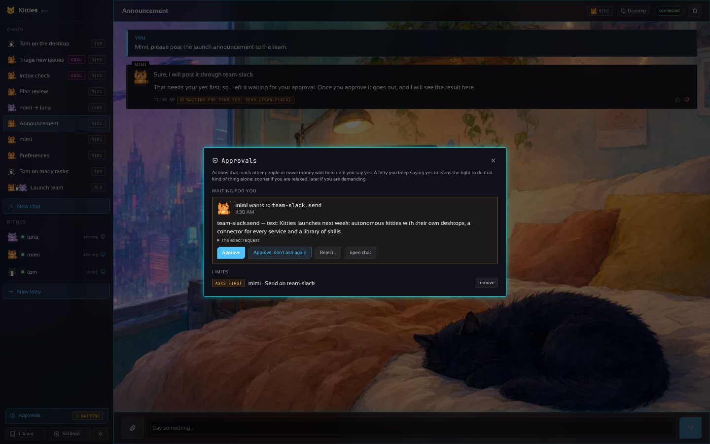 |
| 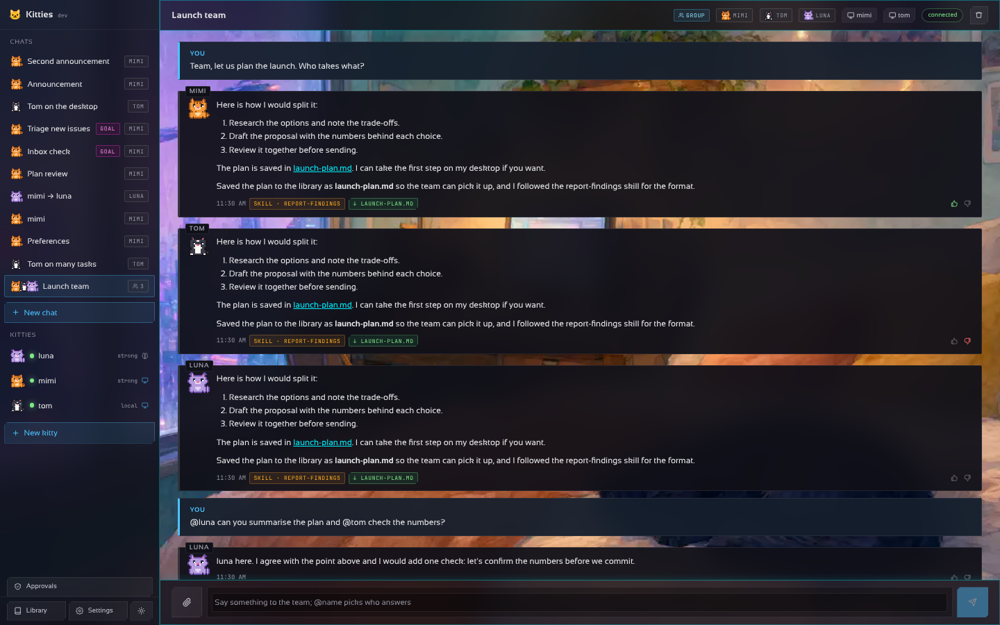 | 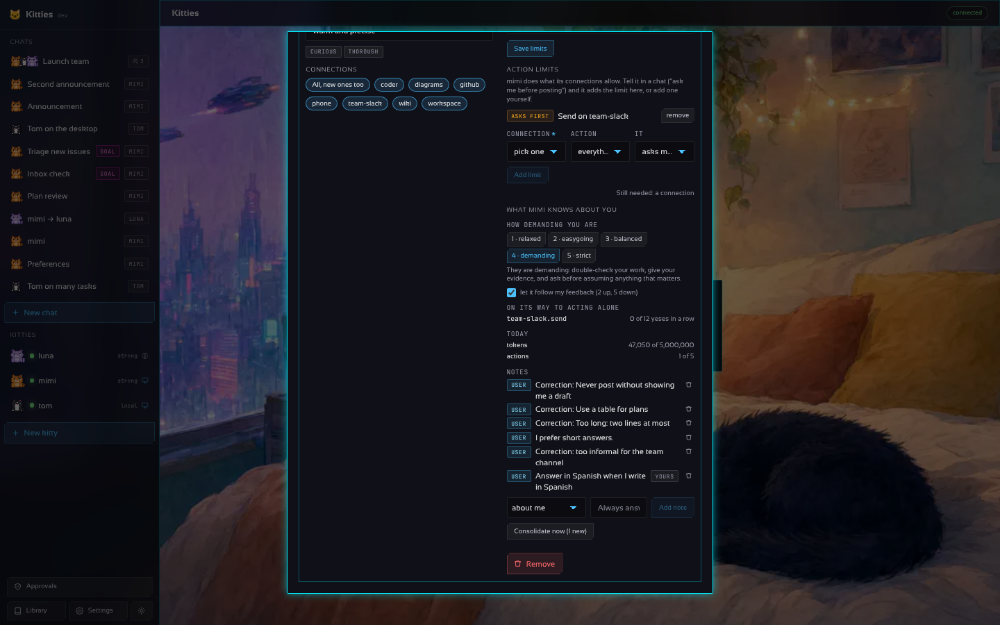 |
| 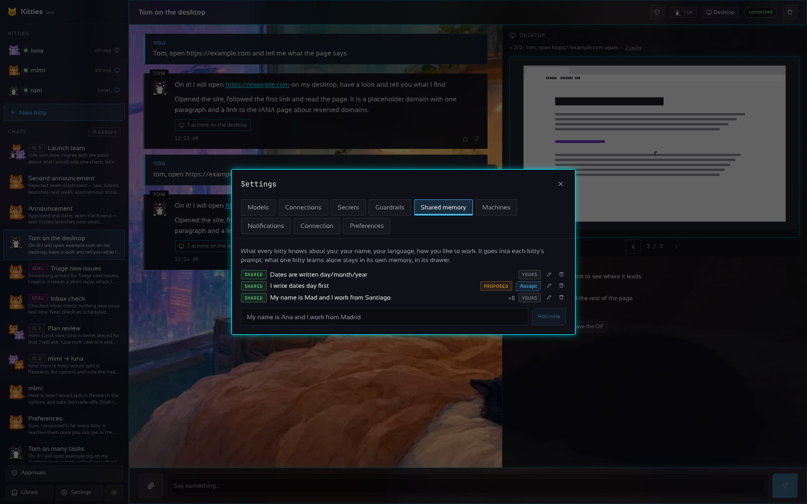 | |
| 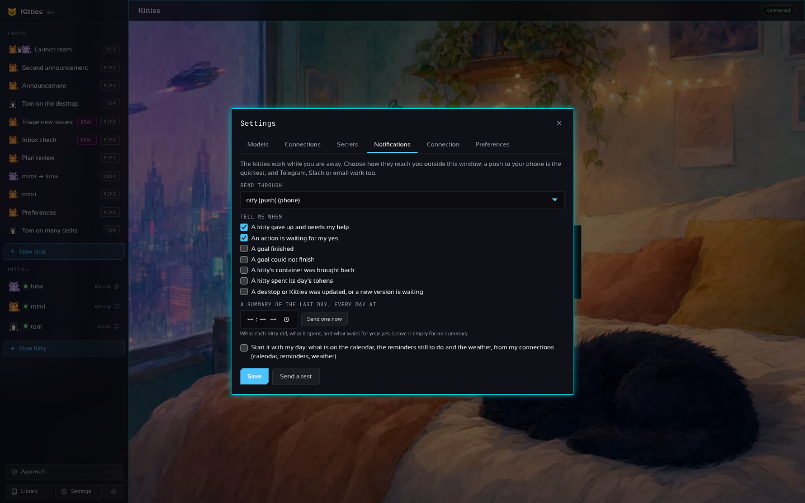 | 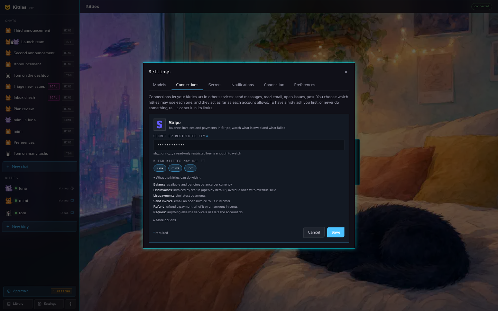 |
| 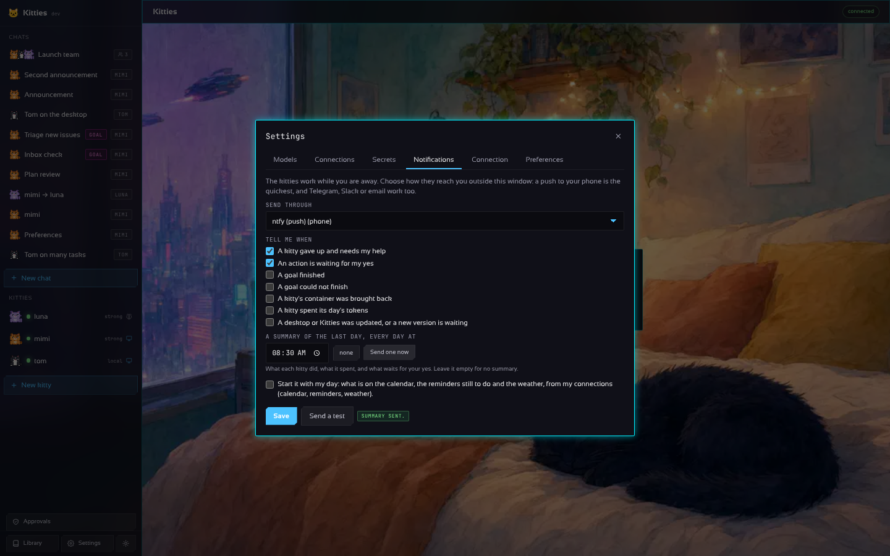 | |

In the YAML:

```yaml
kitties:
  - name: mimi
    approvals: ask               # empty (default): acts as far as the account allows | ask
notify:
  connector: phone               # any messaging connector; ntfy pushes to your phone
  on: [help, approval, goal_done, goal_blocked, recovered, budget]   # default: help, approval
  digest: "08:30"                # a summary of the last day, every day (gateway's clock); empty: none
connectors:
  phone: { kind: ntfy, settings: { topic: my-kitties } }
```
