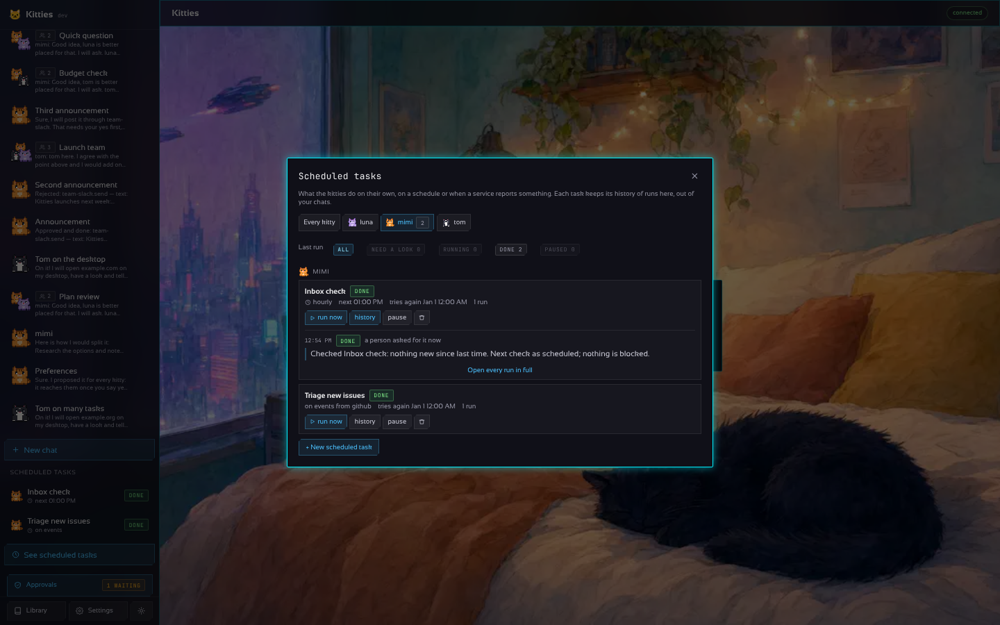
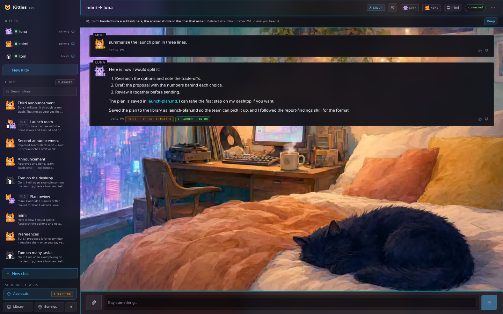
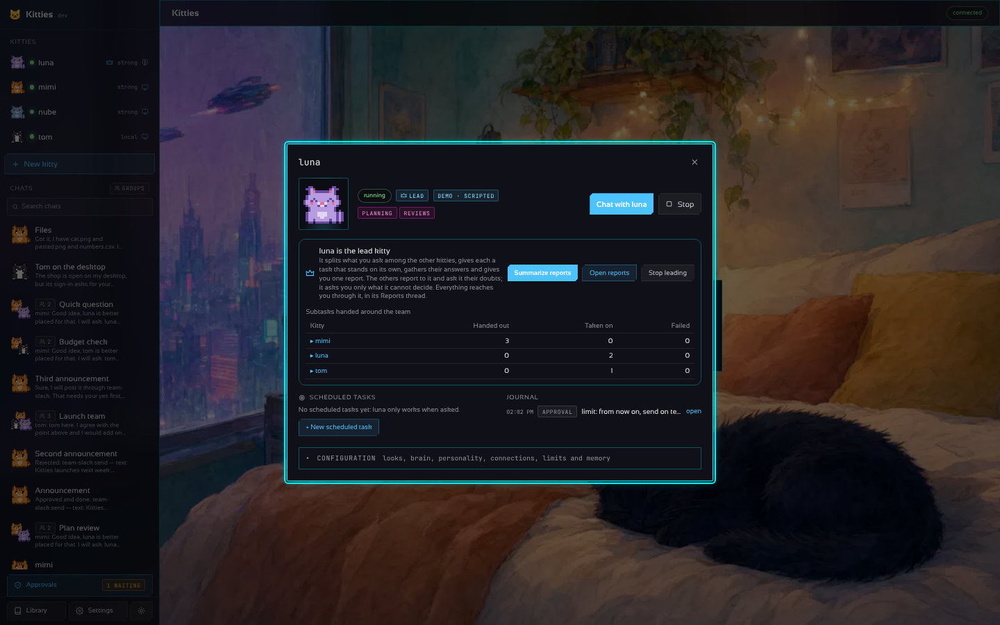
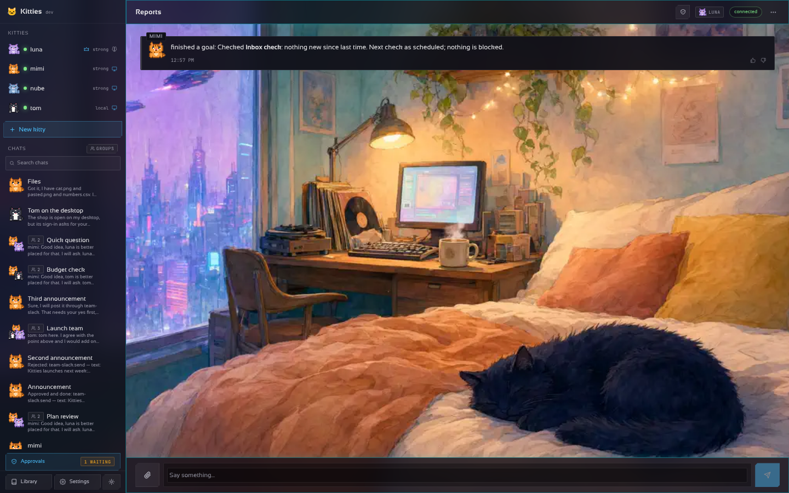

# Autonomy, trust and being told

## On their own

A kitty is not only something you talk to. Each one has an agenda:

- **Scheduled tasks (goals).** Standing tasks it pursues without being asked: on a schedule
  (cron, or *hourly*, *daily*, *weekdays at nine*), when a service reports something, or when you
  press *run now*. They have a section of their own in the sidebar, *Scheduled tasks*, apart from
  the chats: a task opens the window of every kitty's tasks, where *history* lists its runs,
  newest first (when and why it ran, how it ended, the kitty's last words); the filter keeps the
  tasks by how their last run ended (*need a look*: blocked, escalated or failed; running; done;
  paused; the sidebar's amber *N to look at* opens it on the first), and *Open every run
  in full* opens its thread, so you can read along and chime in. That thread is not a chat: the
  sidebar does not list it, and a line over it says whose task it is. The same tasks are in the
  kitty's drawer. API: `GET /v1/goals/{id}/runs`; MCP: `goal_runs`. A task you remove gives its
  thread back to the chats.
- **Saved steps, no tokens.** A goal can name a page flow the kitty saved (`page_flow` with
  `save`, see [the desktop](DESKTOP.md#reading-and-acting-on-pages-from-the-inside)): *Saved steps
  to play first* in the goal's form, `flow:` in the configuration or in `goal_add`. Each run plays
  it on the desktop without the model and reports the goal done, with the page as it ended in the
  thread; only a flow that fails hands the goal to the kitty, told what went wrong, so it finishes
  by hand and saves the corrected steps under the same name.
- **Incoming events.** GitHub, Slack, Discord, Jira and any service that can POST send their
  events to `POST /v1/hooks/<connector>`, signed with the connector's incoming events secret
  (GitHub's HMAC signature, or an `X-Kitties-Secret` header). The goals that listen to that
  connector run with the event.
- **Unattended by default.** A kitty sees a task through: told to check twelve groups, it
  lists them, ticks them off and does all twelve instead of stopping at two to ask "shall I
  continue?". It only asks when something truly blocks it (a login, a code only you get), and
  keeps working on the rest meanwhile. Past its rounds it goes on by itself, writing a
  checkpoint of what is done and left (it also keeps its list of pending items in `TODO.md` in its workspace, so a cut-off task resumes from it) (no cap on windows of `max_rounds` on the desktop, and no cap on rounds of
  connector calls per answer). `limits.attended: true` (Settings → Limits → *Work on its own*
  off) brings back the old way: stop at the end of the rounds and wait for a "continue".
- **Limits.** Per kitty: tokens, seconds and rounds per task, and how many times a failed
  attempt is tried another way. Unattended, there is no per-task token limit by default (nor a daily one) nor time limit; set `max_tokens`/`max_seconds` to cap one, and `day_tokens` caps the whole day. They are the safety net of unattended work: a task that hits
  one stops, says so (and can be resumed) instead of running on. A **daily budget** caps what a kitty spends around the clock: out of tokens it rests until
  tomorrow (and tells you once), then goes on by itself from where it stopped (right away if you
  raise or remove the limit); past its actions for the day, every post, reply or refund waits
  for your yes even if it normally acts alone.
- **Recovery.** A brain that is down for a while (busy, failing, unreachable) is waited for,
  up to half an hour, ever longer between tries, instead of failing the attempt; each wait shows
  in the chat. A failed attempt is retried with a different approach. When a kitty gives up,
  its **backup** kitty takes the task over; without one, the free kitty of the fleet most like it
  (a desktop if the task needs one, not in error, not at work; then the connectors it uses and
  the skills of its soul) stands in, up to `stand_ins` tasks a day (3 by default); when none is
  free (or the kitty is *attended*), the kitty asks you (the chat is
  marked *help* until you answer). A watchdog brings a stopped container back and retries a
  kitty in error.
- **Follow-ups.** A goal whose run did not finish (blocked, escalated to you, or it could not
  even start) is picked up again by itself: after 10 minutes, then 30, then 2 hours, in the same
  thread, told to go on from where it stopped, with its `TODO.md` (what it wrote down as done
  and left) right in the call. A run that finishes starts the count again; past
  the third the goal waits for its schedule, an event or you. The journal says when the next one
  is due, and the goal shows *tries again …*. Both waits are set in *Settings → Preferences →
  Working on their own* (or `autonomy:` in the YAML).
- **A spare brain.** A model profile can name a `fallback`: while it is down the kitties think
  with the spare instead of waiting ([Configuration](CONFIGURATION.md#a-spare-brain)).
- **Delegation.** A kitty can hand a subtask to another (`@delegate luna {"task": "..."}`,
  or the native `delegate` tool), waits for the answer and goes on. Hand-overs are bounded in
  depth so two kitties cannot bounce a task back and forth. The chat it happens in becomes a
  group of kitties: the helper joins it as a *delegate* (it does not answer what you write
  there; `@name` still picks among the members), the sidebar huddles their cats with the count,
  the header lists the helper with a dashed edge, and its answer shows under the turn that
  asked, with its own name and cat (a long answer opens whole on request), and a link to the
  thread between the two. That thread is a detail, not a chat: the sidebar does not list it (the
  answer is already in the chat that asked, so it would read twice), the kitty that asked is told
  not to repeat the answer, and the thread is deleted `handover_keep` after its work ended (72
  hours by default). *Keep* in the line over the thread keeps it (it then shows among the chats,
  tagged *kept*); *Let it go* puts it back on the clock. API: `PUT /v1/chats/{id}/keep`
  `{"keep": true}`; MCP: `chat_keep`. While it works, the chat shows it at work with its cat and a link to
  follow it. The sidebar's *groups* button lists only the chats with more than one kitty. The
  **+** beside a helper in the header makes it a member (it then answers there too), and the
  **×** takes it off the chat (its answers stay; it is back if handed work there again, or when
  you click its dimmed tag in the header). The lead's panel, in its drawer, counts the subtasks
  each kitty handed out, took on and failed; a row opens the kitty's latest hand-over threads.
  A kitty that fails three subtasks in a row is reported to the lead (and to you, with
  `delegated` notices on), so a broken model, limit or desktop does not go unnoticed. When a
  hand-over finishes or fails, the lead hears it in its Reports thread (unless the lead asked),
  and you do too if *Notifications* has "A kitty finished a subtask…" (`delegated`) on; the
  hand-overs of a chat that end within a minute arrive as one message (sent at once if the
  gateway stops). A kitty you delete leaves every chat it helped in. An exposed chat
  (guardrails) never delegates, so it stays a chat of one kitty.
- **A journal.** Every run, event, retry, hand-over, cry for help and recovery is a line in the
  kitty's journal, in its drawer.

| | |
| --- | --- |
|  |  |
|  |  |
|  |  |

In the YAML, under a kitty:

```yaml
autonomy:                        # Settings → Preferences → Working on their own
  follow_ups: 10m 30m 2h         # waits before an unfinished goal runs again; off: never
  brain_wait: 30m                # how long a task waits for a model that is down; off: not at all
  stand_ins: 3                   # tasks a day a kitty without a backup hands to a free one; off: none
  lead_limits: ask               # the lead's lasting changes of the others' limits wait for a yes; auto (default)
  parallel_handovers: 4          # hand-overs of one reply that run at the same time (1 to 16); off: one at a time
  lead_summary: "18:00"          # the lead sums its Reports thread up every day at this time; empty: never
  handover_keep: 72h             # how long a thread between two kitties stays after its hand-over ended (1h to 2160h); off: always
kitties:
  - name: mimi
    backup: luna                 # takes over what mimi gives up on
    limits: {max_tokens: 200000, max_seconds: 900, retries: 2, day_tokens: 2000000, day_actions: 20}
    goals:
      - title: Inbox check
        text: Look at the inbox and answer what is easy.
        every: "@hourly"
      - title: Triage new issues
        on: [github]             # the github connector's inbound_secret signs the hook
```

## The lead kitty

One kitty of the fleet can be the **lead**: the principal one, your main contact and the
orchestrator of the others. There is one at most; making another kitty the lead takes it from the
one before. Without a lead, nothing below applies and every kitty speaks for itself.

The fleet follows the [elephant-goldfish model](https://github.com/google/elephant-goldfish-model):
the lead is the *elephant*, which keeps the long memory and the whole picture (what you want, what
was decided, what each kitty did) and talks with you; the others are *goldfish*, which take each
task fresh, from what the lead wrote alone, and give back a short result. It is a flat
organisation: the lead orchestrates and decides, it does not do everyone's work.

- **It hands the work out.** Its prompt names the team (what each kitty is good at, whether it has
  a computer, the services it may use, whether it is busy) and tells it to split what you ask:
  it does what is quick or its own, delegates each piece to the kitty best placed for it (several
  pieces to several kitties if need be; pieces for different kitties run **at the same time**, up
  to `parallel_handovers` at once (4 by default), so it waits for the slowest instead of for each
  in a row; the chat shows who is working and who waits its turn), checks their answers and gives you **one report** of the
  whole: what was done, by whom, what failed and what is left. The other kitties know who leads,
  and treat a task it hands them as coming from you.
- **The others follow it first.** A task the lead hands a kitty goes before the kitty's own work:
  a goal of its own due while it works on one waits until the lead's task ends (up to 30 minutes;
  the journal says it waited).
- **Each task stands on its own.** A kitty reads a task from the lead fresh: it sees that task,
  not the earlier ones in their thread nor the lead's conversation with you, so the lead writes
  every task with the goal, the facts and limits it needs and what to give back. The kitty ends
  with a short report (done, failed, left). To check an important result, the lead can hand it to
  another kitty to review with fresh eyes.
- **Doubts go to the lead, not to you.** A kitty that doubts something in work it does on its own
  (a goal, a scheduled task) asks the lead (`@ask_lead {"question": "..."}`, or its native
  `ask_lead` tool), and a goal it gives up on goes to the lead as a question too. The question
  lands in the lead's Reports thread and wakes it. If the lead knows, it answers
  (`@answer_kitty mimi {"text": "..."}`) and the answer goes back to the thread that asked, where
  the kitty carries on; the turn that asked says *mimi asked luna; the answer comes back here*.
  If only you can decide, the lead asks you in its Reports thread, in its name (the thread shows
  *help*, and you are notified); you answer the lead there, and it passes your answer on. A
  hand-over from the lead is never asked back (the lead reads the doubt in the answer), an exposed
  chat never reaches the lead, and a thread asks at most 3 times between two of your messages:
  past that, or when the lead cannot be reached in 30 minutes, you are asked as before, still in
  the lead's name. A kitty's request to take its desktop (`ask_help`: a password, a captcha) still
  comes to you, since only you can do it.
- **The reports come back through it.** What another kitty has to tell you (a goal done or
  stuck, help it needs, an action waiting for a yes, its day's tokens) lands in the lead's
  **Reports** thread, from the kitty that sent it, and the notification goes out in the lead's
  name (*luna: mimi finished a goal*). The daily summary is the lead's too, and stays in that
  thread. Nothing is lost: the original thread is linked, and the notification still arrives.
  The news of one chat that come within 10 minutes is **one report** (a hand-over that ended and
  the goal that ended through it read as one message, each line by the kitty that sent it; the
  same line twice is kept once). The Reports thread has a section of its own in the sidebar,
  after the chats: the sidebar reads *Chats*, *Reports*, *Scheduled tasks*.
  The goals the team finishes within a minute reach you as **one** message of the lead
  (*luna: 3 goals finished*, with a line each), which opens its Reports thread.
- **It gives the others more room.** For a long task it hands out, the lead can give a kitty more
  rounds of actions, tokens or seconds per task (or fewer, to keep one short), within caps: 500
  rounds, 2,000,000 tokens, 7,200 seconds (0 goes back to the default). Only the lead may, never
  for itself.
  - *For one task alone*: it passes `max_rounds`, `max_tokens` or `max_seconds` to `delegate`
    (`@delegate tom {"task": "...", "max_rounds": 200}`). They hold while that task runs and end
    with it; the delegation and the kitty's journal say so.
  - *For good*: `@task_limits tom {"max_rounds": 120, "max_seconds": 1800}` (or its native
    `task_limits` tool) changes the kitty's limits (Settings → Limits shows them), lands in both
    journals and in the Reports thread, and the lead says so in its report.
  - *With your yes*: *Settings → Preferences → Working on their own → Ask me before the lead
    kitty changes another's limits* (`autonomy.lead_limits: ask`) holds each lasting change in
    Approvals until you approve it.
- **Ask it how things are going.** Write in the Reports thread: the lead reads the reports
  there and answers from them, or hands out the next round of work. *Summarize reports* in its
  drawer asks it for that in one click: what each kitty did, what is stuck or failed, what waits
  for you and what it suggests next. With *The lead sums up the reports every day at*
  (`autonomy.lead_summary: "18:00"`) it does so by itself each day, and the summary reaches your
  notification channel in its name.
- **It is who you talk to by default.** A new chat starts with the lead ticked, `kitties chat`
  with no name talks to it, and WhatsApp (and ntfy replies) go to it when you choose no kitty.

| | |
| --- | --- |
|  |  |

Choose it in the kitty's drawer (*Make luna the lead*, *Open reports*, *Stop leading*), in the YAML,
from the terminal or through the API and MCP:

```yaml
kitties:
  - name: luna
    lead: true          # at most one; a kitty with replicas cannot lead
```

```sh
kitties lead luna      # or: kitties lead (who leads), kitties lead none
kitties chat           # no name: talk to the lead
curl -X PUT -H "Authorization: Bearer $(kitties token)" -d '{"kitty":"luna"}' http://127.0.0.1:7488/v1/lead
```

A lead set in the YAML applies when the fleet has none; one chosen in the interface wins. With
Claude, `fleet_lead`, `fleet_lead_set` and `lead_ask` (a task for the whole fleet, answered with one
report) do the same ([MCP](MCP.md)).

## Learning, trust and being told

Autonomy needs a memory, a leash that loosens with trust, and a way to reach you.

- **Memory.** Each kitty keeps what it knows about you and the work: notes in three scopes
  (*you*, *work* and one per project), plus *shared* notes that every kitty knows (kept once, in
  `memory/_shared.json`; a kitty's distillation never rewrites them and removing a kitty keeps
  them; Settings → Shared memory lists them), pinned notes of your own, and a level of how demanding you
  are (1 relaxed to 5 strict) that it learns from the thumbs under its answers. Every few verdicts
  it distils the corrections into lasting notes with its own brain. It writes notes itself
  (`@memory remember {...}` or the native `memory_*` tools) when you say "remember that...". The
  memory sits in its prompt, so it answers the way you like. Any note can be corrected in place
  (it becomes yours), and a kitty's notes go to a JSON file and come back from one (Export and
  Import in its memory), to keep them or hand them to another kitty. A shared note a kitty writes
  is only *proposed*: it stays out of every prompt until you accept it (or write or correct it
  yourself), and you are notified as for an action that waits for a yes. Each note counts the answers it was in the prompt for (×N), and the notes can be
  searched and narrowed to a scope. A note of the kitty's that has not reached a prompt in two
  weeks shows as *unused*, and the next consolidation drops it unless it still matters.
- **Action limits.** Nothing is limited by default: a kitty does on a connection what the account
  allows, since that is the service's to limit (the scopes of the sign-in, the permissions of the
  key). Tell a kitty "ask me before posting" or "never delete anything" and it adds the limit to
  its limiter (`@limit set {"connector": "x", "action": "post", "mode": "ask"}`, or the native
  `limit` tool); you see and change them in the kitty's *Action limits*, or set them there. An
  *ask* action waits in the Approvals screen (*approve*, *approve and stop asking*, *reject with
  a reason*), a *never* one is refused and the kitty says so. A limit the kitty sets shows in the
  chat, with *Undo*. A kitty in `approvals: ask` asks
  about everything that reaches other people until yeses in a row earn its trust, sooner for a
  relaxed person (2) than a strict one (12).
- **Your language, plain words.** The page speaks English, Spanish and Portuguese, what the
  gateway writes into a chat included: the system's language by default, or the one picked in
  *Settings → Preferences* (`?lang=es` or `?lang=pt` for a visit). The kitties
  answer in the language you write in, in everyday words; *Show technical details* in the same
  place writes out the coordinates, commands, tokens and errors as the services wrote them.
- **Notifications.** A kitty that needs you does not wait for you to open the app: through any
  messaging connector (an [ntfy](https://ntfy.sh) topic pushes to your phone) it tells you when it
  needs help, when an action waits for a yes, and optionally when a goal finishes, gets blocked or
  a container recovers or a kitty spends its day's tokens. Bursts are folded into one message every
  ten minutes. Optionally a **daily summary** arrives at the hour you choose: what each kitty did
  in the last day (with its latest lines about what it did on its desktop, in its own words), what
  it spent, which goals ran again on their own and how they ended, the scheduled tasks to look at
  (last run blocked, escalated or failed, each with the link to its runs) and what waits for your yes.
- **Answer from the notification.** With an ntfy channel and *Let me answer from ntfy* ticked
  (`notify.replies: true`), the gateway listens to the same topic: what you write there goes to
  the kitty that notified you last (in the last day), or to the one you name (`luna: …`,
  `@luna …`, `luna y bo: …`, or the ntfy message's title), or to every kitty (`all: …`,
  `todos: …`). With nothing named, the lead kitty answers when there is one; a request the
  lead signed for another kitty is answered by naming that kitty (`bo: …`). A kitty waiting for
  your help takes the message as its answer; one that starts a task on its desktop says so and
  sends the result when it is done. Answers come back to the topic, marked with a 🐱 so the
  gateway never reads its own. Write from the ntfy web app (it installs on the phone and has a
  message box), from any ntfy client that publishes, or with
  `curl -d "luna: are you done?" ntfy.sh/<topic>`. The topic is the password: replies need 20
  characters at least or an access token, and 30 messages an hour of 2000 characters at most are
  taken. Messages written while the gateway was off are not read.
- **Community manager, support, finance.** Besides writing, connectors read and answer: Mastodon
  and Bluesky timelines, mentions, replies and likes; Gmail and Outlook inboxes; Slack and
  Telegram messages; Stripe balance, invoices and payments; Zendesk tickets. Results come back as
  one line per item, and Stripe's events (failed payments, disputes) can start a goal.
- **A browser that stays signed in.** Chromium keeps its profile in the kitty's workspace, so
  logins and cookies survive restarts and the kitty does not sign in again each morning.
- **Long threads.** When a thread passes forty turns the early ones are summarised and only the
  latest sixteen stay verbatim, so a goal that runs for weeks does not outgrow its context.

| | |
| --- | --- |
|  |  |
|  |  |
|  | |
|  |  |
|  | |

In the YAML:

```yaml
kitties:
  - name: mimi
    approvals: ask               # empty (default): acts as far as the account allows | ask
notify:
  connector: phone               # any messaging connector; ntfy pushes to your phone
  on: [help, approval, goal_done, goal_blocked, recovered, budget, delegated, progress]   # default: help, approval; progress: a long task's plan lines, one every 10 minutes at most
  digest: "08:30"                # a summary of the last day, every day (gateway's clock); empty: none
  replies: true                  # answer the kitties by writing to the ntfy topic
connectors:
  phone: { kind: ntfy, settings: { topic: my-kitties-k7f9q2xw81 } }   # 20+ characters, or a token
```
