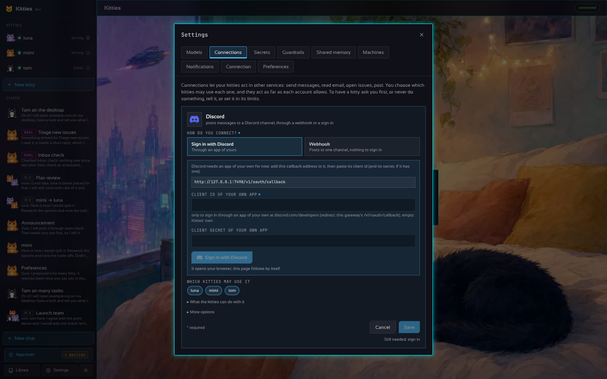
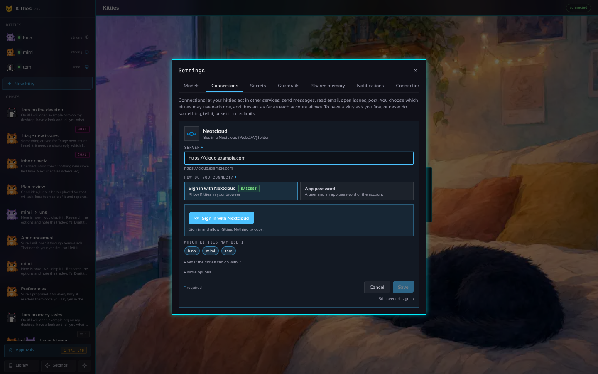

# Configuration, connectors and sign-in

## Configuration

`kitties init` writes a commented file; the full one is
[`configs/kitties.example.yaml`](../configs/kitties.example.yaml). The essentials:

```yaml
providers:
  strong: { kind: anthropic, model: claude-sonnet-5-5 }
  local:  { kind: ollama, model: qwen3:8b }
default_provider: strong

kitties:
  - name: mimi
    soul: { persona: a patient researcher, traits: [curious, thorough] }
    connectors: [team-slack]
  - name: tom
    provider: local
    soul_file: souls/tom.yaml
    replicas: 3

containers: { runtime: auto, image: ghcr.io/madkoding/kitty-desktop:latest, memory_mb: 2048, swap_mb: 1024, cpus: 2, auto_off_minutes: 15 }
cloud:      { provider: "", max_running: 5, idle_minutes: 15, size: small, api_key_env: BOAT_API_KEY }
gateway:    { listen: 127.0.0.1:7488, token: "" }
motita:     { url: http://127.0.0.1:7477 }

connectors:
  team-slack: { kind: slack, url: https://hooks.slack.com/services/XXX }
  coder:      { kind: motita, description: runs a coding task in motita }
```

`containers.auto_off_minutes` is how many minutes a kitty's machine stays on without use before it
turns itself off (15 by default, `0` never, at most a week). Each kitty can have a value of its own
(its window, Desktop, "Turn off after", or `PATCH /v1/kitties/{ref}`). See
[the machine's power](DESKTOP.md#turning-the-machine-on-and-off).

`containers.browser_refresh_minutes` is how often the browser of each desktop visits its open tabs
again so sites that end idle sessions (Gmail, banks) keep the kitty logged in (20 by default, `0`
never, at most 1440). Tabs someone is using are only visited quietly, never reloaded. **Settings ›
Machines** changes it (kept in `settings.json`) and the desktops that are on get it at once; each
kitty can have its own (its window, Desktop). See
[the browser's profile](DESKTOP.md#updating-a-desktop-without-losing-what-it-knows).

`containers.memory_mb` and `containers.swap_mb` are the RAM and the swap of each kitty's machine
(2048 and 1024 MB by default; `memory_mb: 0` leaves the engine's own, `swap_mb: 0` is no swap).
**Settings › Machines** changes them for every kitty (kept in `settings.json`, over the file) and
gives each kitty values of its own; so do `PUT /v1/settings/machines` and `PATCH /v1/kitties/{ref}`
`{memory_mb, swap_mb}`. See [the machine's memory](DESKTOP.md#the-machines-memory).

### The connector catalogue

| Category | Services |
| --- | --- |
| Messaging | Slack (webhook, bot token or OAuth sign-in; reads and replies), Discord, Telegram, WhatsApp (Cloud API, official; or [a linked device](WHATSAPP.md) with a number of their own, unofficial), Email (SMTP), Matrix, Google Chat, Microsoft Teams, ntfy (push to your phone) |
| Social media | Facebook Pages (post, posts, comments, reply, like, Messenger inbox and answers), Instagram professional accounts (pictures and reels, posts, comments, replies), Mastodon and Bluesky (post, timeline, mentions, reply, like), X, LinkedIn |
| Calendar, reminders & contacts | CalDAV (iCloud, Fastmail, Nextcloud, Synology…: events, new events, reminders, ticking them off), CardDAV (find and add people), the Mac's own Calendar, Reminders and Contacts (when the gateway runs on the Mac), Google Contacts and Tasks, Outlook contacts and Microsoft To Do |
| Git | GitHub (issues, comments, pull requests, files; a token or OAuth sign-in), GitLab, Gitea/Forgejo, motita (coding tasks) |
| Productivity | Notion, Trello, Todoist, Linear, Jira, Zendesk (support tickets), Things and OmniFocus (on the Mac) |
| Finance | Stripe (balance, invoices, payments, refunds) |
| Home, news & weather | Home Assistant (states, acting on devices; its automations can post events), RSS and Atom feeds, the weather and forecast (Open-Meteo, no key) |
| Music | Spotify (what is playing, play, pause, skip and queue with Premium, search, playlists), TIDAL (search and playlists: its public API has no remote playback) |
| Office | Dropbox (list, search, read, save, share a link), Google Workspace (OAuth: Gmail inbox and send, Calendar, Drive, Sheets, Docs), Microsoft 365 (OAuth: Outlook inbox and send, Calendar, OneDrive), Airtable, Nextcloud (WebDAV files), Google Sheets (Apps Script) |
| Drawing | Diagrams through Kroki (mermaid, plantuml, graphviz, d2…) rendered to SVG artifacts, Figma, Excalidraw scenes |
| Generic | Webhook, any HTTP API with a bearer token, a program on the gateway's machine |

Each one is a button with its logo under **Settings → Connectors**: pick the service, fill the
fields it needs (secrets are kept on the gateway; OAuth services get a *Sign in* button), or
write it in the YAML with `kind` and `settings`. Signed-in tokens are refreshed in the
background ahead of their expiry, so a kitty's first call after a quiet night never waits or
fails on a stale token. In a chat, every call a kitty makes shows up as a chip with the
service's logo. Inside its
container a kitty also has LibreOffice, Inkscape, Mousepad (text editor), ImageMagick and mtPaint for office documents
and drawing on its own display.

For iCloud calendars and contacts use `https://caldav.icloud.com` and `https://contacts.icloud.com`
with an app-specific password from appleid.apple.com. iCloud reminders made with iOS 13 or later
are no longer served over CalDAV: on a Mac, the **Mac Calendar, Reminders & Contacts** connection
reaches them through the Reminders app (macOS asks once to allow it). Google and Microsoft accounts
signed in before contacts and tasks were added need to sign in once more for them.

**The actions are not the limit.** What a service lists (post, reply, search…) are the common
things, said simply. Every service with an HTTP API also has **Request**: any endpoint of that
API (method, path, query, body), called with the account the connection has. A kitty uses it for
whatever a listed action does not cover — DMs on X, bookmarks, labels in Gmail, workflows on
GitHub — and only the service decides what the account may do: the permissions of its sign-in,
its keys or its token. A full URL may only name the service's own hosts. Reading (GET) runs on
its own; other methods ask first only if you or a kitty set a limit for them. Sign-ins ask for
the broad permissions of each service (Dropbox gets whatever the app has enabled in its
console), so accounts signed in before need to sign in once more to get them.

### A spare brain

A profile can name another as its `fallback`. While the first is busy, failing (429, 5xx) or
unreachable after its own retries, the kitties that think with it go on with the fallback instead
of waiting; anything else (a refused key, a bad request) is still the first one's answer. In
*Settings → Models → More*, it is *If it is down, think with*.

```yaml
providers:
  main:  { kind: anthropic, model: claude-sonnet-5-5, fallback: spare }
  spare: { kind: openai, model: gpt-5.5 }
```

### Prompt caching

Every turn of a long chat or tool loop re-sends the same start (system prompt, tool list, earlier
turns). Providers can reuse that start from a cache at a fraction of the price and latency, and
kitties asks for it by default. `prompt_cache: false` on a profile turns off what kitties adds;
`cache_ttl: 1h` makes Anthropic keep it an hour instead of five minutes (writes cost more, so it
pays off for kitties that are asked something every few minutes to an hour).

| Provider | What kitties does |
| --- | --- |
| `anthropic` | Marks the last tool, the system prompt and the last message with `cache_control` (3 of the 4 allowed breakpoints), so each turn reads everything before it from the cache. A prefix under the model's minimum (1024 tokens on most models, 4096 on some) is not cached, with no error. |
| `claude-code` | The `claude` program caches by itself; kitties only counts what it reports. |
| `openai`, `codex` | Caching is automatic from 1024 tokens; kitties adds a `prompt_cache_key` derived from the system prompt so requests that share it land on the same cache. |
| `openrouter` | Anthropic and Google models get `cache_control` on the system prompt and the last turn; other models cache by themselves. |
| `gemini` | Implicit caching (2.5 and later) is automatic; kitties reads `cachedContentTokenCount`. Explicit `cachedContents` is not used. |
| `deepseek`, `groq`, `qwen`, `mistral`, `copilot` | Automatic, server side, nothing to send; the hits are read from the usage the server reports when it does. |
| `ollama` | Local: the server keeps its own KV cache between requests. There is no billing, so nothing is sent or counted. |

Each reply's usage carries `cache_read` and `cache_write` (tokens served from, or written to,
the cache) next to `input` and `output`; `input` always includes them, so the daily token
budget counts the whole prompt either way, but the part read from the cache weighs a tenth
(`input - cache_read * 0.9 + output`): a long tool loop re-sends the same start every round, and
it should not burn the day's tokens at full price. The same weight applies to `max_tokens` per
task.

**Daily token budget.** `limits.day_tokens` (Settings → the kitty → Limits; `0` or empty means no
limit, which is the default). At 80% the person is notified once a day; at 100% the kitty stops
until tomorrow, says so in the chat with where to raise it, and notifies once. Raising the limit
makes it continue right away.

**What is limited and what is not.** Kitties sets no token limit of its own by default: `max_tokens`
and `day_tokens` in a kitty's limits are `0` (none), a document goes into the message whole, and the
thread is not cut at a fixed number of turns. What remains comes from the model: its context window
(`context_tokens` of the profile; the provider's usual one by default, 1000000 for Gemini)
and the size of one answer (`max_tokens` of the profile, 16384 by default). When a thread or a file
would not fit the window, the oldest turns are let go (the early ones are summarised) or the end of
the file is read in parts and condensed, instead of the request failing. See [LIMITS.md](LIMITS.md)
([en español](LIMITS.es.md)). Today's use shows in the kitty's panel (amber from 80%, red when spent).

### Signing in instead of pasting keys

Most connections sign in: **Sign in with …** opens the service, you allow Kitties, and the token
is kept and renewed on the gateway. The form asks first **how do you connect?** (the sign-in, an
API key or token, an app's keys, a webhook) and shows only that way's fields, each marked as
required.

| Signs in | How |
| --- | --- |
| Mastodon, Home Assistant | nothing to set up: Kitties registers itself on the instance, or uses the gateway's own address as its app |
| Nextcloud, and CalDAV / CardDAV on a Nextcloud | nothing to set up: Nextcloud's Login Flow v2 opens its page, you allow Kitties, and the app password it hands back becomes the connection's password (revoke it in Nextcloud → Security) |
| Trello | through Kitties' own API key when the build has one, else the API key of a Power-Up of yours (trello.com/power-ups/admin) with this gateway's address allowed as an origin; Trello hands the token back in the page's address, which the callback page posts to the gateway |
| Gitea, Forgejo (Codeberg) | an OAuth2 app made on your instance (Settings → Applications), with this gateway's `/v1/oauth/callback` as its redirect |
| Google, Microsoft, Slack, Discord, GitHub, GitLab, Notion, Todoist, Linear, Jira, Airtable, Figma, Zendesk, X, LinkedIn, Facebook, Instagram, Spotify, TIDAL, Dropbox | through Kitties' own app when the build has one, else an app of yours (its redirect address is this gateway's `/v1/oauth/callback`) |

**The redirect address.** The service matches it to the letter, so register exactly the one Settings shows
in the connection (a copy-ready box under "needs an app of your own"): this gateway's `/v1/oauth/callback`,
on the public address when `gateway.public_url` is set, else on the host you opened Kitties at
(`http://127.0.0.1:7488/v1/oauth/callback` on a desktop). Spotify refuses `localhost`, so Kitties sends
`127.0.0.1` there. An "INVALID_CLIENT: Invalid redirect URI" or "redirect_uri: Not matching configuration"
means the dashboard has another address (for example `http://127.0.0.1:8888/callback`, the example in
Spotify's own docs): add the one from Settings. Behind a proxy or Docker, set `gateway.public_url` (and
`trust_proxy`) so the address is the one you reach from the browser.

**Google** sends the browser back to `127.0.0.1` (so a *Desktop app* client needs no redirect
registered) or to an `https` address only, asks only for the scopes of the services ticked in the
connection, shows the account's email, and lets each connection be another account. Step by step:
[GOOGLE.md](GOOGLE.md).

Signing in also fills what you would otherwise look up: your Facebook Page and its token (one
that does not expire), the Instagram account linked to it, your LinkedIn author URN, your X user
id, your Jira site, your Discord webhook (Discord asks for the server and channel and makes the
webhook there; a pasted webhook URL still works). Telegram, WhatsApp, email, Stripe and the webhooks
keep their keys: those services have no sign-in for this.




**X** takes the sign-in (its OAuth 2.0 Client ID and Secret, with this gateway's callback under
*User authentication settings*), or, without a sign-in, the four **OAuth 1.0 keys** of *Keys and
tokens*: Consumer Key and Secret, Access Token and Secret (Read and write). Those do not expire,
and the account's id comes from the access token. The OAuth 2.0 access token the portal shows
lasts two hours, and the app-only Bearer Token cannot post.

A saved key is never shown again: **Clear** next to it forgets it on the next save, and **Sign
out** forgets an account. Signing in replaces a token typed before (it would win over the
account). Through the API, `PUT /v1/settings/connectors/{name}` takes `"clear": ["token",
"sign_in"]` for the same.

Each connection says what it uses (the sign-in, the OAuth 1.0 keys, a token or a webhook) and has
a **Test** that reads who the account is, without posting; a save tests it by itself. A webhook
cannot be tested without posting, so it says so. X's pasted OAuth 2.0 token counts down its two
hours on the list and in the form.

The apps a build signs in through come from `OAUTH_APPS` at build time
(`make OAUTH_APPS="spotify=<client id>,facebook=<id>:<secret>" dist`; the release reads the
`KITTIES_OAUTH_APPS` repository secret), or from `KITTIES_<SERVICE>_CLIENT_ID` and
`KITTIES_<SERVICE>_CLIENT_SECRET` on the gateway. An event created with `attendees` invites them (Google, Outlook and CalDAV
send the invitations), and counts as reaching people for a kitty in `approvals: ask`. Notion Calendar has no public API: it shows the Google
or iCloud calendars, which the kitties reach directly.

With **Settings → Notifications → Start it with my day**, the daily summary opens with what is
on the calendar, the reminders still to do and the weather. A Home Assistant automation tells the
kitties what happens with a `rest_command` that posts `{"entity_id": "{{ trigger.entity_id }}",
"state": "{{ trigger.to_state.state }}"}` to `/v1/hooks/<name>` with the connection's secret as
`X-Kitties-Secret`; the goals that listen to it (`on: [<name>]`) run.

Facebook and Instagram use Meta's Graph API with a token of your own app (developers.facebook.com):
for a Page, a long-lived Page token and the Page id; for Instagram, a professional (business or
creator) account linked to a Page, with a Page token, or an Instagram Login token (`IG…`), and the
account id. Instagram only publishes media from a public https URL (a JPEG, or an MP4 for a reel).
Publishing, replying, liking and messaging ask you first until you trust the kitty with them.

Keys come from the provider's usual variable (`OPENAI_API_KEY`, `ANTHROPIC_API_KEY`,
`GEMINI_API_KEY`, `GROQ_API_KEY`, `OPENROUTER_API_KEY`, `DEEPSEEK_API_KEY`, `DASHSCOPE_API_KEY`,
`MISTRAL_API_KEY`, `OLLAMA_API_KEY`) unless `api_key` or `api_key_env` says otherwise.

### A subscription instead of a key

Under **Settings → Models**, and in the *Quick start* of the first run, a provider that has one
offers *API key* or the subscription you already pay for. Every sign-in below works from a browser
on another machine too (the local network, a public address, a phone): none of them needs the
browser to reach the gateway back.

| Subscription | How it signs in | Saved as |
| --- | --- | --- |
| Claude (Pro, Max) | Anthropic only allows it through Claude Code, installed where the gateway runs (*Install Claude Code there* runs Anthropic's installer, `curl -fsSL https://claude.ai/install.sh \| bash`, into `~/.local/bin`). *Sign in with Claude* runs its own `claude auth login`: open the link, sign in on claude.com and paste back the code it shows (or run `claude auth login` in a terminal). Kitties runs the `claude` program for each answer (tools as text, no API key passed to it) and never sees nor keeps the login | `kind: claude-code` |
| ChatGPT (Plus, Pro, Business) | *Sign in with ChatGPT* in the browser; the callback lands on `localhost:1455`, or paste its address back when the gateway runs elsewhere | `kind: codex, auth: login` |
| GitHub Copilot | a code typed on github.com/login/device | `kind: copilot, auth: login` |
| Google (Gemini) | *Sign in with Google* in the browser when the gateway has a Google app (`KITTIES_GOOGLE_CLIENT_ID`, see [GOOGLE.md](GOOGLE.md#gemini-with-the-same-app)); else the login of gcloud (`gcloud auth application-default login`). Billed to a Cloud project | `kind: gemini, auth: login` |
| Qwen | ended by Qwen on 2026-04-15: a DashScope key is the way in | — |
| Ollama Cloud, Cursor | no sign-in for other apps: Ollama Cloud takes a key from ollama.com/settings/keys (`kind: ollama-cloud`); Cursor has no API to think with | — |

The tokens are kept in `data_dir/accounts` (one file per account, readable by you only) and
renewed before they expire.

## Pictures and files in the chat

Pictures attached to a message are shown to models that see them: Anthropic, Gemini, OpenAI, Codex,
Claude Code, Copilot and OpenRouter. A model behind a compatible server (Ollama, a custom address)
is taken as blind unless the profile says otherwise:

```yaml
providers:
  local:
    kind: ollama
    model: llava
    vision: true      # false hides pictures from a model that cannot see them
```

PDFs go as native documents to Anthropic, Gemini and OpenAI; every other model gets their text.
Limits (20 files, 100 MB a message) are in [ARCHITECTURE.md](ARCHITECTURE.md#attachments).

## What is kept on disk

The screenshots the kitties take at every step of a desktop task are kept 30 days and 2 GB in all,
the oldest going first; Settings → Preferences → Storage changes it and shows where the disk goes.
Everything else that grows by itself is bounded too: see [STORAGE.md](STORAGE.md).

```yaml
retention:
  shot_days: 30   # -1: forever
  shots_mb: 2048  # -1: no cap
```

## Local or cloud desktops

`containers.runtime` is `auto`, `docker`, `podman` or `cloud`. With `cloud`, every kitty's desktop
runs in the cloud; a kitty can choose for itself with `compute: local` or `compute: cloud` (empty
follows the runtime). The `cloud` block names the provider (`boat`), the most desktops running at
once (1 to 5), the idle minutes before one sleeps and the machine size. The API key is read from the
environment variable `cloud.api_key_env` (`BOAT_API_KEY`), never from this file;
`cloud.deployment` is a stable id for this install (empty derives one from `data_dir`), and only
machines carrying it are ever touched. Cloud desktops are created, slept, woken and removed, and run commands and take screenshots
through the provider's command API; stdin input and the live view are not available yet: see
[the design](design/cloud-compute.md).
