# Cómo usa un kitty su escritorio

*[In English](DESKTOP.md)*

**En una línea:** cada kitty tiene un computador Linux propio en un contenedor Docker; la IA mira
una captura de pantalla, decide dónde hacer clic o qué escribir, y Kitties lo ejecuta con mouse y
teclado simulados, una y otra vez hasta terminar la tarea.

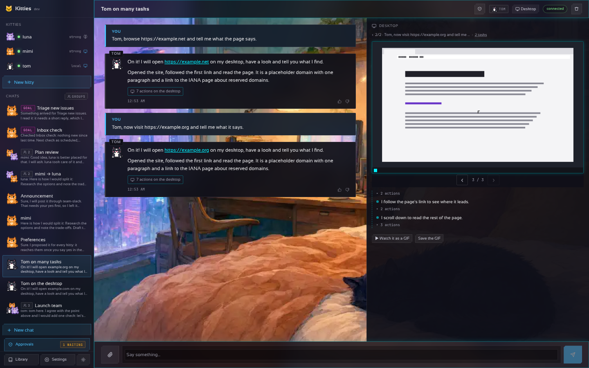

## Las piezas

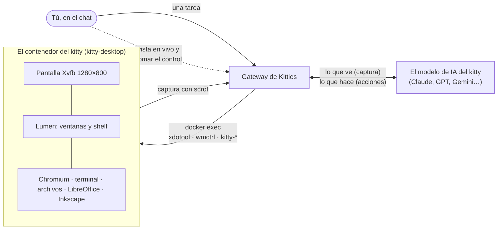

- **El computador.** Un contenedor por kitty, de la imagen `kitty-desktop`: una pantalla virtual
  (Xvfb) con un escritorio real (Lumen, Chromium, terminal, PCManFM, LibreOffice, Inkscape). No
  publica ningún puerto: el gateway entra solo con `docker exec`. Su carpeta de trabajo vive en el
  equipo anfitrión, así que sus archivos sobreviven al contenedor.
- **Los ojos.** El gateway saca una captura de la pantalla y se la entrega al modelo, que puede
  ver imágenes. Después de cada tanda de acciones llega una nueva, así el kitty ve lo que hizo.
- **Las manos.** El modelo responde con acciones pequeñas, como llamadas de herramienta (o como
  líneas de texto si el proveedor no las tiene):

  ```
  @tool click {"x": 640, "y": 420}
  @tool type {"text": "hola"}
  @tool key {"keys": "ctrl+l"}
  ```

  Kitties revisa cada una y la convierte en un comando: el mouse y las teclas con `xdotool`, las
  ventanas (listar, enfocar) con `wmctrl`, y ayudantes propios de la imagen para abrir una página
  (`kitty-open`), lanzar un programa (`kitty-launch`) o instalarlo (`kitty-install`). El modelo
  nunca escribe un comando de shell libre: instalar solo acepta nombres de paquete, un clic solo
  coordenadas.

## El ciclo

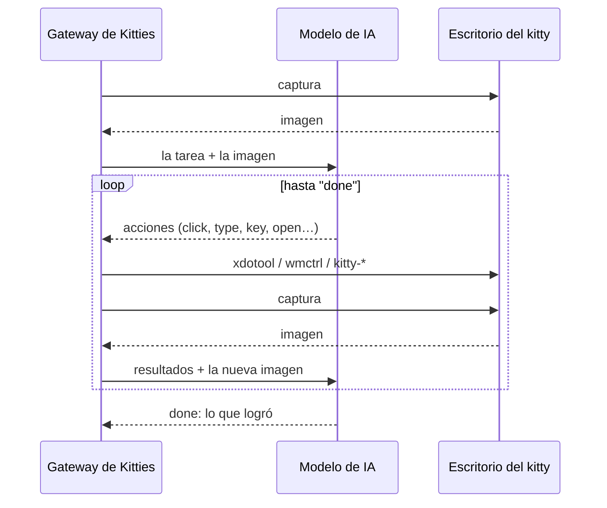

Corre en segundo plano. En el chat la tarea se lee en frases cortas que la kitty escribe al pasar a
algo nuevo ("Abro el navegador y busco vuelos a Lima": qué hace y para qué, nunca los clics), cada
una con sus acciones plegadas bajo cuántas fueron; un toque las abre una por una, con su captura. El
chat sigue lo último mientras estás al final; si subes para leer, espera y ofrece un botón para
volver a lo último. Un pedido de ayuda nunca se pliega, la frase en curso tiene un botón **Detener** al lado (el
Continuar del chat retoma la tarea; tras cinco minutos en marcha pregunta antes), y **Ajustes › Preferencias › Mostrar cada
acción de una tarea** deja todas las tareas abiertas acción por acción en este navegador. Fuera de la
página, las frases de una tarea larga llegan por WhatsApp a medida que salen y, si lo eliges, por las
notificaciones (`progress`), cuyo enlace (`#chat/<id>/live`) abre el chat con el escritorio del
kitty en vivo. Una tarea tiene límites
(tiempo, rondas, tokens) y se puede cancelar en cualquier momento.

## Mirar sin imagen

Una captura es lo más caro de una ronda, así que solo llega cuando puede contar algo nuevo. Tras
un lote de solo `windows`, `run`, `install` o `read_screen` nada cambió en la pantalla, y al kitty
se le dice eso en vez de darle la misma imagen otra vez. Cuando solo necesita leer la pantalla o
encontrar una palabra donde hacer clic, `read_screen` responde en texto: el OCR de la imagen
(`kitty-ocr`, Tesseract en inglés y español) imprime una línea por cada texto con el `x,y` de su
centro, que un clic puede usar tal cual.

## Primero el texto, la imagen al final

Una captura cuesta muchas veces los tokens del texto que muestra, así que al kitty se le pide
trabajar por texto y mirar solo cuando el texto no basta (un canvas, una imagen, la ventana propia
de un programa):

1. **Archivos y terminal.** `file_read` (líneas numeradas, una parte de un archivo largo con `from`
   y `lines`; un PDF con `pdftotext`, y los archivos de Word, Excel, PowerPoint y OpenDocument desde
   su XML, sin abrir ningún programa), `file_list` (carpetas, archivos y tamaños) y `file_write` (en su home o en `/tmp`; el
   texto va por la entrada del comando, no por su línea de comandos) son el `kitty-file` de la
   imagen; `shell` ejecuta una línea de comandos con bash, tuberías incluidas, en la carpeta de
   trabajo; `shell` y `run` se detienen tras `timeout` segundos (300 por defecto, 600 como máximo) y
   su salida se corta en 12.000 caracteres.
2. **Las páginas web por dentro** (abajo).
3. **La pantalla**: `screenshot`, `read_screen` (OCR) y clics en coordenadas.

Ninguna herramienta de texto trae una captura después; un lote con un clic en coordenadas, una
tecla o un `open` sí. Cada mensaje de un kitty cuenta cómo vio su trabajo: *3 capturas · 12
lecturas de texto*, y al pasar el ratón cuánto pesaron más o menos (una captura de la pantalla son
unos 1.365 tokens, como cuenta Anthropic una imagen; el texto, unos cuatro caracteres por token:
estimaciones, no una factura).

## Leer y actuar en las páginas por dentro

En el navegador un kitty no tiene que adivinar a partir de píxeles. `page_read` le da la
dirección, el título y el texto de la página, y una lista numerada de lo que se puede pulsar o
rellenar (`from` sigue con un texto largo, `find` imprime solo los pasajes con ciertas palabras);
`page_click` y `page_type` actúan sobre un elemento de esa lista (o sobre el que muestra cierto
texto, o el campo con cierta etiqueta), esté donde esté en la pantalla, dentro de un shadow root o
fuera de la vista. `page_goto` va a una dirección (abriendo el navegador si hace falta) y
`page_wait` espera a que la página muestre cierto texto.

Cada una responde con una lectura corta de la página tal como la dejó la acción (cuando terminó de
cargar y su DOM quedó quieto un momento): primero las líneas que la acción agregó, así el resultado
al final de una página larga se ve sin leerla entera otra vez, y se sigue la pestaña que abrió un
clic. Esa lectura reemplaza a la captura.

`page_flow` ejecuta varios de esos pasos de una vez, sin una ronda del modelo por cada uno:
`goto`, `click`, `type`, `wait`, `read` y `back`, y se detiene en el primero que falla. Con `save`
los pasos se guardan con un nombre en la carpeta de trabajo (`.flows/`) y `{"name": ...}` los
vuelve a ejecutar: una rutina que el kitty aprendió (una búsqueda, un informe que descarga cada
mañana) cuesta una sola llamada. Un flujo que escribe en un campo de contraseña nunca se guarda; los
secretos van por `type_secret`. Una [meta](AUTONOMY.md) puede reproducir un flujo guardado en su
horario sin pasar por el modelo.

Es el DevTools del propio navegador, al que llega `kitty-page` de la imagen por el loopback del
contenedor: el puerto no se publica, así que solo lo usa lo que corre dentro del contenedor. Lo que
dice una página vuelve marcado como texto de la página, y al kitty se le dice que nunca lo tome como
una instrucción; el valor de un campo de contraseña no se imprime nunca. Cuando el texto de una
página parece un CAPTCHA o un código que solo tú recibes, al kitty se le pide que te pregunte
(`ask_help`), igual que cuando lo dice la pantalla.

## Cuando necesita a una persona

Hay cosas que un kitty no puede hacer solo: un captcha, una contraseña, un código que llega a tu
teléfono. Entonces usa `ask_help` (todos los modelos lo tienen, llamen a las herramientas de forma
nativa o en texto), te llega una notificación y se abre una ventana sobre el chat con lo que el
kitty ve y un campo para lo que necesita: escribe un código o una respuesta y **díselo**, o marca
*es un secreto* y el texto se **escribe en su escritorio** sin que el kitty lo vea. O **toma el
control**: ves su escritorio en vivo (H.264, con unos milisegundos de retraso), tus clics, arrastres, rueda y teclas van a su
pantalla, y el portapapeles funciona en ambos sentidos. El kitty espera; cuando respondes o le
devuelves el escritorio, sigue solo.

La vista es [voxl](https://github.com/tembo/voxl) (MIT; enlaza x264, así que la imagen es GPL, como
Kitties): la pantalla como H.264 por un WebSocket, decodificada en la página con WebCodecs. Corre
dentro de cada escritorio en el loopback del contenedor, con una contraseña hecha en cada arranque, y
el contenedor sigue sin publicar puertos: el gateway es su proxy inverso
(`/v1/kitties/{ref}/voxl/t/{ticket}/`, con un ticket que se pide con
`POST /v1/kitties/{ref}/voxl/ticket` tras iniciar sesión, así que ningún token va en los enlaces del
marco), y cada conexión es un `docker exec ... socat` hacia el contenedor. Solo pasa el visor (su
página, scripts y WebSocket), no la transferencia de archivos, las grabaciones ni las capturas de
voxl. Donde el navegador no tiene WebCodecs (piden HTTPS o localhost), en la app de
Android con un gateway que no es HTTPS, en un webview sin WebCodecs (la app de escritorio enmarca el gateway que arrancó y pide el ticket por su puente), o con un escritorio de una imagen antigua, la página
retrocede sola: rectángulos (`/v1/kitties/{ref}/rects`: la imagen entera una vez y luego solo los
mosaicos que cambian, unidos), imágenes enteras (`/stream`, motion JPEG) y, como último recurso,
capturas una tras otra. Esas imágenes las saca `kitty-grab`, un programa en C de la imagen que se
queda conectado a la pantalla, la lee por memoria compartida y comprime solo lo que cambió (cerca de
un tercio de la CPU del bucle de `scrot` que reemplaza, y que queda de respaldo, y hasta 30
imágenes por segundo).

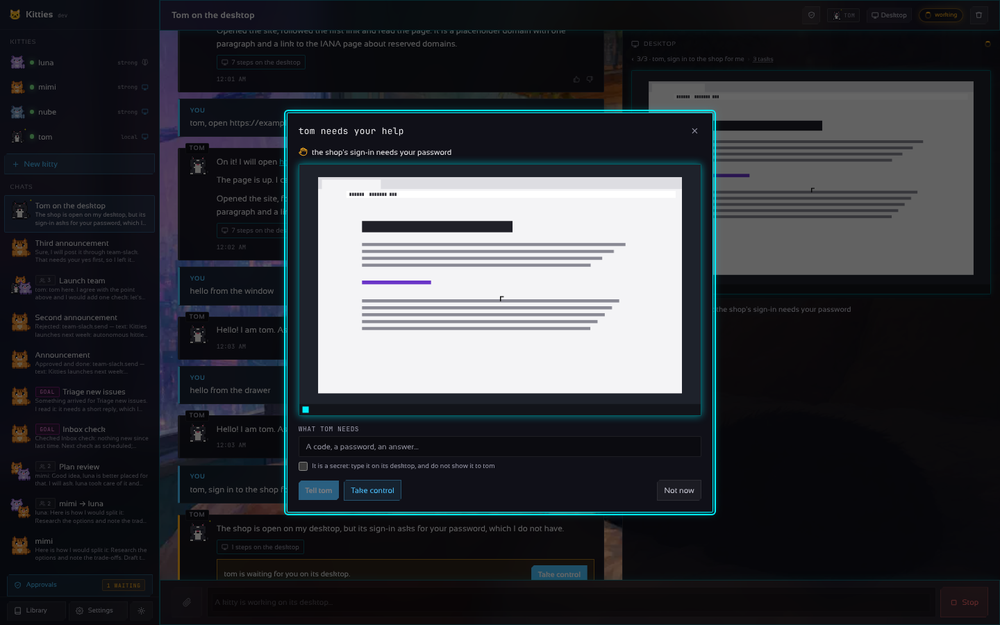

Una contraseña o un código no tienen por qué pasar por el modelo de IA. Marca *es un secreto* y el
texto se escribe del gateway al teclado del kitty por la entrada estándar del comando (nunca en una
línea de comandos, donde cualquier proceso podría leerla); igual lo que escribes tú mismo mientras
tienes su escritorio. Dale un nombre y queda en la **bóveda** (Ajustes, Secretos): AES-256-GCM con
una clave en su propio archivo, o en `KITTIES_VAULT_KEY`, listada por nombre y por los kitties que
pueden usarla. Al kitty se le dicen los nombres que puede usar y llama a `type_secret {"name": ...}`:
el secreto va de la bóveda a su teclado, y ni el kitty, ni su modelo, ni los pasos del chat ni los
registros lo guardan jamás.

Un kitty no tiene que acordarse de pedir. Cuando ve la misma pantalla cuatro veces seguidas se le
dice que pruebe otro camino, o que pida; y cuando esa pantalla parece un CAPTCHA o un código que
solo recibes tú (un OCR de ella, en inglés, español o portugués), pide de inmediato en vez de
gastar su presupuesto contra una pared.

## Una tarea como GIF

Las capturas de una tarea son su película: **Verla como GIF** y **Guardar el GIF**, bajo los
pasos, las convierten en un GIF animado (`internal/replay`: una paleta para todas las imágenes,
cada imagen con solo lo que cambió), servido en `/v1/chats/{id}/turns/{n}/replay.gif`.

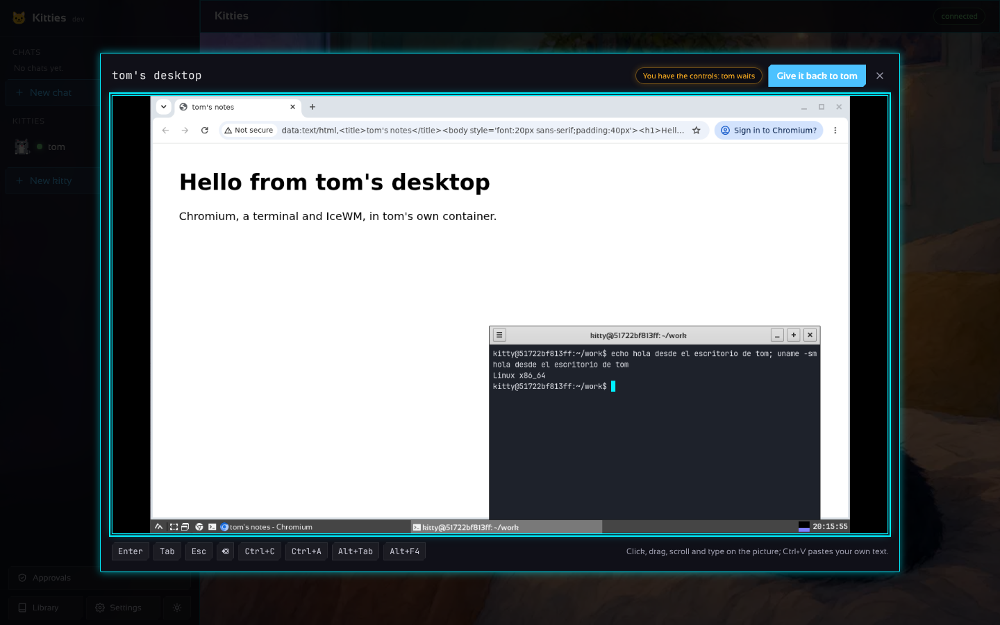

## Tu teclado, el portapapeles y la barra de teclas

Con el control, las teclas llegan al escritorio como los caracteres que escribe tu propia
distribución de teclado, sea cual sea la del escritorio: `@` con AltGr en un teclado español
(AltGr+2) o latinoamericano (AltGr+Q), `€`, `\`, `ñ` o una `á` con tecla muerta. Windows informa
AltGr como Control y Alt presionados, y la Option de un Mac es Alt, así que un carácter hecho con
ellas se escribe tal cual en vez de llegar al escritorio como un atajo Ctrl+Alt (la imagen parcha
el visor de voxl para esto, `docker/kitty-desktop/voxl/*.patch`, y la vista de respaldo hace lo
mismo en `keys.ts`). El visor además toma las teclas apenas tomas el control, sin un primer clic
dentro de la imagen.

**Ctrl+C** y **Ctrl+V** funcionan como en tu equipo: lo que copias en el escritorio llega a tu
portapapeles, y Ctrl+V pega el tuyo allá (el texto completo de una vez, con sus saltos de línea).
Bajo la imagen, una **barra de teclas** (iconos Lucide) tiene lo que tu teclado o tu teléfono no
pueden presionar allá: Esc, Tab, Enter, Retroceso, **Alt+Tab**, **Ctrl+Alt+Supr** (la lista de
tareas, `top` en una terminal), el **menú de apps** (Alt+F1), **Copiar** y **Pegar** entre los dos
portapapeles, `@`, y **Ctrl**, **Alt**, **Shift** y **Super** que quedan presionadas para la
siguiente tecla; el botón del teclado suma F1 a F12, las flechas, Inicio/Fin/RePág/AvPág,
Ctrl+Z/A/X/S/F/L, Alt+F4 y los caracteres que otras distribuciones esconden. En un teléfono sus
filas se desplazan de lado. El campo de abajo sigue enviando texto al portapapeles del kitty y
trayendo el suyo, para un navegador que no deja a la página leer el tuyo. Mientras solo miras,
**Copiar de** trae el portapapeles del kitty al tuyo sin tomar el control.

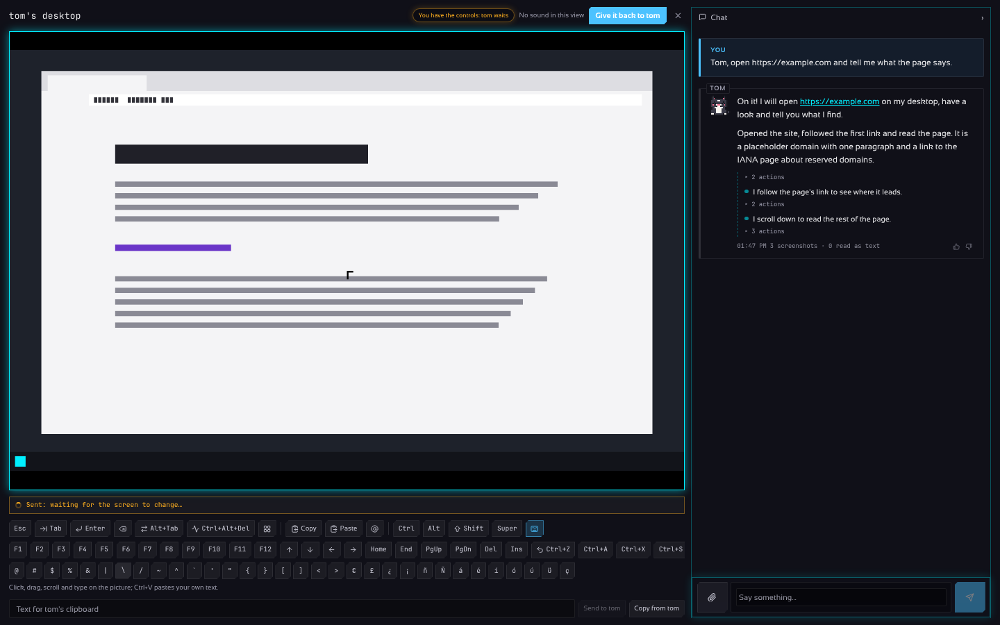

## El chat junto al escritorio en vivo

La ventana del escritorio en vivo de una kitty lleva su chat como barra lateral: le escribes y
sigues lo que hace en la pantalla sin dejar la imagen. Es el mismo chat de la página (`Conversation`
y `Composer`, con los mismos turnos, adjuntos y valoraciones), así que nada se guarda dos veces;
cada tarea muestra sus pasos plegados bajo el mensaje, y una tarea en curso se queda abierta. La
barra se pliega a una tira (se recuerda en el navegador), en el móvil empieza plegada y se apila
bajo la imagen, y nunca le quita al escritorio las teclas ni el sonido: escribir en ella es escribir
en el chat, y los controles de la imagen siguen donde estaban.

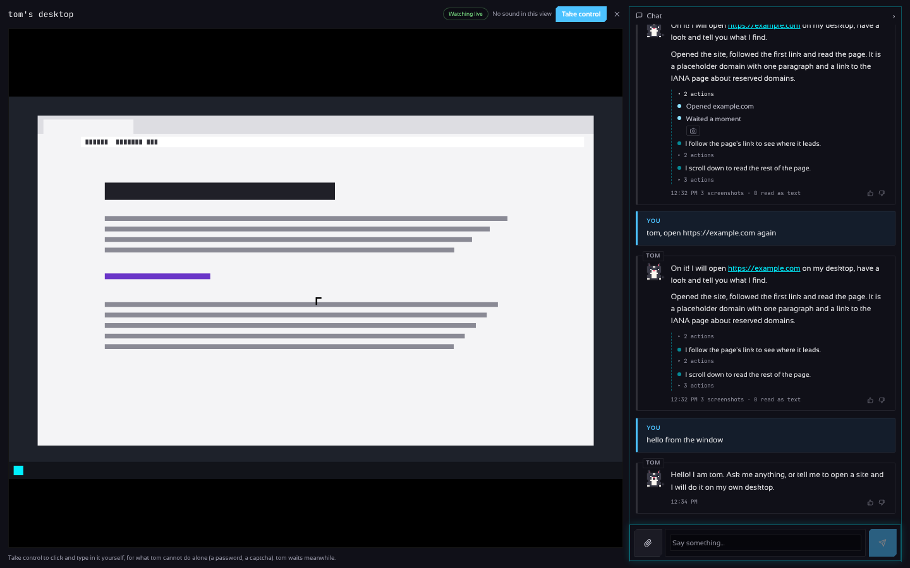

## Encender y apagar la máquina

El escritorio de un kitty corre en su **máquina** (su contenedor), y la máquina puede estar apagada. Se
enciende y apaga desde la ventana del kitty (botón **Iniciar** / **Detener**), desde la API
(`POST /v1/kitties/{ref}/power` `{"on": true|false}`; `GET` dice su estado) y por el propio kitty; y
**se apaga sola tras 15 minutos sin uso** (`containers.auto_off_minutes`; cada kitty puede tener su
tiempo en su ventana, Escritorio, «Apagar tras», de 5 minutos a 8 horas, o **nunca**). Apagarla conserva
la carpeta de trabajo y respalda las sesiones del navegador, como cualquier detención; encenderla
devuelve el escritorio (el primer arranque descarga la imagen).

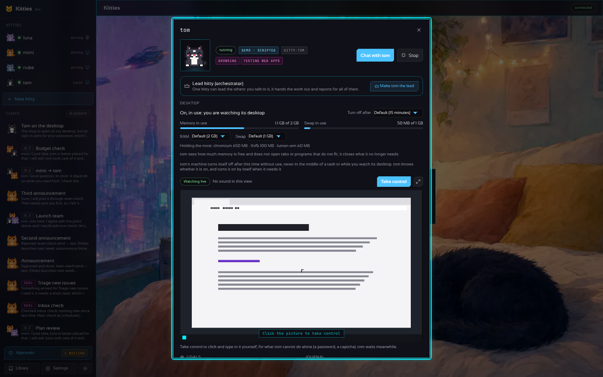

**Qué cuenta como uso.** El tiempo sin uso se cuenta desde lo último de esto, y la máquina no se apaga
nunca (sola, ni con una detención no forzada) mientras ocurra alguna de estas cosas:

- el kitty está en medio de una tarea (de escritorio, o una que te espera con `ask_help`);
- tienes el control del escritorio o lo estás viendo en vivo (su ventana abierta en el escritorio);
- hay un comando corriendo en la máquina;
- el kitty actuó en la pantalla, o tú la miraste o hiciste clic hace un momento: la cuenta vuelve a 0.

Detenerla mientras está en uso responde **409** con lo que la usa, y la ventana pregunta antes de
apagarla igualmente (`"force": true`). Un gateway recién iniciado solo empieza a contar; no apaga una
máquina que estaba en uso antes.

**El kitty conoce su máquina.** Cada petición al modelo termina con un mensaje corto que dice si la
máquina está encendida, iniciando o apagada (y por qué: se apagó sola, la apagaste tú, la apagó el
kitty) y cuánto falta para que se apague sola. Ese mensaje va marcado como *volátil*: la caché de prompt
del proveedor termina antes de él, así que el prompt del sistema, las herramientas y la conversación
siguen en caché sea cual sea el estado (ver `provider.Message.Volatile`). El kitty tiene además la
herramienta **`machine`** (`@tool machine {"action": "status|on|off"}`): `status` dice el estado, `on`
la enciende y espera a que esté lista, `off` la apaga cuando termina con la pantalla por un buen rato
(se rechaza mientras tú la ves o la controlas). Y una herramienta de escritorio usada con la máquina
apagada **la enciende primero**, espera (hasta 3 minutos) y lo muestra como un paso del turno; si no
puede, al kitty se le dice claramente que su máquina está apagada y por qué, y la herramienta no se ejecuta.

## La memoria de la máquina

Cada máquina tiene cierta **RAM y swap**: 2 GB y 1 GB por defecto (`containers.memory_mb` y
`swap_mb`). **Ajustes › Máquinas** los cambia para todos los kitties y para cada uno (la ventana de un
kitty, Escritorio, muestra los mismos selectores), con lo que cada máquina usa ahora y lo que tiene en
total el motor de contenedores; las máquinas encendidas lo comparten, y un tamaño mayor que el del motor
se rechaza.

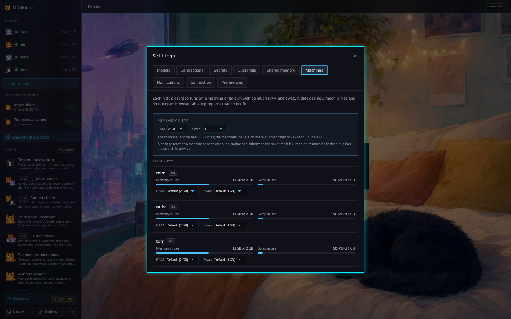

**Dónde se aplica un cambio.** En un escritorio local (Docker o Podman) el nuevo tamaño llega a la
máquina al instante (`docker update`), encendida o no. Cuando el motor no puede (un Podman antiguo, un
cgroup sin contabilidad de swap) la ventana lo dice, y la máquina se rehace con el nuevo tamaño la
próxima vez que se encienda: su home, su carpeta de trabajo y las sesiones del navegador se quedan. Una
máquina en la nube tiene el tamaño de su proveedor (`cloud.size`), y los selectores lo dicen. Con
Docker Desktop (Windows, macOS) la memoria del propio motor se fija en Docker Desktop › Settings ›
Resources (en Windows con WSL 2, en `.wslconfig`).

**El kitty conoce su memoria.** El mensaje sobre su máquina (arriba) dice además cuánta RAM y swap están
usadas y libres, leídas dentro de la máquina (cgroup v2 o v1, si no `/proc/meminfo`) y guardadas 10
segundos. `@tool machine {"action": "status"}` agrega lo que más ocupa (Chromium con sus procesos, la
pantalla, los programas). Antes de **`open`** (una pestaña del navegador, unos 150 a 300 MB) y
**`launch`** (un programa) el gateway mira: con menos de 250 MB libres para una pestaña, o 400 MB para un
programa, la herramienta se rechaza y al kitty se le dice cuánto queda y que cierre pestañas (`ctrl+w`)
o programas primero, o que te pida más RAM. El kitty líder y otros clientes MCP ven lo mismo en
`kitty_compute`.

## Actualizar un escritorio sin perder lo que sabe

Un escritorio se hace a partir de una imagen, y puede salir una más nueva. Un contenedor conserva la
imagen con la que se creó, así que actualizarlo es rehacerlo. **El gateway lo hace solo**
(`containers.auto_update`, activado por defecto): a los dos minutos de arrancar, y luego cada
`containers.update_check_hours` (6), baja la imagen, y cada escritorio en marcha que tenga una más
vieja se actualiza cuando su kitty está inactivo. Un kitty en medio de una tarea, o cuyo escritorio
tienes tú, queda para la siguiente ronda, y se vuelve a comprobar justo antes de tocar nada; un
escritorio detenido se rehace al iniciarlo; el journal anota cada actualización y, si activaste ese evento en Ajustes, Notificaciones, también
te avisan. `updates.window` ("02:00-06:00") deja los reinicios para la noche. Se apaga con
`auto_update: false`; la ventana del kitty dice si está activa.

También se puede hacer a mano: la ventana del kitty dice **hay un escritorio más nuevo** (la imagen
de esta máquina no es la que corre el contenedor) y **Actualizar el escritorio** lo hace, si el kitty
no está en medio de una tarea y no tienes tú su escritorio. En ambos casos baja la imagen, cierra el navegador de forma ordenada (`kitty-page quit`, para que todo
se escriba a disco), respalda, rehace el contenedor y devuelve el respaldo. La carpeta de trabajo
está en tu computador y nunca se toca.

**Todos los kitties de una vez.** Cuando hay una imagen nueva, la barra lateral muestra **Escritorio
nuevo** con cuántos kitties pueden tenerla (los que usan un computador contenedor en esta máquina; los
de la nube no tienen imagen aquí). Su ventana, que también está en Ajustes › Preferencias ›
Actualizaciones, lista los escritorios, **Buscar un escritorio nuevo** baja la imagen ahora, y
**Actualizar todos** (o los que marques) los actualiza uno tras otro con una barra de progreso y el
estado de cada uno: actualizado, al próximo inicio (uno detenido: se quita su contenedor viejo y no se
enciende ahora), después (trabajando, o tienes tú su escritorio) o falló, con el motivo. Su home,
programas, perfil del navegador (su volumen) y carpeta Shared se quedan; al final se borra la imagen
vieja. El gateway busca la imagen nueva cada `containers.update_check_hours` aunque
`auto_update` esté apagado: así te avisa y tú decides cuándo actualizar.

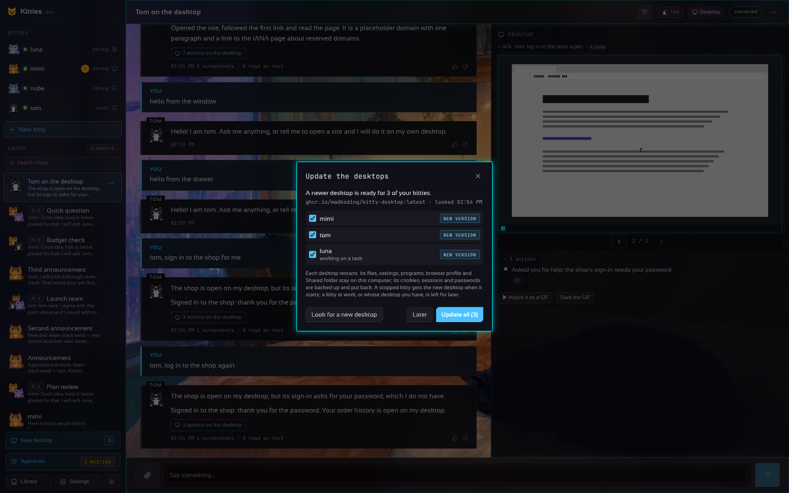

Lo que sabe el navegador del kitty (cookies, sesiones, almacenamiento local) vive en un
**volumen de Docker propio**, `kitties-browser-<contenedor>`, montado en `/var/lib/kitty-browser`: está
en el disco Linux del motor de contenedores y sobrevive a reinicios, actualizaciones y a un contenedor
rehecho. No está en la carpeta de trabajo porque Chromium bloquea su perfil con un enlace simbólico
(`SingletonLock`), y una carpeta de un computador Windows o macOS montada por Docker Desktop no puede
tenerlo: ahí Chromium no arrancaba con ese perfil y los inicios de sesión iban a un perfil temporal que
cada reinicio perdía. `kitty-profile` dice dónde está el perfil; uno guardado antes en `~/work/.browser`
se copia al volumen la primera vez (no hay que volver a iniciar sesión) y luego se borra de la carpeta
de trabajo, para que no queden cookies en el disco de tu computador; `kitty-restore` pone el perfil de
un respaldo directo en el volumen (solo si está vacío), nunca en la carpeta de trabajo. Un gateway
anterior que no monta el volumen igual lo guarda en el contenedor cuando la carpeta de trabajo no puede tenerlo.

Tres cosas más evitan perderlo: el navegador se cierra de forma ordenada antes de cualquier parada o
actualización, y también cuando el contenedor se detiene desde fuera (`docker stop`/`restart`, al
apagarse Docker o el computador: el escritorio lo cierra primero, porque solo escribe sus cookies cada
medio minuto); continúa donde se quedó (una política de Chromium), lo que conserva las **cookies de
sesión** (inicios de sesión sin caducidad) tras un reinicio; y un arranque lento se deja terminar en vez
de apartar el perfil. El perfil usa `--password-store=basic` (sin llavero que perder), que solo
ofusca: por eso el **gestor de contraseñas del navegador está apagado** (una política de Chromium). Las
contraseñas y códigos van en la **bóveda** del gateway (Ajustes), cifrada fuera de la máquina, y el
kitty las escribe con `type_secret` sin leerlas; las contraseñas guardadas antes en el navegador siguen
funcionando. Un escritorio
detenido de golpe también vuelve a levantar: al arrancar se borra el candado viejo de la pantalla.

**Iniciar sesión en el navegador mismo está apagado** (políticas `BrowserSignin=0` y `SyncDisabled`),
no iniciar sesión en las páginas. El Chromium de Debian no tiene claves OAuth de Google que Google
acepte, así que tras entrar a Gmail el navegador intentaba atarse a la cuenta, fallaba y cerraba la
sesión de la cuenta también en la web: parecía iniciada y un momento después no lo estaba. Ahora una
sesión de Google son cookies, como las de cualquier sitio, y se queda en el perfil.

**Las sesiones se mantienen vivas** mientras el navegador está abierto: `kitty-refresh` vuelve a
visitar sus pestañas cada 20 minutos, así un sitio que cierra sesiones inactivas (Gmail, bancos) ve al
kitty como presente. Nunca pierde trabajo ni estorba: una pestaña se recarga solo si no es la que está
en pantalla mientras alguien (la persona en la vista en vivo o los clics del propio kitty) usó el
escritorio en los últimos 5 minutos, no tiene nada escrito, nada sonando y el kitty no ha manejado el
navegador (`kitty-page`) en los últimos 2 minutos; las demás solo reciben una visita silenciosa (una
petición a su propia dirección con sus cookies, desde dentro de la página, sin cambiar nada en
pantalla), y una página que pregunta antes de salir se queda donde está. Cada cuánto: **Ajustes ›
Máquinas › Sesiones del navegador** (nunca, o cada 10 a 120 minutos; `containers.browser_refresh_minutes`
en el archivo), que llega al instante a los escritorios encendidos. Cada kitty puede tener el suyo (su ventana, Escritorio, «Volver a visitar las pestañas abiertas», o
`PATCH /v1/kitties/{ref}` `{browser_refresh_minutes}`), y un kitty puede guardar uno en
`~/.config/kitties/browser-refresh` (minutos, se lee en cada pasada); `KITTY_BROWSER_IDLE` cambia
los 5 minutos. La ventana del kitty (Escritorio) dice cuándo se visitaron las pestañas por última vez
y cuántas se recargaron o se visitaron en silencio (`/dev/shm/kitty-refresh.json`, solo cuentas), y
**Visitar ahora** hace una pasada al instante (`POST /v1/kitties/{ref}/browser/visit`), con el mismo
cuidado.
`kitty-refresh --once` hace una pasada a mano; el registro es `/tmp/kitty-refresh.log` (solo
direcciones, nunca lo que dice una página).

**Páginas en el idioma del host.** El gateway pasa al escritorio el idioma del host (`$LANG`, el de
Windows o el de macOS) como `KITTY_LANG`, igual que su zona horaria, y el navegador pide las páginas
en él (`Accept-Language`: `es-CL,es,en-US,en`): Google o un banco ven el idioma de siempre desde el
lugar de siempre y preguntan menos si es un dispositivo nuevo. Un idioma elegido en los ajustes del
navegador se respeta. Los menús del navegador también salen en ese idioma (la imagen trae
`chromium-l10n`, recortado a inglés, español, portugués, francés, alemán e italiano; el argumento de
construcción `CHROMIUM_LOCALES` elige otros, `all` los deja todos; con otro idioma los menús salen en
inglés y las páginas siguen en él). `containers.env` puede fijar `KITTY_LANG` para todos los escritorios.

El **respaldo** (`kitty-backup`) añade una copia fuera del contenedor: cookies, sesiones, contraseñas
guardadas, almacenamiento local y preferencias del navegador, y `~/.ssh`, `~/.gitconfig`,
`~/.git-credentials`, `~/.netrc`, `~/.config/gh`, `~/.config/git` y las apps ancladas a la barra (`~/.config/kitties/pins`). El gateway lo guarda cifrado
(AES-256-GCM, la clave de la bóveda) en `backups/` de su carpeta de datos, uno por kitty, reemplazado
por cada nuevo; se hace cuando el escritorio se detiene, antes de una actualización y con **Respaldar
ahora**. `kitty-restore` se lo devuelve a un contenedor que se rehace (nunca sobrescribe un archivo
que ya está: un workspace que conservó su perfil es más nuevo que cualquier respaldo). El respaldo de
un kitty eliminado se borra con él.

## Lo que sobrevive al escritorio: inicio, programas y Compartido

Tres carpetas de tu computadora se montan en el escritorio de cada kitty, y nada las borra: ni una
actualización, ni una detención, ni eliminar al kitty.

| En tu computadora | En el escritorio | Qué guarda |
| --- | --- | --- |
| `<data_dir>/work/<nombre>` | `~/work` | sus archivos, su tema y los paquetes de Debian que instaló |
| `<data_dir>/homes/<nombre>` | `/home/kitty` | sus configuraciones (`~/.config`) y los programas que instaló para sí (`~/.local`: pipx, `pip --user`, `npm install -g`; `/opt/kitty-apps`) |
| `<data_dir>/shared/<nombre>` | `~/Shared` | lo que hizo para ti: la app lo muestra en **Biblioteca > Compartido** |
| volumen `kitties-browser-<contenedor>` | `/var/lib/kitty-browser` | el perfil del navegador: cookies, sesiones, almacenamiento local (ver arriba) |

- **Programas.** Un paquete de Debian vuelve solo en un escritorio rehecho, como sea que se haya
  instalado (`kitty-install`, `sudo apt install`: un hook de dpkg lo recuerda); `kitty-install --remove
  <paquete>` lo olvida. Lo que está en `~/.local` o `/opt/kitty-apps` simplemente sigue ahí.
- **Configuraciones.** El inicio se siembra desde la imagen (`kitty-home`): se copia lo que falta, y solo
  el aspecto propio del escritorio (menús de Lumen, picom, PCManFM, GTK) se renueva cuando cambia la imagen.
- **Compartido.** `kitty-share <archivo>` copia un archivo ahí (`-d carpeta`, `--list`); el kitty lo sabe.
  La página lista los archivos de todos los kitties, previsualiza imágenes y texto, descarga cualquiera,
  copia uno a la biblioteca (**guardar en biblioteca**) y borra. Cada carpeta admite hasta
  `containers.shared_quota_mb` (5120, 5 GB; negativo: sin límite), que `kitty-share` respeta.
- **Mover un escritorio antiguo.** Un escritorio hecho antes de que el inicio viviera en tu computadora
  lo tiene dentro del contenedor: antes de borrarlo se copia (`homes/.moving/<nombre>.tar`, sin
  `~/.cache`) y se pone en el nuevo, que se reinicia una vez. Si la copia falla, el escritorio antiguo
  se deja como estaba y la actualización dice por qué.
- **Exportar y restaurar.** La ventana del kitty muestra lo que guarda y cuánto ocupa; **Exportar
  archivos** descarga un `.tar.gz` de su inicio, trabajo y Compartido sin llaves, contraseñas ni
  sesiones del navegador (esas quedan en el respaldo cifrado), y **Restaurar desde una exportación** lo
  devuelve al escritorio en marcha (un archivo más nuevo del kitty se queda).

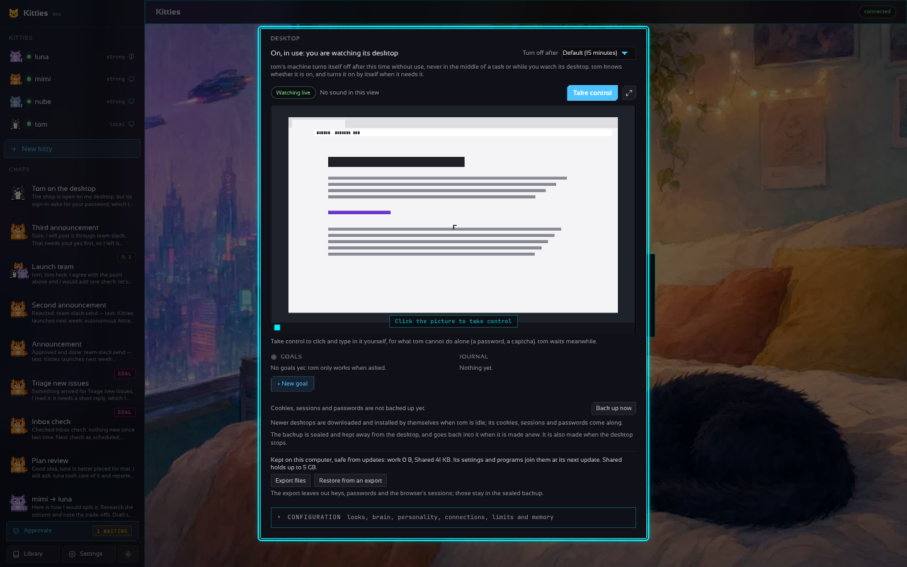
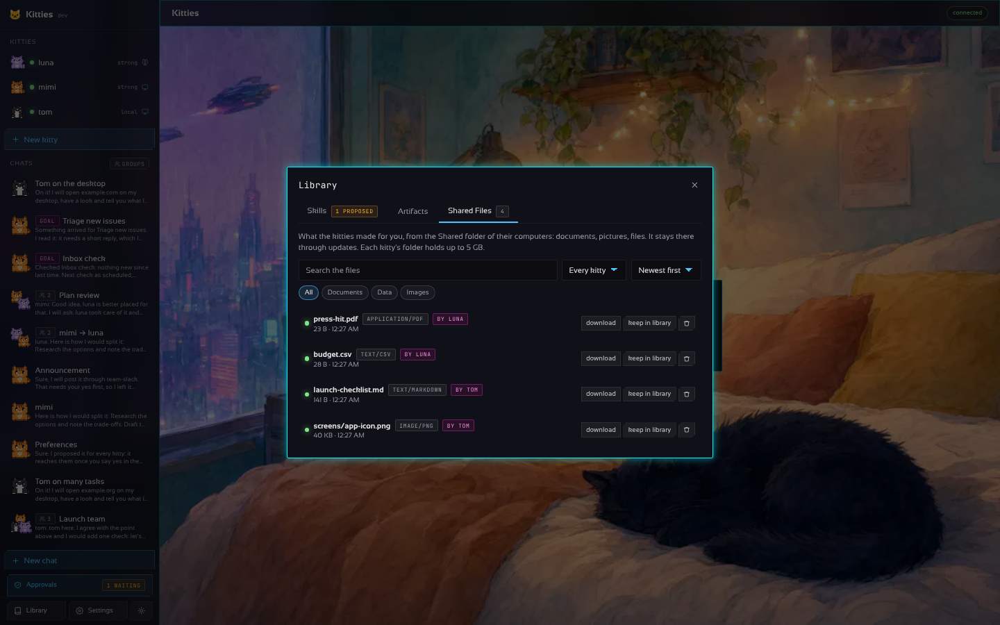

## Dónde está en el código

| Qué | Dónde |
| --- | --- |
| La imagen: pantalla, escritorio, programas, ayudantes | [`docker/kitty-desktop/`](../docker/kitty-desktop) |
| Las acciones que el modelo puede pedir, revisadas y convertidas en comandos | [`internal/desktop/desktop.go`](../internal/desktop/desktop.go) |
| El ciclo: captura, modelo, acciones, otra vez | [`internal/chat/chat.go`](../internal/chat/chat.go) |
| Contenedores: arrancar, `exec`, captura, stream en vivo | [`internal/container/`](../internal/container) |
| La energía de la máquina: uso, apagado por inactividad, encender y apagar | [`internal/orchestrator/power.go`](../internal/orchestrator/power.go) |
| Lo que el kitty sabe de su máquina, la herramienta `machine`, el encendido automático, el chequeo de memoria | [`internal/chat/machine.go`](../internal/chat/machine.go) |
| La RAM y el swap de la máquina: límites, lectura, valores por defecto | [`internal/kitty/memory.go`](../internal/kitty/memory.go), [`internal/orchestrator/memory.go`](../internal/orchestrator/memory.go) |
| Tomar el control: retenciones, entrada de la persona, `ask_help` | [`internal/orchestrator/control.go`](../internal/orchestrator/control.go) |
| Los respaldos cifrados de las sesiones de un kitty, y la actualización de un escritorio | [`internal/keep`](../internal/keep), [`internal/orchestrator/sessions.go`](../internal/orchestrator/sessions.go) |
| Los secretos guardados que un kitty puede escribir, cifrados | [`internal/vault`](../internal/vault) |
| El proxy del visor en vivo (voxl) y su túnel al contenedor | [`internal/gateway/voxl.go`](../internal/gateway/voxl.go), [`internal/container/tunnel.go`](../internal/container/tunnel.go) |
| Lo que cambió en la pantalla, como rectángulos sobre la última imagen | [`internal/rects`](../internal/rects) |
| La vista en vivo en la app | [`desktop/frontend/src/LiveDesktop.tsx`](../desktop/frontend/src/LiveDesktop.tsx) |
