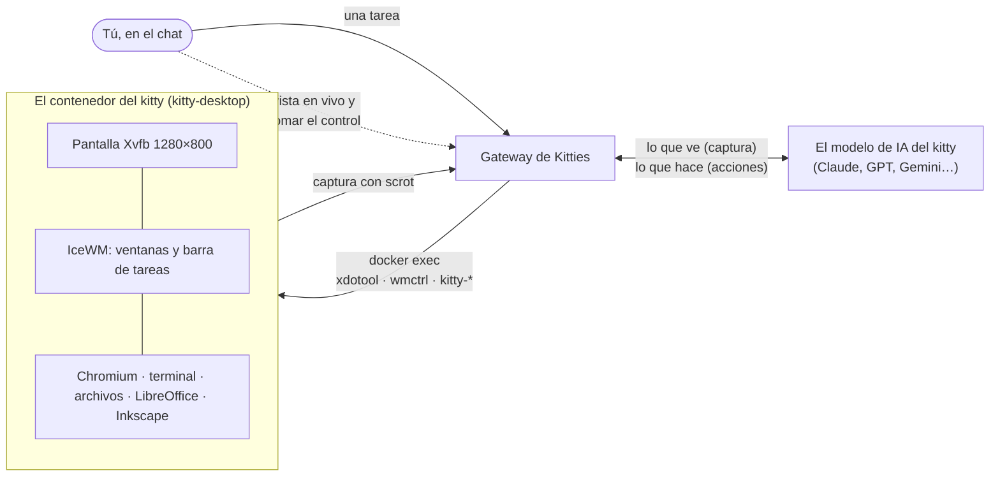
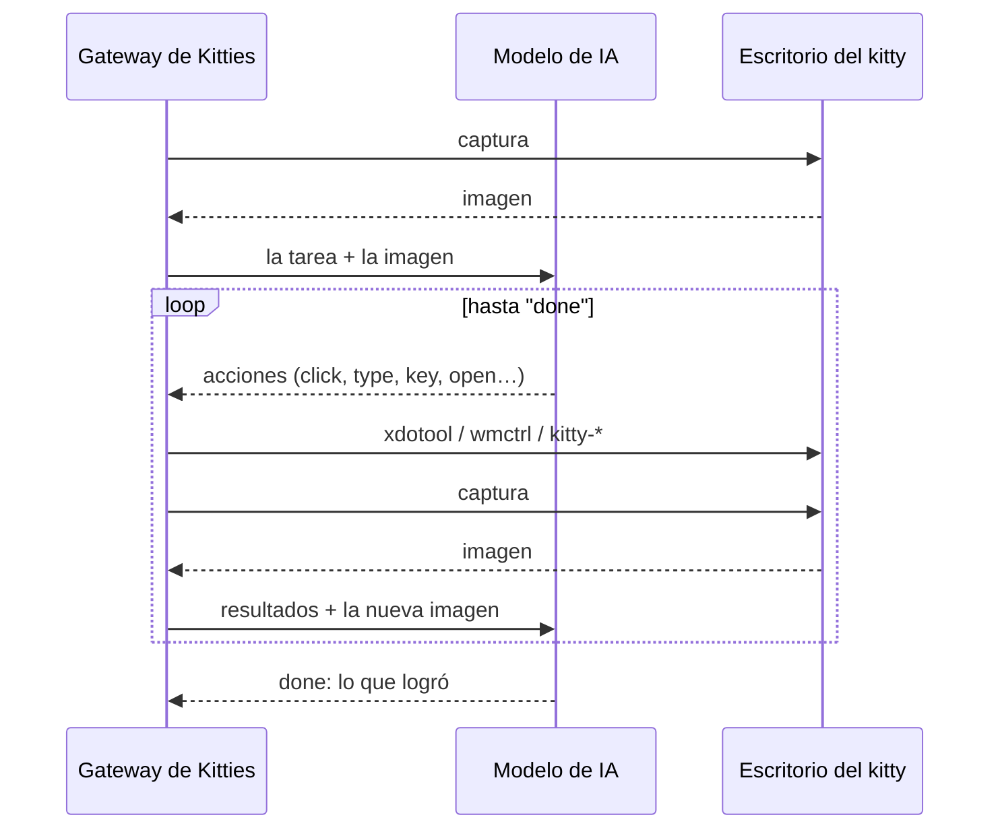

# Cómo usa un kitty su escritorio

*[In English](DESKTOP.md)*

**En una línea:** cada kitty tiene un computador Linux propio en un contenedor Docker; la IA mira
una captura de pantalla, decide dónde hacer clic o qué escribir, y Kitties lo ejecuta con mouse y
teclado simulados, una y otra vez hasta terminar la tarea.


## Las piezas



- **El computador.** Un contenedor por kitty, de la imagen `kitty-desktop`: una pantalla virtual
  (Xvfb) con un escritorio real (IceWM, Chromium, terminal, PCManFM, LibreOffice, Inkscape). No
  abre ningún puerto: el gateway entra solo con `docker exec`. Su carpeta de trabajo vive en el
  equipo anfitrión, así que sus archivos sobreviven al contenedor.
- **Los ojos.** El gateway saca una captura de la pantalla y se la entrega al modelo, que puede
  ver imágenes. Después de cada tanda de acciones llega una nueva, así el kitty ve lo que hizo.
- **Las manos.** El modelo responde con acciones pequeñas, como llamadas de herramienta (o como
  líneas de texto si el proveedor no las tiene):

  ```
  @tool click {"x": 640, "y": 420}
  @tool type {"text": "hola"}
  @tool key {"keys": "ctrl+l"}
  ```

  Kitties revisa cada una y la convierte en un comando: el mouse y las teclas con `xdotool`, las
  ventanas (listar, enfocar) con `wmctrl`, y ayudantes propios de la imagen para abrir una página
  (`kitty-open`), lanzar un programa (`kitty-launch`) o instalarlo (`kitty-install`). El modelo
  nunca escribe un comando de shell libre: instalar solo acepta nombres de paquete, un clic solo
  coordenadas.

## El ciclo



Corre en segundo plano; cada paso, con su captura, aparece en el chat. Una tarea tiene límites
(tiempo, rondas, tokens) y se puede cancelar en cualquier momento.

## Cuando necesita a una persona

Hay cosas que un kitty no puede hacer solo: un captcha, una contraseña, un código que llega a tu
teléfono. Entonces usa `ask_help`: el chat muestra el botón **Tomar el control** y te llega una
notificación. Ves su escritorio en vivo (motion JPEG por el gateway, con un cuarto de segundo de
retraso), tus clics, arrastres, rueda y teclas van a su pantalla, y el portapapeles funciona en
ambos sentidos. El kitty espera; cuando le devuelves el escritorio, sigue solo.


## Dónde está en el código

| Qué | Dónde |
| --- | --- |
| La imagen: pantalla, escritorio, programas, ayudantes | [`docker/kitty-desktop/`](../docker/kitty-desktop) |
| Las acciones que el modelo puede pedir, revisadas y convertidas en comandos | [`internal/desktop/desktop.go`](../internal/desktop/desktop.go) |
| El ciclo: captura, modelo, acciones, otra vez | [`internal/chat/chat.go`](../internal/chat/chat.go) |
| Contenedores: arrancar, `exec`, captura, stream en vivo | [`internal/container/`](../internal/container) |
| Tomar el control: retenciones, entrada de la persona, `ask_help` | [`internal/orchestrator/control.go`](../internal/orchestrator/control.go) |
| La vista en vivo en la app | [`desktop/frontend/src/LiveDesktop.tsx`](../desktop/frontend/src/LiveDesktop.tsx) |
