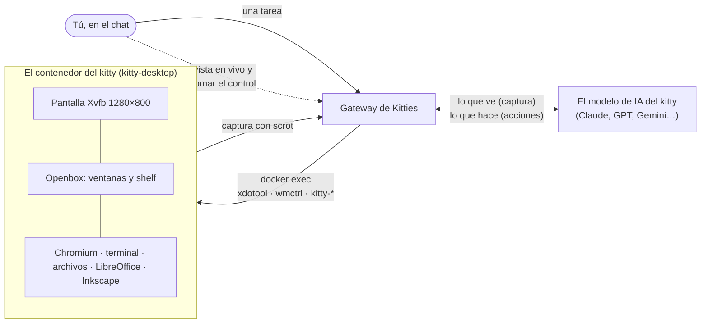
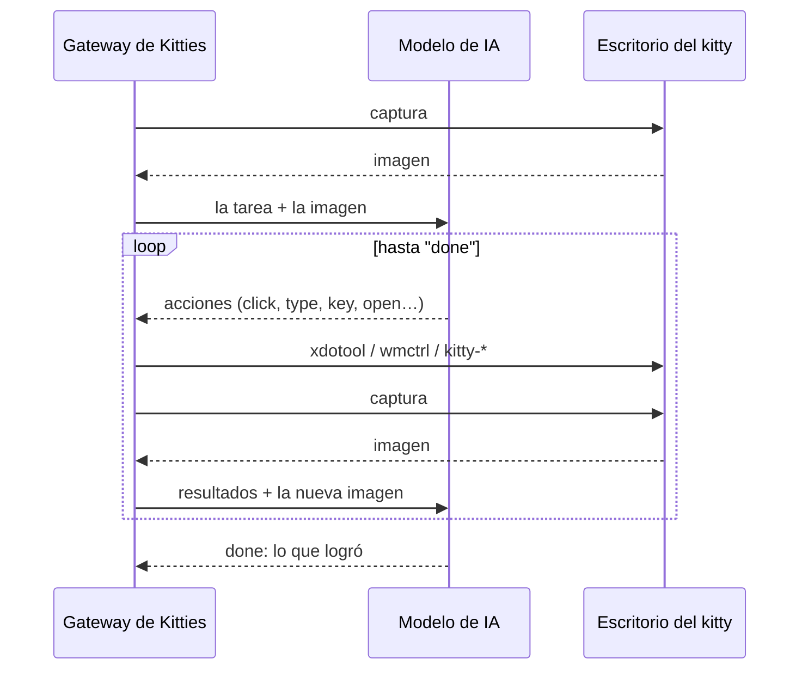
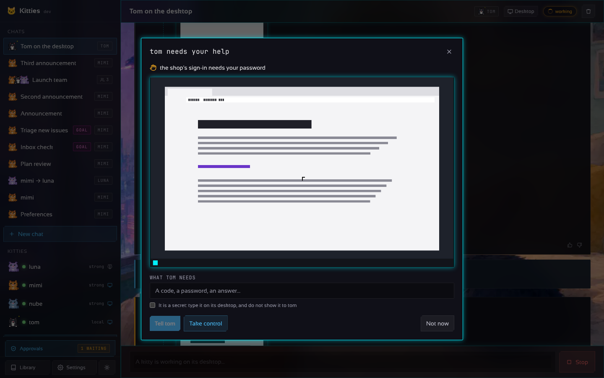
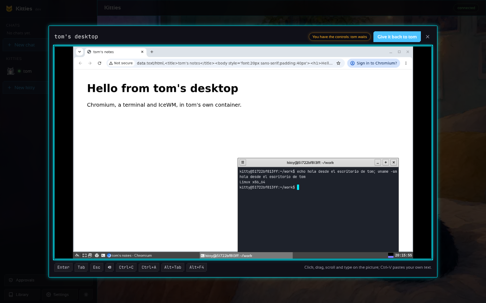

# Cómo usa un kitty su escritorio

*[In English](DESKTOP.md)*

**En una línea:** cada kitty tiene un computador Linux propio en un contenedor Docker; la IA mira
una captura de pantalla, decide dónde hacer clic o qué escribir, y Kitties lo ejecuta con mouse y
teclado simulados, una y otra vez hasta terminar la tarea.


## Las piezas



- **El computador.** Un contenedor por kitty, de la imagen `kitty-desktop`: una pantalla virtual
  (Xvfb) con un escritorio real (Openbox, Chromium, terminal, PCManFM, LibreOffice, Inkscape). No
  publica ningún puerto: el gateway entra solo con `docker exec`. Su carpeta de trabajo vive en el
  equipo anfitrión, así que sus archivos sobreviven al contenedor.
- **Los ojos.** El gateway saca una captura de la pantalla y se la entrega al modelo, que puede
  ver imágenes. Después de cada tanda de acciones llega una nueva, así el kitty ve lo que hizo.
- **Las manos.** El modelo responde con acciones pequeñas, como llamadas de herramienta (o como
  líneas de texto si el proveedor no las tiene):

  ```
  @tool click {"x": 640, "y": 420}
  @tool type {"text": "hola"}
  @tool key {"keys": "ctrl+l"}
  ```

  Kitties revisa cada una y la convierte en un comando: el mouse y las teclas con `xdotool`, las
  ventanas (listar, enfocar) con `wmctrl`, y ayudantes propios de la imagen para abrir una página
  (`kitty-open`), lanzar un programa (`kitty-launch`) o instalarlo (`kitty-install`). El modelo
  nunca escribe un comando de shell libre: instalar solo acepta nombres de paquete, un clic solo
  coordenadas.

## El ciclo



Corre en segundo plano; cada paso, con su captura, aparece en el chat. Una tarea tiene límites
(tiempo, rondas, tokens) y se puede cancelar en cualquier momento.

## Mirar sin imagen

Una captura es lo más caro de una ronda, así que solo llega cuando puede contar algo nuevo. Tras
un lote de solo `windows`, `run`, `install` o `read_screen` nada cambió en la pantalla, y al kitty
se le dice eso en vez de darle la misma imagen otra vez. Cuando solo necesita leer la pantalla o
encontrar una palabra donde hacer clic, `read_screen` responde en texto: el OCR de la imagen
(`kitty-ocr`, Tesseract en inglés y español) imprime una línea por cada texto con el `x,y` de su
centro, que un clic puede usar tal cual.

## Leer y actuar en las páginas por dentro

En el navegador un kitty no tiene que adivinar a partir de píxeles. `page_read` le da la
dirección, el título y el texto de la página, y una lista numerada de lo que se puede pulsar o
rellenar; `page_click` y `page_type` actúan sobre un elemento de esa lista (o sobre el que
muestra cierto texto), esté donde esté en la pantalla, dentro de un shadow root o fuera de la
vista. Es el DevTools del propio navegador, al que llega `kitty-page` de la imagen por el
loopback del contenedor: el puerto no se publica, así que solo lo usa lo que corre dentro del
contenedor. Lo que dice una página vuelve marcado como texto de la página, y al kitty se le dice
que nunca lo tome como una instrucción; el valor de un campo de contraseña no se imprime nunca.

## Cuando necesita a una persona

Hay cosas que un kitty no puede hacer solo: un captcha, una contraseña, un código que llega a tu
teléfono. Entonces usa `ask_help` (todos los modelos lo tienen, llamen a las herramientas de forma
nativa o en texto), te llega una notificación y se abre una ventana sobre el chat con lo que el
kitty ve y un campo para lo que necesita: escribe un código o una respuesta y **díselo**, o marca
*es un secreto* y el texto se **escribe en su escritorio** sin que el kitty lo vea. O **toma el
control**: ves su escritorio en vivo (solo los rectángulos que cambiaron, como VNC, con un cuarto
de segundo de retraso), tus clics, arrastres, rueda y teclas van a su pantalla, y el portapapeles funciona en
ambos sentidos. El kitty espera; cuando respondes o le devuelves el escritorio, sigue solo. La vista
se dibuja con rectángulos (`/v1/kitties/{ref}/rects`: la imagen entera una vez y luego solo los
mosaicos que cambian, unidos); la app de escritorio lee el mismo flujo y se lo pasa a su
página, un gateway que no lo tenga se sigue como imágenes enteras (`/stream`, motion JPEG), y las
capturas una tras otra son el último recurso. Las imágenes las saca `kitty-grab`, un programa en C
de la imagen que se queda conectado a la pantalla, la lee por memoria compartida y comprime solo lo
que cambió (cerca de un tercio de la CPU del bucle de `scrot` que reemplaza, y que queda de
respaldo, y hasta 30 imágenes por segundo).



Una contraseña o un código no tienen por qué pasar por el modelo de IA. Marca *es un secreto* y el
texto se escribe del gateway al teclado del kitty por la entrada estándar del comando (nunca en una
línea de comandos, donde cualquier proceso podría leerla); igual lo que escribes tú mismo mientras
tienes su escritorio. Dale un nombre y queda en la **bóveda** (Ajustes, Secretos): AES-256-GCM con
una clave en su propio archivo, o en `KITTIES_VAULT_KEY`, listada por nombre y por los kitties que
pueden usarla. Al kitty se le dicen los nombres que puede usar y llama a `type_secret {"name": ...}`:
el secreto va de la bóveda a su teclado, y ni el kitty, ni su modelo, ni los pasos del chat ni los
registros lo guardan jamás.

Un kitty no tiene que acordarse de pedir. Cuando ve la misma pantalla cuatro veces seguidas se le
dice que pruebe otro camino, o que pida; y cuando esa pantalla parece un CAPTCHA o un código que
solo recibes tú (un OCR de ella, en inglés, español o portugués), pide de inmediato en vez de
gastar su presupuesto contra una pared.

## Una tarea como GIF

Las capturas de una tarea son su película: **Verla como GIF** y **Guardar el GIF**, bajo los
pasos, las convierten en un GIF animado (`internal/replay`: una paleta para todas las imágenes,
cada imagen con solo lo que cambió), servido en `/v1/chats/{id}/turns/{n}/replay.gif`.



## Actualizar un escritorio sin perder lo que sabe

Un escritorio se hace a partir de una imagen, y puede salir una más nueva. Un contenedor conserva la
imagen con la que se creó, así que actualizarlo es rehacerlo. **El gateway lo hace solo**
(`containers.auto_update`, activado por defecto): a los dos minutos de arrancar, y luego cada
`containers.update_check_hours` (6), baja la imagen, y cada escritorio en marcha que tenga una más
vieja se actualiza cuando su kitty está inactivo. Un kitty en medio de una tarea, o cuyo escritorio
tienes tú, queda para la siguiente ronda, y se vuelve a comprobar justo antes de tocar nada; un
escritorio detenido se rehace al iniciarlo; el journal anota cada actualización y, si activaste ese evento en Ajustes, Notificaciones, también
te avisan. `updates.window` ("02:00-06:00") deja los reinicios para la noche. Se apaga con
`auto_update: false`; la ventana del kitty dice si está activa.

También se puede hacer a mano: la ventana del kitty dice **hay un escritorio más nuevo** (la imagen
de esta máquina no es la que corre el contenedor) y **Actualizar el escritorio** lo hace, si el kitty
no está en medio de una tarea y no tienes tú su escritorio. En ambos casos baja la imagen, cierra el navegador de forma ordenada (`kitty-page quit`, para que todo
se escriba a disco), respalda, rehace el contenedor y devuelve el respaldo. La carpeta de trabajo
está en tu computador y nunca se toca.

Lo que sabe el navegador del kitty ya vive en esa carpeta (cookies, contraseñas guardadas, almacenamiento
local), y ahora dos cosas evitan perderlo: el navegador se cierra de forma ordenada antes de cualquier
parada o actualización (solo escribe sus cookies cada medio minuto, y un contenedor que se elimina
pierde las últimas), y continúa donde se quedó (una política de Chromium), lo que conserva las
**cookies de sesión** (inicios de sesión sin caducidad) tras un reinicio. Las contraseñas usan
`--password-store=basic`, cifradas con una clave que comparten todos los contenedores, así que un perfil
se abre en uno nuevo.

El **respaldo** (`kitty-backup`) añade una copia fuera del contenedor: cookies, sesiones, contraseñas
guardadas, almacenamiento local y preferencias del navegador, y `~/.ssh`, `~/.gitconfig`,
`~/.git-credentials`, `~/.netrc`, `~/.config/gh` y `~/.config/git`. El gateway lo guarda cifrado
(AES-256-GCM, la clave de la bóveda) en `backups/` de su carpeta de datos, uno por kitty, reemplazado
por cada nuevo; se hace cuando el escritorio se detiene, antes de una actualización y con **Respaldar
ahora**. `kitty-restore` se lo devuelve a un contenedor que se rehace (nunca sobrescribe un archivo
que ya está: un workspace que conservó su perfil es más nuevo que cualquier respaldo). El respaldo de
un kitty eliminado se borra con él.

## Dónde está en el código

| Qué | Dónde |
| --- | --- |
| La imagen: pantalla, escritorio, programas, ayudantes | [`docker/kitty-desktop/`](../docker/kitty-desktop) |
| Las acciones que el modelo puede pedir, revisadas y convertidas en comandos | [`internal/desktop/desktop.go`](../internal/desktop/desktop.go) |
| El ciclo: captura, modelo, acciones, otra vez | [`internal/chat/chat.go`](../internal/chat/chat.go) |
| Contenedores: arrancar, `exec`, captura, stream en vivo | [`internal/container/`](../internal/container) |
| Tomar el control: retenciones, entrada de la persona, `ask_help` | [`internal/orchestrator/control.go`](../internal/orchestrator/control.go) |
| Los respaldos cifrados de las sesiones de un kitty, y la actualización de un escritorio | [`internal/keep`](../internal/keep), [`internal/orchestrator/sessions.go`](../internal/orchestrator/sessions.go) |
| Los secretos guardados que un kitty puede escribir, cifrados | [`internal/vault`](../internal/vault) |
| Lo que cambió en la pantalla, como rectángulos sobre la última imagen | [`internal/rects`](../internal/rects) |
| La vista en vivo en la app | [`desktop/frontend/src/LiveDesktop.tsx`](../desktop/frontend/src/LiveDesktop.tsx) |
