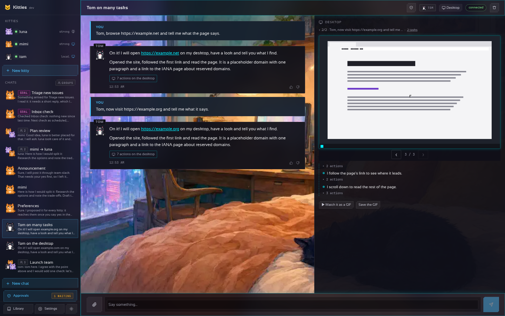
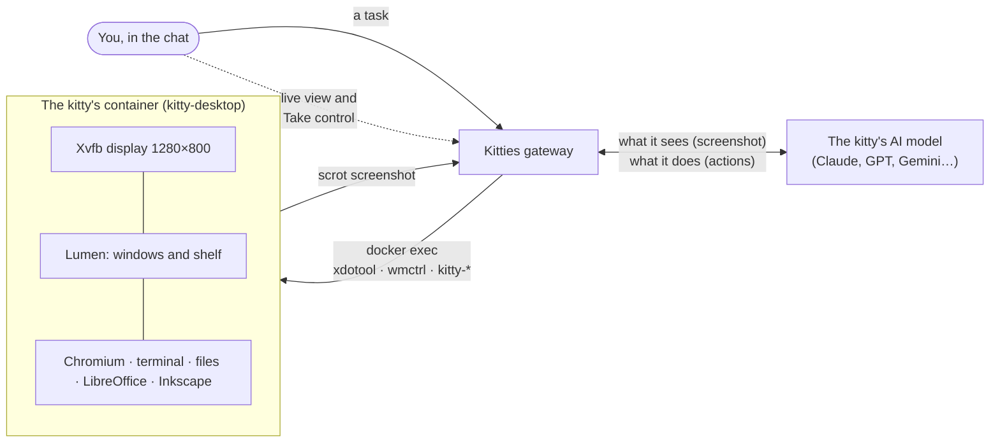
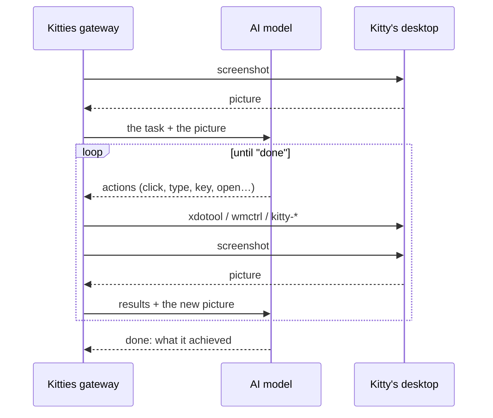
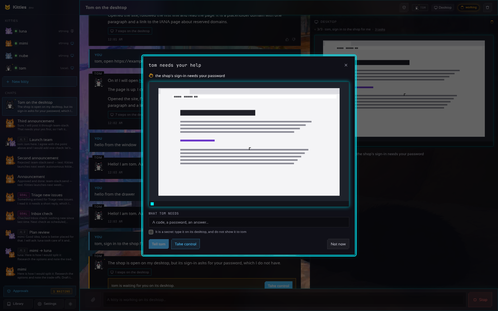
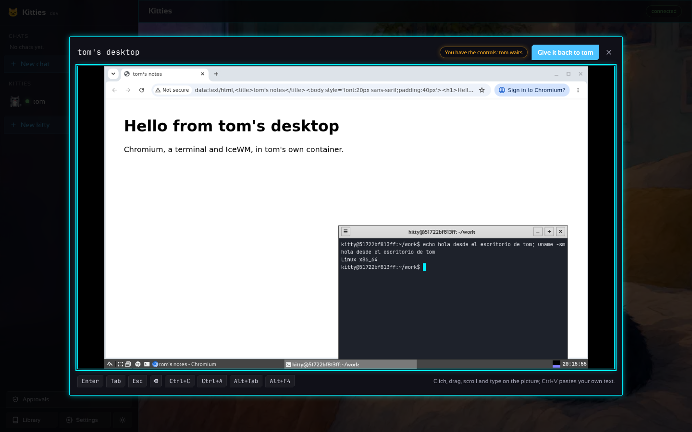
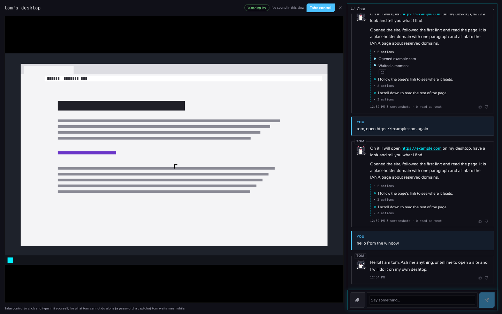
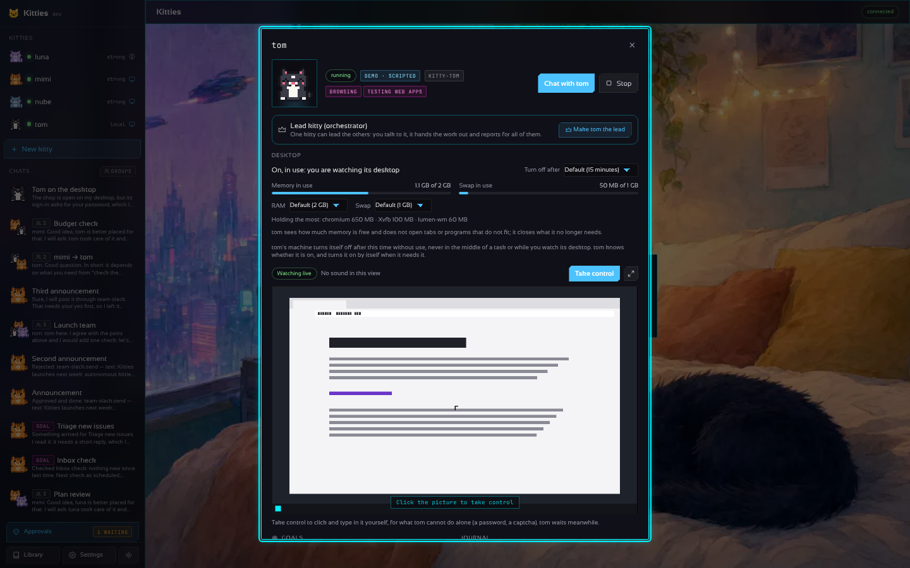
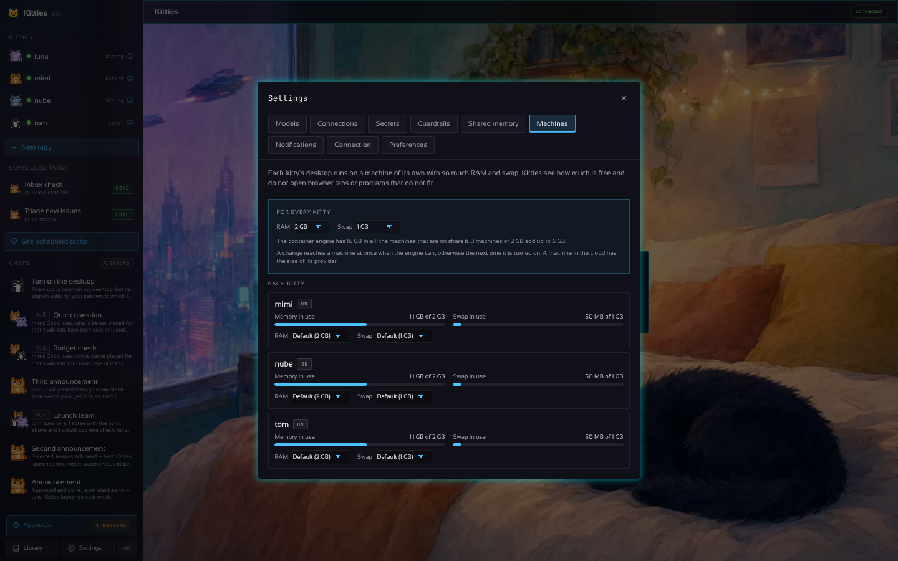
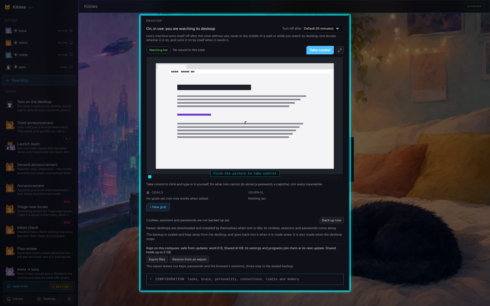
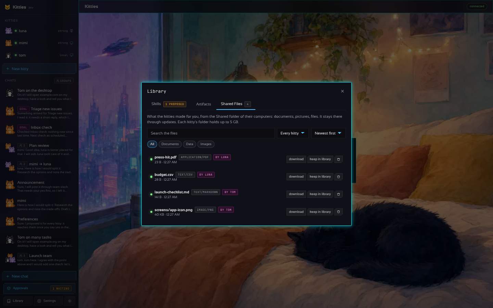

# How a kitty uses its desktop

*[En español](DESKTOP.es.md)*

**In one line:** every kitty has a Linux computer of its own in a Docker container; the AI looks
at a screenshot, decides where to click or what to type, and Kitties does it with a simulated
mouse and keyboard, again and again until the task is done.



## The pieces



- **The computer.** One container per kitty, from the `kitty-desktop` image: a virtual display
  (Xvfb) with a real desktop on it (Lumen, Chromium, a terminal, PCManFM, LibreOffice, Inkscape).
  Its only published port is the live view's, on the host's loopback (`127.0.0.1`, random port, behind a password); everything else goes with `docker exec`. Its work folder lives on the
  host, so its files outlive the container.
- **The eyes.** The gateway takes a screenshot of the display and hands it to the model, which
  can see pictures. After every batch of actions a new one follows, so the kitty sees what its
  actions did.
- **The hands.** The model answers with small actions, as tool calls (or as text lines when the
  provider has none):

  ```
  @tool click {"x": 640, "y": 420}
  @tool type {"text": "hello"}
  @tool key {"keys": "ctrl+l"}
  ```

  Kitties checks each one and turns it into a command: the mouse and the keys through `xdotool`,
  windows (list, focus) through `wmctrl`, and the image's own helpers to open a page
  (`kitty-open`), start a program (`kitty-launch`) or install one (`kitty-install`). The model never
  writes a free shell command: an install takes package names only, a click takes coordinates.

## The loop



It runs in the background; every step, with its screenshot, shows up in the chat. A task has
limits (time, rounds, tokens) and can be cancelled at any moment.

## Text first, pictures last

A screenshot costs many times the tokens of the text it shows, so a kitty is told to work by text
and to look only when text cannot tell (a canvas, a picture, a program's own window):

1. **Files and the terminal.** `file_read` (numbered lines, a part of a long file with `from` and
   `lines`; a PDF through `pdftotext`, and Word, Excel, PowerPoint and OpenDocument files from their
   XML, with no program to open), `file_list` (folders, files and sizes) and `file_write` (in its home or `/tmp`; the text
   goes on the command's input, not its command line) are the image's `kitty-file`; `shell` runs a
   command line with bash, pipes and all, in the working folder; `shell` and `run` are stopped after
   `timeout` seconds (300 by default, at most 600) and their output is cut at 12,000 characters.
2. **Web pages from the inside** (below).
3. **The display**: `screenshot`, `read_screen` (OCR) and clicks at coordinates.

None of the text tools brings a screenshot after it; a batch with a click at coordinates, a key or
an `open` still does. Each kitty message counts how it saw its work: *3 screenshots · 12 read as
text*, and on hover about what they weighed (a screenshot of the display is some 1,365 tokens, the
way Anthropic counts an image; text at about four characters a token: estimates, not a bill).

## Reading and acting on pages from the inside

In the browser a kitty does not have to guess from pixels. `page_read` gives it the page's
address, title and text, and a numbered list of what can be clicked or filled in (`from` goes on
with a long text, `find` prints only the passages with some words); `page_click` and `page_type`
act on an element of that list (or on the one that shows some text, or the field with some label),
wherever it is on the screen, in a shadow root or scrolled out of view. `page_goto` goes to an
address (opening the browser if needed) and `page_wait` waits until the page shows some text.

Every one of them answers with a short read of the page as the action left it (once it has loaded
and its DOM has been still a moment): the lines the action added come first, so the result at the
end of a long page is seen without reading it all again, and a tab the click opened is followed.
That read replaces the screenshot.

`page_flow` runs several of those steps in one go, without a round of the model for each:
`goto`, `click`, `type`, `wait`, `read` and `back`, stopping at the first that fails. With `save`
the steps are kept by name in the working folder (`.flows/`) and `{"name": ...}` runs them again: a
routine the kitty learned (a search, a report it downloads every morning) costs one call. A flow
that types into a password field is never kept; secrets go through `type_secret`. A
[goal](AUTONOMY.md) can play a kept flow on its schedule without the model at all.

It is the browser's own DevTools, reached by the image's `kitty-page` on the container's loopback:
the port is not published, so only what runs inside the container can use it. What a page says
comes back marked as the page's own text, and the kitty is told never to take it as an
instruction; a password field's value is never printed. When a page's text reads like a CAPTCHA or
a code only you receive, the kitty is told to ask you (`ask_help`), as it is when the screen says so.

## When it needs a person

Some things a kitty cannot do alone: a captcha, a password, a code sent to your phone. It then
uses `ask_help` (every model has it, whether it calls tools natively or in text), a notification
goes out, and a window opens over the chat with what the kitty sees and a box for what it needs:
write a code or an answer and **tell it**, or tick *it is a secret* and the text is **typed on
its desktop** without the kitty being shown it. Or **take control**: you see its desktop live
(H.264, a few milliseconds behind), your clicks, drags, wheel
and keys go to its display, and the clipboard works both ways. The kitty waits; when you answer
or give the desktop back, it goes on by itself.

The view is [voxl](https://github.com/tembo/voxl) (MIT; it links x264, so the image is GPL, like
Kitties): the display as H.264 over a WebSocket, decoded in the page with WebCodecs. It runs inside
each desktop on the container's own loopback, with a password made up at each start, and the
container publishes it only on the host's loopback (the gateway dials that port, else the container's address, else `docker exec ... socat`): the gateway is its reverse proxy
(`/v1/kitties/{ref}/voxl/t/{ticket}/`, a ticket asked for with `POST /v1/kitties/{ref}/voxl/ticket`
after signing in, so no token goes in the frame's links), and every connection to it is a
`docker exec ... socat` into the container. Only the viewer goes through (its page, scripts and
WebSocket), not voxl's own file transfer, recordings or screenshots. Where the browser has no
WebCodecs (they need HTTPS or localhost), in the Android app on a gateway that
is not HTTPS, in a webview without WebCodecs (the desktop app frames the gateway it started, getting its ticket through the app's bridge), or on a desktop of an older image, the page falls back by itself: rectangles
(`/v1/kitties/{ref}/rects`: the whole picture once, then only the tiles that differ, merged), whole
pictures (`/stream`, motion JPEG) and, as the last resort, screenshots one after another. Those
pictures come from `kitty-grab`, a small C program in the image that stays connected to the
display, reads it through shared memory and compresses only what changed (about a third of the CPU
of the `scrot` loop it replaces, which stays as the fallback, and up to 30 pictures a second).



A password or a code does not have to travel through the AI model. Tick *it is a secret* and the text
is typed from the gateway to the kitty's keyboard through the command's standard input (never in
a command line, where any process could read it); the same goes for what you type yourself while
you hold its desktop. Give it a name and it is kept in the **vault** (Settings, Secrets): AES-256-GCM
under a key in its own file, or in `KITTIES_VAULT_KEY`, listed by name and by the kitties that may
use it. A kitty is told the names it may use and calls `type_secret {"name": ...}`: the secret goes
from the vault to its keyboard, and neither the kitty, its model, the chat's steps nor the logs
ever hold it.

A kitty does not have to think of asking. When it sees the very same screen four times in a row
it is told to try another way, or to ask; and when that screen reads like a CAPTCHA or a code
only you receive (an OCR of it, in English, Spanish or Portuguese), it asks at once instead of
spending its budget on a wall.

## A task as a GIF

The screenshots of a task are its film: **Watch it as a GIF** and **Save the GIF** under the
steps make them an animated GIF (`internal/replay`: one palette for all the pictures, each
picture carrying only what changed), served at `/v1/chats/{id}/turns/{n}/replay.gif`.



## The chat beside the live desktop

The window of a kitty's live desktop carries the kitty's chat as a sidebar, so you can write to it
and follow what it does on the display without leaving the picture. It is the same chat as the
page's (`Conversation` and `Composer`, with the same turns, attachments and ratings), so nothing is
kept twice. A task reads as the short lines the kitty writes when it moves on to something new
("I open the browser and look up flights to Lima": what it does and what for, never the clicks),
each with its actions folded under how many they were; a tap opens them one by one. The chat
follows the latest line while you are at its end; scroll up to read and it waits, with a button to
go back to the latest. The picture has no hint over it: a click on it, or the Take control button,
takes the controls. A call for help never folds away, the line at work has a **Stop** button next to it (the chat's
Continue picks the task up again; after five minutes at work it asks first), and **Settings › Preferences › Show every action
of a task** has every task open action by action in this browser. Away from the page, a long task's
lines reach WhatsApp as they come and, when chosen, the notifications (`progress`), whose link
(`#chat/<id>/live`) opens the chat with the kitty's desktop live.
The sidebar folds to a thin bar (remembered in the browser), starts folded on a phone, where it
stacks under the picture, and never takes the keys or the sound from the desktop: typing in it is
typing in the chat, and the controls of the picture stay where they were.



## Turning the machine on and off

A kitty's desktop runs on its **machine** (its container), and the machine can be off. It is turned
on and off from the kitty's window (the **Start** / **Stop** button), from the API
(`POST /v1/kitties/{ref}/power` `{"on": true|false}`; `GET` tells its state), and by the kitty itself;
and it **turns itself off after 15 minutes without use** (`containers.auto_off_minutes`; each kitty
can have its own in its window, Desktop, "Turn off after", from 5 minutes to 8 hours, or **never**).
Turning it off keeps the work folder and backs up the browser's sessions, like any stop; turning it on
again brings the desktop back (the first start downloads the image).



**What counts as use.** The time without use counts from the last of these, and the machine is never
turned off (by itself, or by a stop that is not forced) while one of them is going on:

- the kitty is in the middle of a task (a desktop task, or one that waits for you with `ask_help`);
- you have taken control of the desktop, or are watching it live (its window open on the desktop);
- a command is running in the machine;
- the kitty acted on the display, or you looked at or clicked on it, a moment ago: the count starts
  again at 0 minutes.

A stop while the machine is in use answers **409** with what is using it, and the window asks
before turning it off anyway (`"force": true`). A gateway that has just started only begins to
count; it does not turn off a machine that was in use before.

**The kitty knows its machine.** Every request to the model ends with a short message that says whether
the machine is on, starting or off (and why it is off: it turned itself off, you turned it off, the
kitty did), and how long is left before it turns itself off. That message is marked *volatile*: the
provider's prompt cache ends before it, so the system prompt, the tools and the conversation stay cached
whatever the state (see `provider.Message.Volatile`). The kitty also has the **`machine`** tool
(`@tool machine {"action": "status|on|off"}`): `status` tells the state, `on` turns it on and waits
until it is up, `off` turns it off when it is done with the display for a good while (refused while you
watch or control it). And a desktop tool used while the machine is off **turns it on first**, waits
for it (up to 3 minutes) and shows that as a step of the turn; if it cannot, the kitty is told
plainly that its machine is off and why, and the tool does not run.

## The machine's memory

Each machine has so much **RAM and swap**: 2 GB and 1 GB by default (`containers.memory_mb` and
`swap_mb`). **Settings › Machines** changes them for every kitty and for each one (a kitty's window,
Desktop, shows the same pickers), with what each machine uses now and what the container engine has
in all; the machines that are on share it, and a size bigger than the engine is refused.



**Where a change applies.** On a local desktop (Docker or Podman) a new size reaches the machine at
once (`docker update`), running or not. When the engine cannot (an older Podman, a cgroup without swap
accounting) the window says so, and the machine is made anew with the new size the next time it is
turned on: its home, workspace and browser sessions stay. A machine in the cloud has its provider's
size (`cloud.size`), and the pickers say so. With Docker Desktop (Windows, macOS) the engine's own memory
is set in Docker Desktop › Settings › Resources (on Windows with WSL 2, in `.wslconfig`).

**The kitty knows its memory.** The message about its machine (above) also says how much RAM and swap
are used and free, read inside the machine (cgroup v2 or v1, else `/proc/meminfo`) and kept 10 seconds.
`@tool machine {"action": "status"}` adds what holds the most (Chromium with its processes, the
display, the programs). Before **`open`** (a browser tab, some 150 to 300 MB) and **`launch`** (a
program) the gateway looks: with less than 250 MB free for a tab, or 400 MB for a program, the tool is
refused and the kitty is told what is free and to close tabs (`ctrl+w`) or programs first, or to ask
you for more RAM. The lead and other MCP clients see the same in `kitty_compute`.

## Updating a desktop without losing what it knows

A desktop is made from an image, and a newer one can come. A container keeps the image it was made
from, so an update makes it anew. **The gateway does it by itself** (`containers.auto_update`, on by
default): two minutes after it starts, and then every `containers.update_check_hours` (6), it pulls
the image, and each running desktop that is on an older one is updated when its kitty is idle. A
kitty in the middle of a task, or whose desktop you hold, is left for the next round and checked again
right before anything is touched; a stopped desktop is made anew when it is started; the journal
notes each update, and, if you turned that event on in Settings, Notifications, you are told
too. `updates.window` ("02:00-06:00") keeps the restarts to the night. Turn it off with
`auto_update: false`; the window of the kitty says whether it is on.

The same can be done by hand: the kitty's window says **a newer desktop is available** (the image
on this machine is not the one the container runs) and **Update the desktop** does it, when the
kitty is not in the middle of a task and you do not hold its desktop. Either way it pulls the image, closes the
browser in an orderly way (`kitty-page quit`, so everything is written to disk), backs up, makes the
container anew and puts the backup back. The work, home and Shared folders are on your computer and are never touched (see below).

**Every kitty at once.** When a new image is out, the sidebar shows **New desktop** with how many
kitties can have it (those with a container computer on this machine; a desktop in the cloud has no
image here). Its window, also in Settings › Preferences › Updates, lists the desktops; **Look for a
new desktop** pulls the image now, and **Update all** (or the ones you tick) updates them one after
the other, with a progress bar and how each one went: updated, at its next start (a stopped one: its
old container is removed and it is not turned on now), later (working, or you hold its desktop) or
failed, with the reason. Its home, programs, browser profile (its volume) and Shared folder stay;
the old image is deleted at the end. The gateway looks for a new image every
`containers.update_check_hours` even with `auto_update: false`, so it can tell you and you decide
when to update.

What the kitty's browser knows (cookies, saved passwords, local storage) lives in a **Docker
volume of its own**, `kitties-browser-<container>`, mounted at `/var/lib/kitty-browser`: it is on
the container engine's Linux disk and outlives restarts, updates and a container made anew. It is
not in the workspace because Chromium locks its profile with a symbolic link (`SingletonLock`), and
a folder of a Windows or macOS computer mounted by Docker Desktop cannot hold one: there Chromium
would not start on it, and the logins went to a temporary profile that every restart lost.
`kitty-profile` says where the profile is; a profile kept in `~/work/.browser` before is copied into
the volume the first time (nothing to log in to again), and an older gateway that mounts no volume
still keeps it in the container when the workspace cannot hold it.

Three more things keep it from being lost: the browser closes in an orderly way before any stop or
update, and also when the container is stopped from outside (`docker stop`/`restart`, Docker or the
computer shutting down: the desktop closes it first, as it only writes its cookies every half
minute); it continues where it left off (a Chromium policy), which keeps the **session cookies**
(logins with no expiry) across a restart; and a slow start is left to finish instead of putting the
profile aside. Passwords use the browser's `--password-store=basic`, sealed with a key every
container shares, so a profile opens in a new one with no keyring. A desktop stopped hard also comes
up again: the display's stale lock is removed at the start.

The **backup** (`kitty-backup`) adds a copy away from the container: the browser's cookies, sessions,
saved passwords, local storage and preferences, and `~/.ssh`, `~/.gitconfig`, `~/.git-credentials`,
`~/.netrc`, `~/.config/gh`, `~/.config/git` and the apps pinned to the dock (`~/.config/kitties/pins`). The gateway keeps it sealed (AES-256-GCM, the key of
the vault) under `backups/` in its data folder, one per kitty, replaced by each new one; it is made
when the desktop stops, before an update, and with **Back up now**. `kitty-restore` gives it back to
a container that is made anew (it never overwrites a file that is there: a workspace that kept its
profile is newer than any backup). A removed kitty's backup is deleted with it.

## What outlives the desktop: home, programs and Shared

Three folders of your computer are mounted into each kitty's desktop, and nothing deletes them: not
an update, not a stop, not removing the kitty.

| On your computer | In the desktop | What it holds |
| --- | --- | --- |
| `<data_dir>/work/<name>` | `~/work` | its files, its theme and the Debian packages it installed |
| `<data_dir>/homes/<name>` | `/home/kitty` | its settings (`~/.config`), the programs it installed for itself (`~/.local`: pipx, `pip --user`, `npm install -g`; `/opt/kitty-apps`) |
| `<data_dir>/shared/<name>` | `~/Shared` | what it made for you: the app shows it in **Library > Shared** |
| volume `kitties-browser-<container>` | `/var/lib/kitty-browser` | the browser's profile: cookies, sessions, saved passwords (see above) |

- **Programs.** A Debian package comes back by itself in a desktop made anew, however it was installed
  (`kitty-install`, `sudo apt install`: a dpkg hook remembers it); `kitty-install --remove <package>`
  forgets it. Programs in `~/.local` or `/opt/kitty-apps` are simply there.
- **Settings.** The home is seeded from the image (`kitty-home`): a file it lacks is copied, and only
  the desktop's own look (Lumen's menus, picom, PCManFM, GTK) is renewed when the image changes.
- **Shared.** `kitty-share <file>` copies a file there (`-d folder`, `--list`); the kitty is told so.
  The page lists every kitty's files together, previews pictures and text, downloads anything, copies
  a file into the library (**keep in library**) and deletes. Each folder holds up to
  `containers.shared_quota_mb` (5120, 5 GB; negative: no limit), which `kitty-share` enforces.
- **Moving an older desktop.** A desktop made before homes lived on your computer has its home inside
  its container: before that container is removed, its home is copied out (`homes/.moving/<name>.tar`,
  without `~/.cache`) and put into the new one, which restarts once. If the copy fails, the old
  desktop is kept as it was and the update says why.
- **Export and restore.** The kitty's window shows what it keeps and its size, **Export files**
  downloads a `.tar.gz` of its home, work and Shared folders without keys, passwords or the browser's
  sessions (those stay in the sealed backup), and **Restore from an export** puts one back into the
  running desktop (a newer file of the kitty's stays).




## Where it lives in the code

| What | Where |
| --- | --- |
| The image: display, desktop, programs, helpers | [`docker/kitty-desktop/`](../docker/kitty-desktop) |
| The actions the model may take, checked and turned into commands | [`internal/desktop/desktop.go`](../internal/desktop/desktop.go) |
| The loop: screenshot, model, actions, again | [`internal/chat/chat.go`](../internal/chat/chat.go) |
| Containers: start, `exec`, screenshot, live stream | [`internal/container/`](../internal/container) |
| The machine's power: use, idle shut-off, on and off | [`internal/orchestrator/power.go`](../internal/orchestrator/power.go) |
| What the kitty knows of its machine, the `machine` tool, the auto turn-on, the memory check | [`internal/chat/machine.go`](../internal/chat/machine.go) |
| The machine's RAM and swap: limits, reading, defaults | [`internal/kitty/memory.go`](../internal/kitty/memory.go), [`internal/orchestrator/memory.go`](../internal/orchestrator/memory.go) |
| Taking over: holds, the person's input, `ask_help` | [`internal/orchestrator/control.go`](../internal/orchestrator/control.go) |
| The sealed backups of a kitty's sessions, and the update of a desktop | [`internal/keep`](../internal/keep), [`internal/orchestrator/sessions.go`](../internal/orchestrator/sessions.go) |
| Home, Shared, the move of an older home, export and restore | [`internal/orchestrator/home.go`](../internal/orchestrator/home.go), [`internal/shared`](../internal/shared), [`internal/gateway/shared.go`](../internal/gateway/shared.go) |
| The saved secrets a kitty may type, sealed | [`internal/vault`](../internal/vault) |
| The live view's proxy (voxl) and its tunnel into the container | [`internal/gateway/voxl.go`](../internal/gateway/voxl.go), [`internal/container/tunnel.go`](../internal/container/tunnel.go) |
| What changed on the display, as rectangles to draw over the last picture | [`internal/rects`](../internal/rects) |
| The live view in the app | [`desktop/frontend/src/LiveDesktop.tsx`](../desktop/frontend/src/LiveDesktop.tsx) |
