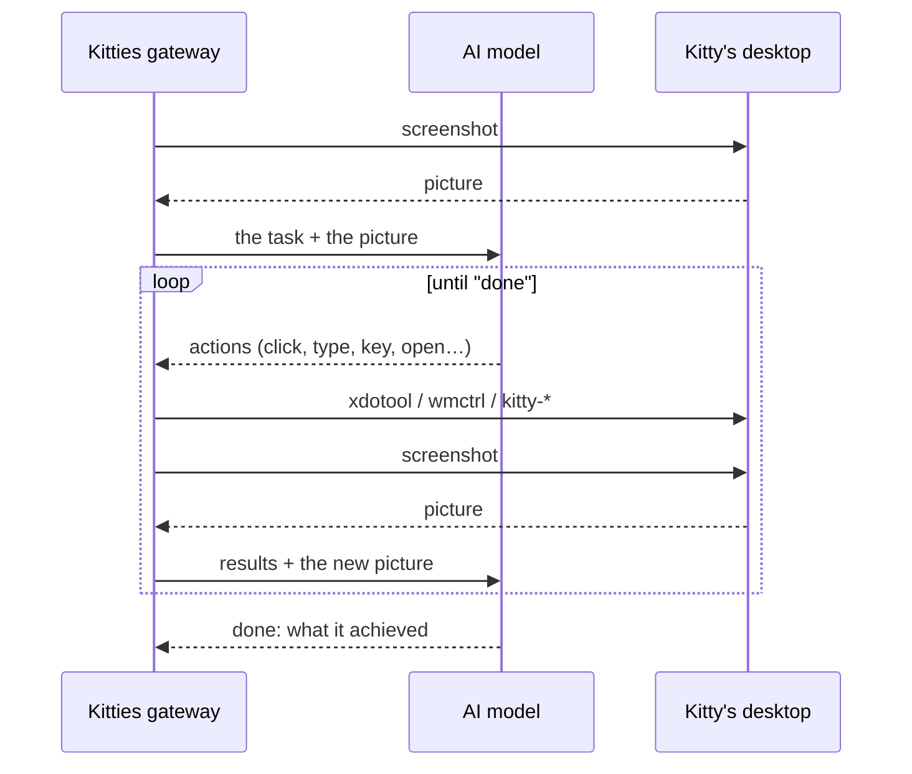

# How a kitty uses its desktop

*[En español](DESKTOP.es.md)*

**In one line:** every kitty has a Linux computer of its own in a Docker container; the AI looks
at a screenshot, decides where to click or what to type, and Kitties does it with a simulated
mouse and keyboard, again and again until the task is done.


## The pieces


- **The computer.** One container per kitty, from the `kitty-desktop` image: a virtual display
  (Xvfb) with a real desktop on it (IceWM, Chromium, a terminal, PCManFM, LibreOffice, Inkscape).
  It publishes no port: the gateway reaches it with `docker exec` only. Its work folder lives on the
  host, so its files outlive the container.
- **The eyes.** The gateway takes a screenshot of the display and hands it to the model, which
  can see pictures. After every batch of actions a new one follows, so the kitty sees what its
  actions did.
- **The hands.** The model answers with small actions, as tool calls (or as text lines when the
  provider has none):

  ```
  @tool click {"x": 640, "y": 420}
  @tool type {"text": "hello"}
  @tool key {"keys": "ctrl+l"}
  ```

  Kitties checks each one and turns it into a command: the mouse and the keys through `xdotool`,
  windows (list, focus) through `wmctrl`, and the image's own helpers to open a page
  (`kitty-open`), start a program (`kitty-launch`) or install one (`kitty-install`). The model never
  writes a free shell command: an install takes package names only, a click takes coordinates.

## The loop



It runs in the background; every step, with its screenshot, shows up in the chat. A task has
limits (time, rounds, tokens) and can be cancelled at any moment.

## Reading and acting on pages from the inside

In the browser a kitty does not have to guess from pixels. `page_read` gives it the page's
address, title and text, and a numbered list of what can be clicked or filled in; `page_click`
and `page_type` act on an element of that list (or on the one that shows some text), wherever it
is on the screen, in a shadow root or scrolled out of view. It is the browser's own DevTools,
reached by the image's `kitty-page` on the container's loopback: the port is not published, so
only what runs inside the container can use it. What a page says comes back marked as the page's
own text, and the kitty is told never to take it as an instruction; a password field's value is
never printed.

## When it needs a person

Some things a kitty cannot do alone: a captcha, a password, a code sent to your phone. It then
uses `ask_help` (every model has it, whether it calls tools natively or in text), a notification
goes out, and a window opens over the chat with what the kitty sees and a box for what it needs:
write a code or an answer and **tell it**, or tick *it is a secret* and the text is **typed on
its desktop** without the kitty being shown it. Or **take control**: you see its desktop live
(only the rectangles that changed, like VNC, about a quarter of a second behind), your clicks, drags, wheel
and keys go to its display, and the clipboard works both ways. The kitty waits; when you answer
or give the desktop back, it goes on by itself. The view is drawn from rectangles (`/v1/kitties/{ref}/rects`:
the whole picture once, then only the tiles that differ, merged); the desktop app reads the same stream
and hands it to its page, a gateway without it is followed as whole pictures (`/stream`, motion
JPEG), and screenshots one after another are the last resort. The pictures come from
`kitty-grab`, a small C program in the image that stays connected to the display, reads it
through shared memory and compresses only what changed (about a third of the CPU of the
`scrot` loop it replaces, which stays as the fallback, and up to 30 pictures a second).


A password or a code does not have to travel through the AI model. Tick *it is a secret* and the text
is typed from the gateway to the kitty's keyboard through the command's standard input (never in
a command line, where any process could read it); the same goes for what you type yourself while
you hold its desktop. Give it a name and it is kept in the **vault** (Settings, Secrets): AES-256-GCM
under a key in its own file, or in `KITTIES_VAULT_KEY`, listed by name and by the kitties that may
use it. A kitty is told the names it may use and calls `type_secret {"name": ...}`: the secret goes
from the vault to its keyboard, and neither the kitty, its model, the chat's steps nor the logs
ever hold it.

A kitty does not have to think of asking. When it sees the very same screen four times in a row
it is told to try another way, or to ask; and when that screen reads like a CAPTCHA or a code
only you receive (an OCR of it, in English, Spanish or Portuguese), it asks at once instead of
spending its budget on a wall.

## A task as a GIF

The screenshots of a task are its film: **Watch it as a GIF** and **Save the GIF** under the
steps make them an animated GIF (`internal/replay`: one palette for all the pictures, each
picture carrying only what changed), served at `/v1/chats/{id}/turns/{n}/replay.gif`.


## Updating a desktop without losing what it knows

A desktop is made from an image, and a newer one can come. A container keeps the image it was made
from, so an update makes it anew. **The gateway does it by itself** (`containers.auto_update`, on by
default): two minutes after it starts, and then every `containers.update_check_hours` (6), it pulls
the image, and each running desktop that is on an older one is updated when its kitty is idle. A
kitty in the middle of a task, or whose desktop you hold, is left for the next round and checked again
right before anything is touched; a stopped desktop is made anew when it is started; the journal
notes each update, and, if you turned that event on in Settings, Notifications, you are told
too. `updates.window` ("02:00-06:00") keeps the restarts to the night. Turn it off with
`auto_update: false`; the window of the kitty says whether it is on.

The same can be done by hand: the kitty's window says **a newer desktop is available** (the image
on this machine is not the one the container runs) and **Update the desktop** does it, when the
kitty is not in the middle of a task and you do not hold its desktop. Either way it pulls the image, closes the
browser in an orderly way (`kitty-page quit`, so everything is written to disk), backs up, makes the
container anew and puts the backup back. The work folder is on your computer and is never touched.

What the kitty's browser knows lives in that folder already (cookies, saved passwords, local
storage), and now two things keep it from being lost: the browser closes in an orderly way before
any stop or update (it only writes its cookies every half minute, and a container that is removed
loses the last ones), and it continues where it left off (a Chromium policy), which keeps the
**session cookies** (logins with no expiry) across a restart. Passwords use the browser's
`--password-store=basic`, sealed with a key every container shares, so a profile opens in a new one.

The **backup** (`kitty-backup`) adds a copy away from the container: the browser's cookies, sessions,
saved passwords, local storage and preferences, and `~/.ssh`, `~/.gitconfig`, `~/.git-credentials`,
`~/.netrc`, `~/.config/gh` and `~/.config/git`. The gateway keeps it sealed (AES-256-GCM, the key of
the vault) under `backups/` in its data folder, one per kitty, replaced by each new one; it is made
when the desktop stops, before an update, and with **Back up now**. `kitty-restore` gives it back to
a container that is made anew (it never overwrites a file that is there: a workspace that kept its
profile is newer than any backup). A removed kitty's backup is deleted with it.

## Where it lives in the code

| What | Where |
| --- | --- |
| The image: display, desktop, programs, helpers | [`docker/kitty-desktop/`](../docker/kitty-desktop) |
| The actions the model may take, checked and turned into commands | [`internal/desktop/desktop.go`](../internal/desktop/desktop.go) |
| The loop: screenshot, model, actions, again | [`internal/chat/chat.go`](../internal/chat/chat.go) |
| Containers: start, `exec`, screenshot, live stream | [`internal/container/`](../internal/container) |
| Taking over: holds, the person's input, `ask_help` | [`internal/orchestrator/control.go`](../internal/orchestrator/control.go) |
| The sealed backups of a kitty's sessions, and the update of a desktop | [`internal/keep`](../internal/keep), [`internal/orchestrator/sessions.go`](../internal/orchestrator/sessions.go) |
| The saved secrets a kitty may type, sealed | [`internal/vault`](../internal/vault) |
| What changed on the display, as rectangles to draw over the last picture | [`internal/rects`](../internal/rects) |
| The live view in the app | [`desktop/frontend/src/LiveDesktop.tsx`](../desktop/frontend/src/LiveDesktop.tsx) |
