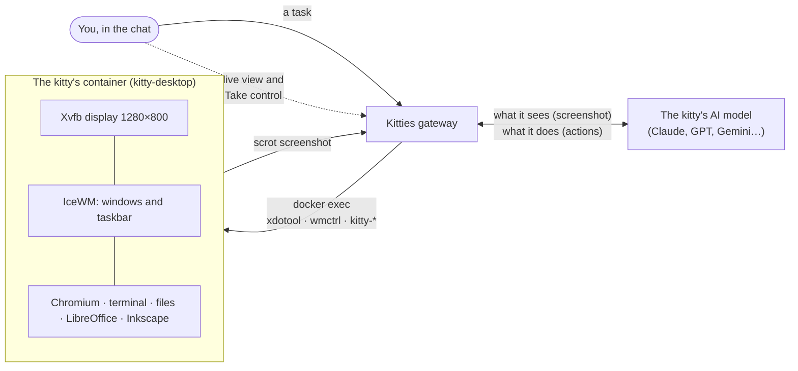
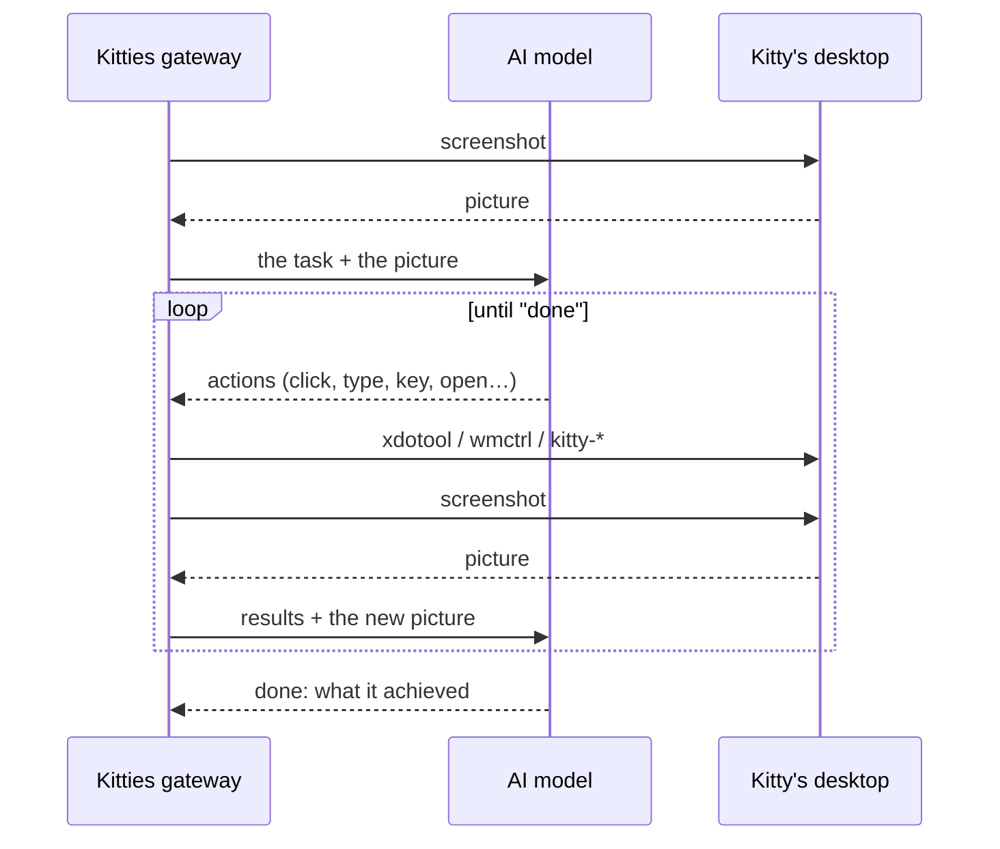

# How a kitty uses its desktop

*[En español](DESKTOP.es.md)*

**In one line:** every kitty has a Linux computer of its own in a Docker container; the AI looks
at a screenshot, decides where to click or what to type, and Kitties does it with a simulated
mouse and keyboard, again and again until the task is done.


## The pieces



- **The computer.** One container per kitty, from the `kitty-desktop` image: a virtual display
  (Xvfb) with a real desktop on it (IceWM, Chromium, a terminal, PCManFM, LibreOffice, Inkscape).
  It opens no port: the gateway reaches it with `docker exec` only. Its work folder lives on the
  host, so its files outlive the container.
- **The eyes.** The gateway takes a screenshot of the display and hands it to the model, which
  can see pictures. After every batch of actions a new one follows, so the kitty sees what its
  actions did.
- **The hands.** The model answers with small actions, as tool calls (or as text lines when the
  provider has none):

  ```
  @tool click {"x": 640, "y": 420}
  @tool type {"text": "hello"}
  @tool key {"keys": "ctrl+l"}
  ```

  Kitties checks each one and turns it into a command: the mouse and the keys through `xdotool`,
  windows (list, focus) through `wmctrl`, and the image's own helpers to open a page
  (`kitty-open`), start a program (`kitty-launch`) or install one (`kitty-install`). The model never
  writes a free shell command: an install takes package names only, a click takes coordinates.

## The loop



It runs in the background; every step, with its screenshot, shows up in the chat. A task has
limits (time, rounds, tokens) and can be cancelled at any moment.

## When it needs a person

Some things a kitty cannot do alone: a captcha, a password, a code sent to your phone. It then
uses `ask_help`: the chat shows a **Take control** button and a notification goes out. You see
its desktop live (motion JPEG through the gateway, about a quarter of a second behind), your
clicks, drags, wheel and keys go to its display, and the clipboard works both ways. The kitty
waits; when you give the desktop back, it goes on by itself.


## Where it lives in the code

| What | Where |
| --- | --- |
| The image: display, desktop, programs, helpers | [`docker/kitty-desktop/`](../docker/kitty-desktop) |
| The actions the model may take, checked and turned into commands | [`internal/desktop/desktop.go`](../internal/desktop/desktop.go) |
| The loop: screenshot, model, actions, again | [`internal/chat/chat.go`](../internal/chat/chat.go) |
| Containers: start, `exec`, screenshot, live stream | [`internal/container/`](../internal/container) |
| Taking over: holds, the person's input, `ask_help` | [`internal/orchestrator/control.go`](../internal/orchestrator/control.go) |
| The live view in the app | [`desktop/frontend/src/LiveDesktop.tsx`](../desktop/frontend/src/LiveDesktop.tsx) |
