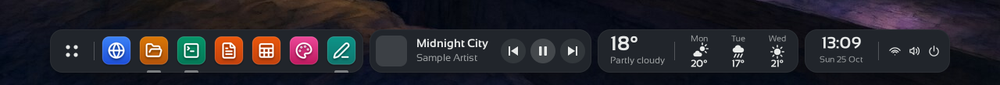
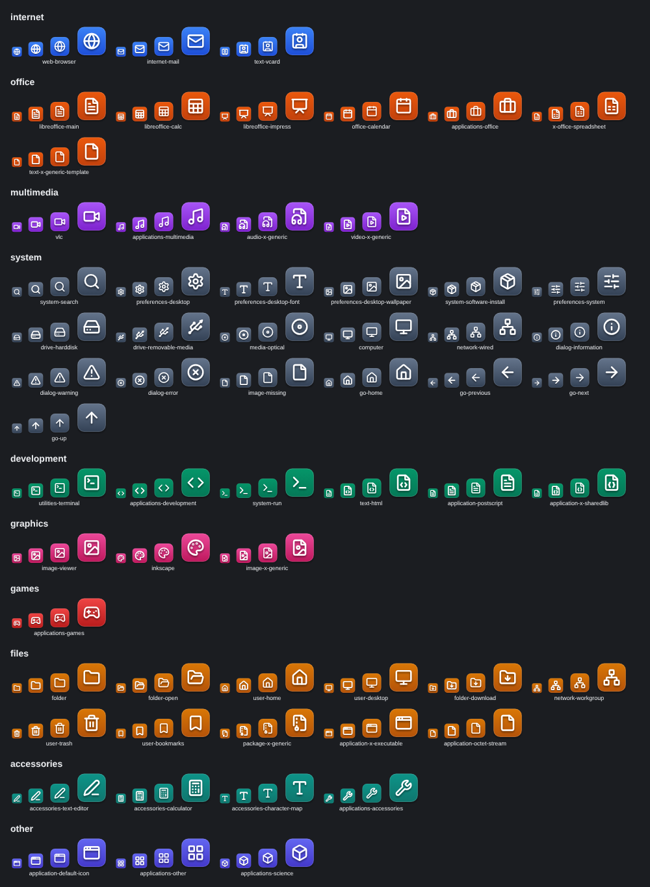

# The kitty's desktop: what it looks like and what it is made of

Every kitty with a body lives in a container built from [`docker/kitty-desktop`](../docker/kitty-desktop):
Debian, a headless X display (Xvfb, 1280×800) and a small desktop of its own. How the kitty *uses*
it (screenshots, actions, taking control) is in [DESKTOP.md](DESKTOP.md); this page is about the
desktop itself.

> The pictures on this page were taken in a test environment (Xvfb with the same Lumen fork,
> theme, icons, fonts and configuration as the image, built from `main`), with sample data: the
> file names, the terminal text, the weather and the track in the player are made up.

## The shelf

The window manager is [Lumen Window Manager](https://github.com/madkoding/lumen-wm), a fork of [Openbox](http://openbox.org) (GPL-2.0+) that adds a **shelf**
(off by default upstream; Kitties turns it on in `docker/kitty-desktop/lumen/rc.xml`). The image
builds the fork at a fixed commit (`LUMEN_COMMIT` in the Dockerfile): bump that commit to update it.

- **A dock** of pinned apps (Chromium, Files, Terminal, Writer, Calc, Inkscape, Text editor). A click
  starts one or focuses its window, and a mark under the icon shows what is open. Apps can be
  **pinned and unpinned** from the dock and **dragged to reorder**; the choice is kept in
  `~/.config/kitties/pins`, which the backup of a kitty's desktop includes, so it survives an update.
- **Apps menu**: the first button opens the menu below, drawn in the shelf's own dark material with
  rounded corners (`menuRadius`, `menuPadding` in `rc.xml`; the colours are
  `lumen/menu-style.themerc`, added to both themes).
- **Player**: shows what the browser plays (MPRIS on the desktop's session bus) with the cover, title,
  artist and previous / play-pause / next. It hides itself when nothing plays.
- **Weather**: today and the next two days from [Open-Meteo](https://open-meteo.com) (no key). The place
  is `KITTY_WEATHER_PLACE` or the first line of `~/.config/kitties/weather-place`; with neither it is
  found from the host's address or time zone. Fahrenheit with `KITTY_WEATHER_UNITS=f`. It hides
  itself when there is no answer.
- **Clock and status**: the time and date, and the glyphs for network, volume, power and battery,
  each opening its own menu. The fork's own documentation has the details of the shelf:
  [madkoding/lumen-wm](https://github.com/madkoding/lumen-wm).

## Theme, fonts and icons

| | What the image ships |
| --- | --- |
| **Windows** | [Numix](https://github.com/numixproject/numix-gtk-theme) (dark), Openbox theme only, from Debian. Greybird-dark is the alternative: `kitty-theme Greybird-dark`, or pick it in the kitty's drawer; the choice is kept in the workspace. |
| **Programs** | GTK programs, Chromium (its face and the pages that offer a dark look), LibreOffice (on screen; a printed or exported document keeps its own colours) and the terminal are dark too. |
| **Fonts** | Sansation for the windows and the shelf, JetBrains Mono (Nerd Font) for the terminal, the same files as the app's page. |
| **Icons** | [Lucide](https://lucide.dev), drawn at build time as white glyphs with a soft shadow on rounded gradient squares, one colour per group of applications. |
| **Wallpaper** | Kitties' own picture, drawn by PCManFM; the desktop has no icons because the shelf holds the apps. PCManFM is also the file manager. |

The icon pack is generated, not drawn by hand: `docker/kitty-desktop/lucide/build-theme.py` reads
`groups.map` (the colours) and `icons.map` (which Lucide glyph and group each icon name gets) and
writes the SVGs, in a normal and a "small" set that stays legible at 16 px. The Lucide version and
checksum are pinned in the Dockerfile (`LUCIDE_VERSION`, `LUCIDE_SHA256`).

## What is installed

Chromium, a terminal (xterm), PCManFM, Mousepad, LibreOffice (Writer, Calc, Impress), Inkscape,
ImageMagick and mtPaint, plus `xdotool`, `wmctrl` and `scrot` for the kitty's hands and eyes.
`kitty-install` adds programs from Debian (sudo only runs the installer, by package name) and
remembers them in the workspace, so a container made anew installs them again. Nothing is
published on the host: the orchestrator reaches a kitty with `docker exec`.

## Changing it

- The look is files: `lumen/rc.xml` (the shelf, fonts, theme and menus), `lumen/menu.xml`,
  `lumen/menu-style.themerc`, `lucide/*.map` and `wallpaper/`. `make image` rebuilds the image.
- Credits for everything in it: [README](../README.md#credits).
