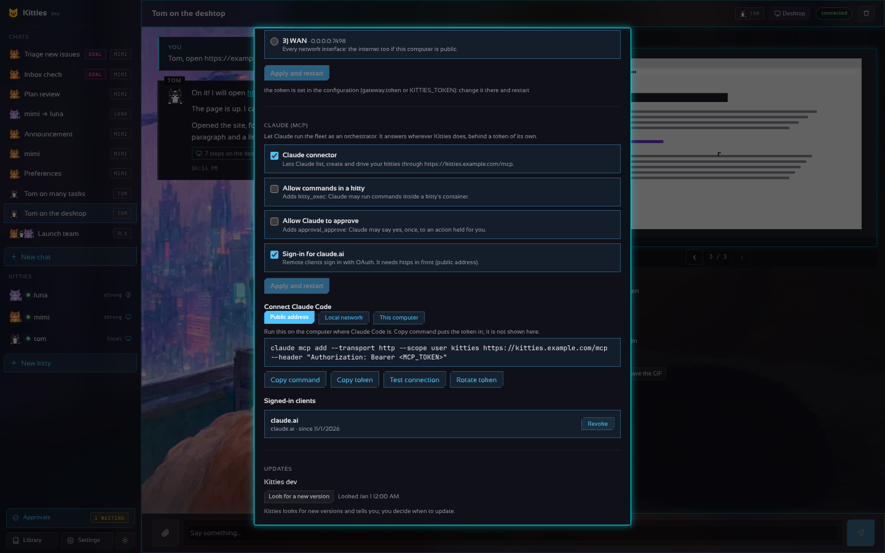

# Claude as the orchestrator: the MCP connector

The gateway speaks the [Model Context Protocol](https://modelcontextprotocol.io) at `/mcp`, so
Claude (Claude Code, Claude Desktop, any MCP client) runs the fleet for you: list, create, start
and stop kitties, give them tasks, look at their desktops. It is **on by default** and answers
wherever the gateway does (this machine, the local network or the public address, see
[the exposure](INSTALL.md)), behind a token of its own: the gateway's token does not open it.

## Turn it off, or widen it

```yaml
gateway:
  mcp:
    enabled: true      # on by default; false turns it off
    # token: ...       # optional; else one is made once and kept in <data>/mcp.token
    allow_exec: false  # true adds kitty_exec (commands inside a kitty's container)
    allow_approve: false  # true adds approval_approve (Claude may say yes, once, to a held action)
```

Or by environment: `KITTIES_MCP=false` (or `true`), `KITTIES_MCP_TOKEN`, `KITTIES_MCP_EXEC=true`,
`KITTIES_MCP_OAUTH=true`, `KITTIES_MCP_APPROVE=true`. The gateway prints every address it answers at
and the line for Claude Code when it starts:

```text
MCP connector: http://192.168.1.20:7488/mcp (token in /home/me/.kitties/mcp.token)
               http://127.0.0.1:7488/mcp
  Claude Code: claude mcp add --transport http --scope user kitties http://192.168.1.20:7488/mcp --header "Authorization: Bearer <token in /home/me/.kitties/mcp.token>"
```

## From Settings

**Settings → Preferences → Claude (MCP)** shows and changes all of this without editing files:



- Switches: the connector, `kitty_exec`, `approval_approve` and OAuth sign-in. Turning on exec or
  approve asks for an explicit yes. The choice is kept in `<data>/mcp-settings.json`, wins over the
  file and the environment, and the gateway restarts to apply it.
- **Connect Claude Code**: one button per address the connector answers at (*Public address*,
  *Local network*, *This computer*; the one the page was opened at is chosen first) and its
  `claude mcp add` command. **The token is never drawn on the page**: on this computer the command
  reads it from its file; for another computer the command shows `<MCP_TOKEN>` and *Copy command*
  puts the real token in only in what it copies. Over plain http on the network the page warns
  that the token travels unencrypted.
- *Copy token* and *Rotate token* are explicit buttons (rotating cuts off every connection; a token
  set in the configuration or `KITTIES_MCP_TOKEN` is not rotated here).
- *Test connection* asks the connector for its tools, with its own token, and says how many Claude gets.
- With OAuth on, the clients that signed in (and when each was last used), each with a *Revoke* button.

The same through the API (gateway token): `GET`/`PUT /v1/mcp` (with `connect`: each address, its
command and whether it needs the token put in), `GET`/`POST /v1/mcp/token`, `POST /v1/mcp/test`.

## Connect Claude Code

The easy way is *Copy command* in Settings, then paste it in a terminal of the computer where
Claude Code runs. By hand, with the gateway's address (`kitties config` shows it) and the
connector's token (`cat ~/.kitties/mcp.token` on the gateway's machine, `sudo cat
/var/lib/kitties/mcp.token` for the installed service, or *Copy token*):

```sh
# Claude Code on the gateway's own machine: the token is read from its file
claude mcp add --transport http --scope user kitties http://127.0.0.1:7488/mcp \
  --header "Authorization: Bearer $(cat ~/.kitties/mcp.token)"

# Claude Code on another computer of the network (exposure: lan or wan)
claude mcp add --transport http --scope user kitties http://192.168.1.20:7488/mcp \
  --header "Authorization: Bearer <MCP token>"

# From anywhere, through the public address (KITTIES_PUBLIC_URL / public_url, https)
claude mcp add --transport http --scope user kitties https://kitties.example.com/mcp \
  --header "Authorization: Bearer <MCP token>"
```

`--scope user` makes the fleet available in every project of that person; leave it out to add it
to the current project only. `claude mcp list` shows it connected and `/mcp` inside Claude Code
lists its tools. The token travels in a header: across the internet put https in front
(`public_url`, TLS or a proxy); on a LAN over plain http, use it only on a network you trust. In
Docker the token file is inside the container (`docker compose exec kitties cat /var/lib/kitties/mcp.token`),
so Settings always gives the command with the token put in.

Without sending a header, Claude Code can also start the bridge as a command; it reads the token
itself and forwards to the running gateway (on this machine by default):

```sh
claude mcp add --scope user kitties -- kitties mcp     # or: kitties mcp -url https://k.example/mcp -token ...
```

### claude.ai (remote connector)

claude.ai reaches the gateway from the internet and signs in with OAuth. Put https in front
(`public_url`, TLS or a proxy), then:

```yaml
gateway:
  public_url: https://kitties.example.com
  mcp: { enabled: true, oauth: true }
```

Add `https://kitties.example.com/mcp` as a custom connector in claude.ai. It registers itself,
opens the gateway's consent page and you type the contents of `mcp.token` once. The gateway
issues one-hour access tokens and 30-day refresh tokens, signed with a key derived from
`mcp.token`, so replacing that token revokes every connection. To cut off one client only, with
the gateway's own token:

```sh
curl -H "Authorization: Bearer $(kitties token)" http://127.0.0.1:7488/v1/mcp/clients          # who signed in
curl -X DELETE -H "Authorization: Bearer $(kitties token)" http://127.0.0.1:7488/v1/mcp/clients/<id>
```

Its tokens stop working at once (the list is kept in `<data>/mcp-clients.json`); to come back it
signs in again.

## Tools

| Tool | What it does |
| ---- | ------------ |
| `fleet_status`, `provider_list` | version, uptime, containers; the models (never keys) |
| `kitty_list`, `kitty_get` | the fleet and one kitty |
| `kitty_create`, `kitty_start`, `kitty_stop` | lifecycle |
| `kitty_remove` | delete a kitty; needs `confirm: true` |
| `kitty_screenshot` | its desktop as a picture |
| `kitty_exec` | a command in its container (only with `allow_exec`) |
| `chat_create`, `chat_list`, `chat_get` | threads (`chat_create` with no members opens one with the lead kitty); `chat_get` returns the last turns; `chat_list` gives each thread's short `gist`, with secrets masked |
| `chat_send`, `chat_cancel` | give a task and read the answer; stop it |
| `chat_update`, `chat_delete` | rename a thread or change its `description`, the base its kitties work from on every turn; delete it (`confirm: true`) |
| `chat_suggest` | one of the thread's kitties reads it all and proposes a title and a description; `apply: true` saves them |
| `kitty_power`, `kitty_compute` | turn a machine on or off; where it runs (local or cloud) and its state |
| `goal_list`, `goal_add`, `goal_run`, `goal_remove`, `kitty_journal` | goals on a schedule or event, run one now, read the journal |
| `memory_list`, `memory_remember`, `memory_edit`, `memory_forget` | what a kitty knows about you and the work (the Memory panel), including the `shared` notes every kitty sees; a note written here is pinned |
| `fleet_lead`, `fleet_lead_set`, `lead_ask` | the lead kitty and its Reports thread; make another the lead (or none); give the lead a task for the whole fleet and read its report ([the lead kitty](AUTONOMY.md#the-lead-kitty)) |
| `kitty_set_limits` | a kitty's rounds (1–500), tokens (1–2,000,000) and seconds (1–7,200) per task, 0 for the default, as its lead does |
| `approval_list`, `approval_reject` | see and reject actions held for a yes |
| `approval_approve` | say yes, this once, to a held action; **only with `allow_approve`** (by default approving stays with you) |

A desktop task goes on after `chat_send` returns: follow it with `chat_get`.

`kitty_compute` only reports where a desktop runs. Local or cloud follows the configuration
(`containers.runtime` and each kitty's `compute`); switching it per kitty from the API waits
for the cloud desktop channel (see [design/cloud-compute.md](design/cloud-compute.md)).

## Safety

- The connector accepts only its own token (not the gateway's, not a cookie, not `?token=`), so
  it can be revoked alone: delete `mcp.token` and restart.
- A request that names another web origin is refused, and wrong tokens are rate-limited.
- No tool returns provider keys, connector secrets or vault values.
- Transport: Streamable HTTP, one JSON answer per POST; no sessions, no streams.
