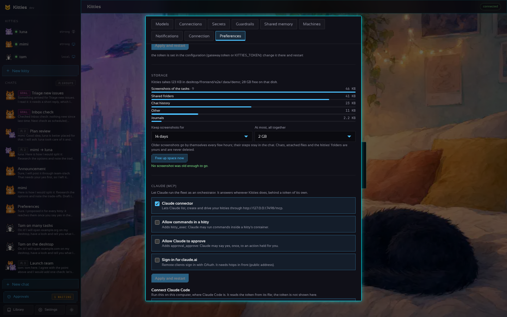

# Uso de disco

Kitties guarda sus datos en una carpeta (`data_dir`, por defecto `~/.kitties`). Una parte es tuya y
queda hasta que la borres; otra crece sola y se limpia. **Ajustes › Preferencias ›
Almacenamiento** muestra cuánto ocupa cada parte, cuánto queda libre en ese disco, y tiene
**Liberar espacio ahora**.



## Lo que se limpia solo

| Qué | Dónde | Límite |
| --- | --- | --- |
| Capturas de las tareas de escritorio (una por paso) | `chats/<id>/<turno>-<paso>.png` | Se guardan 30 días y 2 GB en total por defecto; se van primero las más antiguas (Ajustes, o `retention:` en el YAML). Los pasos quedan en el chat, sin la imagen; una tarea en curso conserva todas las suyas |
| Imágenes del escritorio que deja una actualización (2 a 3 GB cada una) | el motor de contenedores | Se eliminan tras cada actualización del escritorio y con *Liberar espacio ahora*: solo imágenes sin etiqueta con la marca del escritorio (`kitties.home`) que ningún contenedor usa |
| Lo que imprime un escritorio | el log del motor de contenedores | 3 archivos de 10 MB (Docker, `json-file`); uno de 10 MB (Podman). Los escritorios creados antes lo reciben al actualizarse |
| El diario de un kitty | `journal/<kitty>.jsonl` | 1 MB; al pasarlo se van las entradas más antiguas |
| Los logs de la app de escritorio | `gateway.log`, `desktop.log` | Rotan a los 5 MB (se guarda un `.1`) |
| La caché del navegador | el volumen `kitties-browser-<contenedor>` (escritorios anteriores: `work/<nombre>/.browser`) | 256 MB (política de Chromium `DiskCacheSize`) |
| Logs y restos dentro de un escritorio | `/tmp/*.log`, `~/.cache/*.log`, `/tmp` | `kitty-tidy` recorta cada 15 minutos un log de más de 5 MB a su último 1 MB; al arrancar borra lo que lleva 7 días en `/tmp` |
| Paquetes descargados | `/var/cache/apt` en el escritorio | Se limpian tras cada instalación con `kitty-apt` |
| Actualizaciones del propio Kitties | junto al binario | Una descarga a medias de una actualización cortada se borra en el siguiente arranque; la versión que no se sostuvo (`.failed`) se borra cuando se confirma una nueva. Se conserva un `.prev` para volver atrás a mano |
| Los contenedores del servidor (Compose) | el log del motor de contenedores | 3 archivos de 10 MB por servicio (`deploy/docker-compose.yml`) |

La limpieza corre 10 minutos después de arrancar el gateway y luego cada 6 horas.

## Lo que es tuyo, y solo se cuenta

Los chats y su historial, los archivos adjuntos, el home, el espacio de trabajo y la carpeta
Shared de cada kitty (Shared tiene su propia cuota, `containers.shared_quota_mb`), las copias de
sus sesiones, los ajustes de WhatsApp, la memoria, las habilidades y los artefactos (estos tres
tienen sus propios topes). Borra un chat o un kitty para liberar lo que ocupaba.

## Ajustes

```yaml
retention:
  shot_days: 30   # días que se guarda una captura; -1: siempre
  shots_mb: 2048  # lo máximo que ocupan en total, se van primero las más antiguas; -1: sin límite
```

Cero usa los valores por defecto. Un cambio hecho en Ajustes gana sobre el archivo y limpia al
instante.

API: `GET /v1/settings/storage` (las áreas, `total`, `free`, `retention`, la última limpieza),
`PUT /v1/settings/storage` `{shot_days, shots_mb}`, `POST /v1/settings/storage/clean`.
