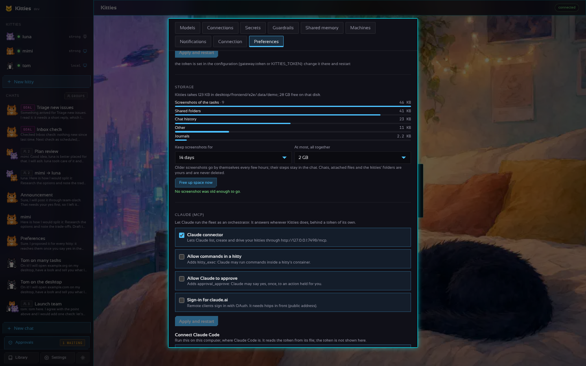

# Disk use

Kitties keeps its data in one folder (`data_dir`, `~/.kitties` by default). Some of it is yours
and stays until you delete it; some grows by itself and is swept. **Settings › Preferences ›
Storage** shows what each part takes, how much is free on that disk, and has **Free up space now**.



## What is swept by itself

| What | Where | Bound |
| --- | --- | --- |
| Screenshots of the desktop tasks (one after each step) | `chats/<id>/<turn>-<step>.png` | Kept 30 days and 2 GB in all by default, the oldest go first (Settings, or `retention:` in the YAML). The steps stay in the chat, without the picture; a task still at work keeps all of its own |
| Desktop images left behind by an update (2 to 3 GB each) | the container engine | Pruned after every desktop update and with *Free up space now*: only untagged images with the desktop's label (`kitties.home`) that no container uses |
| What a desktop prints | the container engine's log | 3 files of 10 MB (Docker, `json-file`); one of 10 MB (Podman). Desktops made before this get it when they are updated |
| A kitty's journal | `journal/<kitty>.jsonl` | 1 MB; past it the oldest entries go |
| The desktop app's logs | `gateway.log`, `desktop.log` | Rotated at 5 MB (one `.1` kept) |
| The browser's cache | the volume `kitties-browser-<container>` (older desktops: `work/<name>/.browser`) | 256 MB (Chromium policy `DiskCacheSize`) |
| Logs and leftovers inside a desktop | `/tmp/*.log`, `~/.cache/*.log`, `/tmp` | `kitty-tidy` trims a log past 5 MB to its last 1 MB every 15 minutes; at start it deletes what has sat in `/tmp` for 7 days |
| Downloaded packages | `/var/cache/apt` in the desktop | Cleaned after each `kitty-apt` install |
| Updates of Kitties itself | beside the binary | A half-written download left by an update that was cut off goes at the next start; the version that did not hold (`.failed`) goes once a newer one is confirmed. One `.prev` is kept, to go back by hand |
| The server's containers (Compose) | the container engine's log | 3 files of 10 MB per service (`deploy/docker-compose.yml`) |

The janitor runs 10 minutes after the gateway starts and then every 6 hours.

## What is yours, and only counted

Chats and their history, the files attached to them, each kitty's home, workspace and Shared
folder (Shared has its own quota, `containers.shared_quota_mb`), the backups of their sessions,
WhatsApp's settings, memory, skills and artifacts (these three have their own caps). Delete a
chat or a kitty to free what it took.

## Settings

```yaml
retention:
  shot_days: 30   # days a screenshot is kept; -1: forever
  shots_mb: 2048  # the most they take together, oldest go first; -1: no cap
```

Zero takes the defaults. A change made in Settings wins over the file and sweeps at once.

API: `GET /v1/settings/storage` (the areas, `total`, `free`, `retention`, the last sweep),
`PUT /v1/settings/storage` `{shot_days, shots_mb}`, `POST /v1/settings/storage/clean`.
