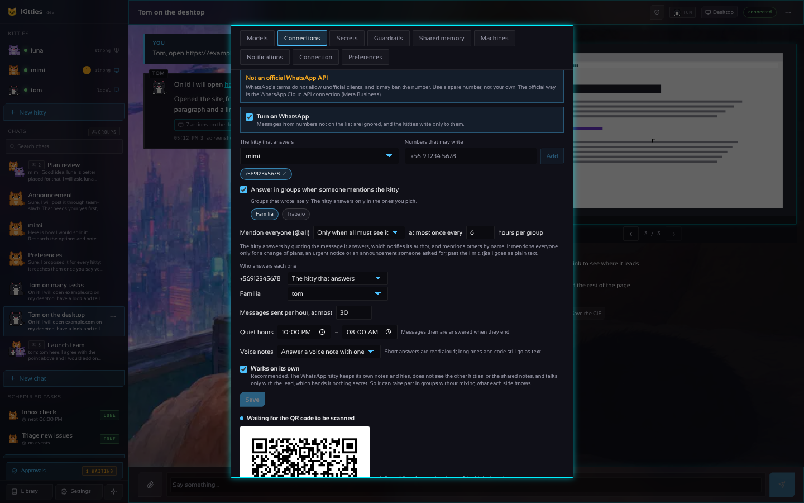
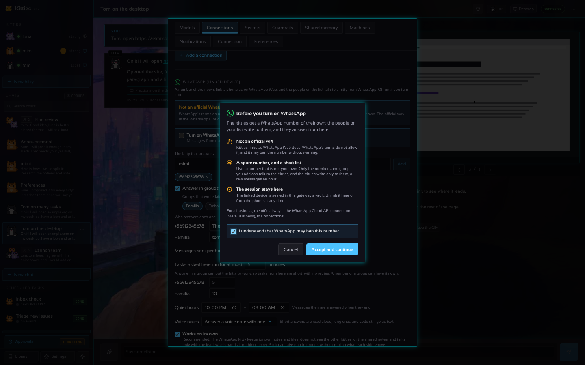
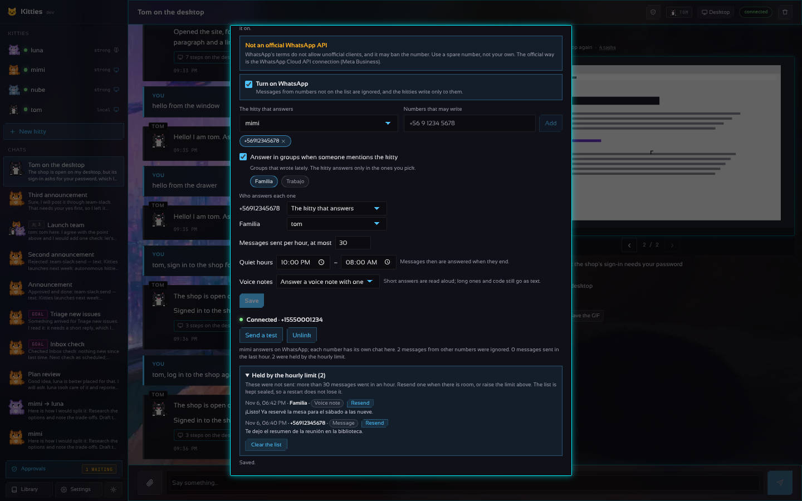

# WhatsApp: un número propio para los kitties

[In English](WHATSAPP.md)

Kitties puede vincularse a un número de WhatsApp como lo hace WhatsApp Web: como **dispositivo
vinculado** de un teléfono, con un código QR que aparece en Ajustes. Desde ahí, las personas que
pongas en la lista escriben a ese número y uno de tus kitties les responde, y los kitties pueden
escribirles con el conector `whatsapp-web`.





> [!WARNING]
> **No es una API oficial.** Los términos de servicio de WhatsApp no permiten clientes no oficiales
> ni automatizados, y WhatsApp puede bloquear un número usado así, por un tiempo o para siempre.
> Usa un **número de repuesto** (otra SIM, una línea prepago), nunca el tuyo, y mantén un uso bajo y
> personal (nada de envíos masivos ni a desconocidos).
>
> **La alternativa oficial** es la [WhatsApp Business Cloud API](https://developers.facebook.com/docs/whatsapp/cloud-api)
> de Meta: la conexión `whatsapp` del catálogo (Ajustes, Conexiones, Agregar una conexión,
> WhatsApp) envía mensajes con ella. Necesita una cuenta de Meta Business y un número registrado
> allí, y fuera de una ventana de 24 horas solo se pueden mandar plantillas aprobadas; a cambio está
> permitida y no se bloquea por ser automática.

## Activarlo

1. Ajustes, **Conexiones**, la sección **WhatsApp (dispositivo vinculado)** al final.
2. Elige **el kitty que responde** (si no eliges ninguno, responde el
   [kitty principal](AUTONOMY.md#the-lead-kitty)) y agrega los **números que pueden escribir** con su código de
   país (`+56 9 1234 5678`). La lista parte vacía: hasta que agregues a alguien, se ignora todo
   mensaje. Marca **Responder en grupos cuando alguien nombra al kitty** para que también hable en
   grupos, y elige los grupos: ahí aparecen los que escribieron hace poco (WhatsApp no le da a un
   dispositivo vinculado la lista de grupos hasta que escriben). Con más de un kitty, **Quién
   responde a cada uno** le da a un número o grupo su propio kitty; **Mensajes enviados por hora**
   limita lo que sale (60 si se deja vacío); el **Horario de silencio** guarda las respuestas hasta
   que termina; **Notas de voz** elige cuándo los kitties responden hablando (ver más abajo).
3. Marca **Activar WhatsApp**. La primera vez, una **bienvenida** explica qué hace y qué arriesga (no
   es una API oficial, usa un número de repuesto, la sesión sellada en el vault, la Cloud API como
   vía oficial): marca **Entiendo que WhatsApp puede bloquear este número**, **Aceptar y
   continuar**, y luego **Guardar**. Se pregunta una sola vez: desactivarlo y activarlo después no
   vuelve a preguntar.
4. Aparece un código QR. En el teléfono del número de los kitties: WhatsApp, Ajustes,
   **Dispositivos vinculados**, **Vincular un dispositivo**, y apunta al código. El código cambia
   cada pocos segundos; si se acaban, **Mostrar un código nuevo**.
5. Cuando diga **Conectado · +número**, **Enviar una prueba** escribe a un número de la lista.

El teléfono debe seguir encendido y conectarse de vez en cuando (WhatsApp desvincula un dispositivo
cuyo teléfono lleva unas dos semanas apagado). Si la conexión se cae, **Reconectar** la abre de nuevo
con la sesión guardada, sin otro código. **Desvincular** quita el dispositivo del teléfono y
olvida la sesión.

## Cómo funciona

- **Un chat por número.** El primer mensaje de un número abre un chat `WhatsApp: <nombre>` con el
  kitty elegido; los siguientes van al mismo chat, así que también ves la conversación en la página.
  La respuesta vuelve a WhatsApp con su Markdown convertido a las marcas de WhatsApp (`*negrita*`,
  `_cursiva_`). Una tarea en el escritorio se sigue: las primeras palabras van al tiro, luego
  cada frase en que el kitty dice lo que va a hacer (`⏳ …`, con un minuto entre una y otra como
  mínimo, la más nueva si llegaron varias) y el resultado cuando termina.
- **Leído y reacciones.** Un mensaje se marca como leído (ticks azules) cuando el kitty lo toma. Una
  respuesta que es solo un emoji va como reacción al mensaje, y los kitties pueden reaccionar con
  el conector.
- **Citas.** En un grupo, y en un chat donde llegaron mensajes nuevos entretanto, la respuesta cita
  el mensaje al que responde.
- **Horario de silencio.** De una hora a otra (el reloj del gateway, `TZ`), un mensaje recibe un
  aviso corto en el idioma del kitty ("🌙 luna descansa hasta las 08:00…") y su respuesta al
  terminar; los envíos y reacciones de los kitties también esperan. Los mensajes en espera quedan
  sellados (`queue.bin`), así que un reinicio no los pierde: se responden en la siguiente conexión
  pasado el silencio.
- **Un kitty por número o grupo.** Cada número o grupo puede tener su propio kitty; los demás van al
  kitty que responde. Cambiar uno de kitty abre un chat nuevo con él.
- **Un límite por hora.** Cuenta todo mensaje, nota de voz, archivo y reacción que sale; pasado el
  límite una respuesta queda retenida y un `send` de un kitty falla con un error claro. Evita que el
  número escriba como un bot. Ajustes lista los últimos 50 mensajes retenidos, del más nuevo al más
  viejo (cuándo, a quién, de qué tipo y cómo empezaba), en **Retenidos por el límite por hora**.
  **Reenviar** manda uno de nuevo cuando el límite tiene espacio (como un envío tuyo: el número o
  grupo debe seguir en la lista, y fuera del horario de silencio) y lo saca de la lista; **Vaciar la
  lista** los olvida todos. La lista queda sellada con la llave del vault (`held.bin`), así que un
  reinicio no la pierde.

  
- **"escribiendo…" mientras piensa.** El chat del teléfono muestra al kitty escribiendo hasta que
  sale la respuesta. Un mensaje que llega mientras sigue ocupado recibe un aviso corto en el idioma
  del kitty (el de su alma, o si no el del mensaje: inglés, español o portugués).
- **Grupos con su propia lista.** Con grupos activado, el kitty responde solo en los grupos que
  elegiste, y ahí cualquiera le habla mencionando con @ al número de los kitties, respondiendo a uno
  de sus mensajes o nombrando al kitty. Cada grupo tiene su chat (`WhatsApp group: <nombre>`), con
  cada línea firmada por quien la escribió; la respuesta va al grupo. Una mención en un grupo que no
  está en la lista se ignora y se cuenta.
- **Fotos, videos, documentos y audios.** Le llegan al kitty como archivos del chat (hasta 25 MB
  cada uno), con su pie de foto como texto. Una **nota de voz** se pasa a texto con la API de voz
  (Whisper) de un perfil `openai` o `groq` con llave; sin uno llega como archivo de audio.
- **Notas de voz de vuelta (texto a voz).** **Notas de voz** en Ajustes: **Nunca** (por defecto),
  **Responder una nota de voz con otra**, o **Todas las respuestas**. La respuesta se lee en voz alta
  con la API de voz de un perfil `openai` con llave (`gpt-4o-mini-tts`, Ogg Opus, enviada como nota
  de voz de verdad, con su duración) y cuenta como un mensaje. Una respuesta que se lee mejor de lo
  que se escucha (más de 1200 caracteres, o con código) sigue yendo como texto, un emoji sigue
  siendo una reacción, y si el servicio de voz falla va el texto. La voz de Groq solo entrega WAV,
  que WhatsApp no reproduce como nota de voz, así que no se usa para esto. Cada kitty puede tener
  **su propia voz** (en su cajón, *Voz para las notas de voz de WhatsApp*, o `voice:` en su alma);
  los demás usan `speak_voice`. Mientras va en camino una respuesta que saldrá como nota de voz, el
  chat del teléfono muestra **grabando audio…** en vez de escribiendo.
- **Stickers, ubicaciones y contactos.** Un sticker llega como su imagen (con su emoji), una
  ubicación como su nombre y dirección con un enlace al mapa, y un contacto compartido como su
  nombre y números.
- **Archivos de vuelta.** Un archivo que el kitty guarda en la biblioteca mientras responde le llega
  solo a la persona (o al grupo): una imagen como imagen y lo demás como documento (hasta 16 MB).
- **La lista funciona en ambos sentidos.** Un mensaje de un número que no está se ignora (y se
  cuenta en Ajustes) sin respuesta; los kitties solo pueden escribir a números de la lista.
- **Chats protegidos.** Los chats con contactos y grupos están protegidos: ahí el kitty no tiene
  escritorio, archivos, bóveda ni notas sobre ti, y se quitan secretos y datos personales de lo que
  dice. Tu propio número conserva el kitty completo cuando lo agregas en Ajustes › Protecciones ›
  *Tus propios números de WhatsApp*. Todo lo que envía el puente sale sin los secretos conocidos.
  Ver [GUARDRAILS.es.md](GUARDRAILS.es.md).
- **Los kitties escriben con el conector.** Mientras el vínculo está conectado, `whatsapp-web` se
  ofrece a los kitties (los que tienen su lista de conexiones vacía o lo nombran):

  ```
  @connector whatsapp-web {"action": "send", "to": "+56912345678", "text": "El informe está listo."}
  @connector whatsapp-web {"action": "send", "to": "Familia", "text": "Aquí está.", "file": "informe.pdf"}
  @connector whatsapp-web {"action": "react", "to": "+56912345678", "emoji": "👍"}
  @connector whatsapp-web {"action": "voice", "to": "+56912345678", "text": "Listo, nos vemos a las nueve."}
  @connector whatsapp-web {"action": "status"}
  ```

  `to` es un número o un grupo de la lista (su nombre o su id); `file` es un archivo de la
  biblioteca, que va con `text` como pie; `voice` manda `text` leído en voz alta como nota de voz
  (se ofrece solo si hay servicio de voz). Sin `to` escribe a quien escribió último (o al único número de la lista). Un envío llega a otras
  personas, así que como todo `send` **queda retenido para tu aprobación** hasta que confíes en el
  kitty para eso ([AUTONOMY.md](AUTONOMY.md)). Las respuestas a quien escribió no se retienen: lo
  pidió.

## Desde el archivo

La sección `whatsapp:` de `kitties.yaml` define lo mismo mientras no se haya guardado nada desde
Ajustes (en un servidor, antes de abrir la página). Después Ajustes guarda lo suyo en
`settings.json`.

```yaml
whatsapp:
  enabled: true                  # activarlo aquí es aceptar el riesgo
  allow: ["+56 9 1234 5678"]
  kitty: mimi                    # vacío: el primer kitty
  groups: true
  allow_groups: ["120363012345678901@g.us"]   # los ids que lista Ajustes (GET /v1/whatsapp, seen_groups)
  kitties: {"+1 555 000 1111": luna, "120363012345678901@g.us": tom}
  max_per_hour: 30               # 0: 60
  quiet: {from: "22:00", to: "08:00"}
  transcribe: ""                 # el perfil openai o groq para notas de voz; vacío: el primero; off: ninguno
  voice: mirror                  # responder con notas de voz: mirror (a notas de voz), always, u off (por defecto)
  speak: ""                      # el perfil openai que lee las respuestas; vacío: el primero; off: ninguno
  speak_voice: nova              # su voz (alloy, nova, shimmer, …); vacío: alloy
```

El código QR se sigue escaneando desde Ajustes, o se lee con `GET /v1/whatsapp` (`qr_png`).

## Dónde se guarda cada cosa

| Qué | Dónde | Cómo |
| --- | --- | --- |
| Encendido o no, la lista, el kitty, el chat de cada número | `<data>/whatsapp/settings.json` | modo 0600, sin secretos |
| Los mensajes que esperan el fin del silencio | `<data>/whatsapp/queue.bin` | **sellados** como la sesión; se borran al responderlos |
| Los mensajes retenidos por el límite por hora (los últimos 50) | `<data>/whatsapp/held.bin` | **sellados** como la sesión; se borran al reenviarlos o vaciar la lista |
| La sesión del dispositivo vinculado (sus llaves, las sesiones Signal, los contactos) | `<data>/whatsapp/session.bin` | **sellada** con la llave del vault (AES-256-GCM, atada a su uso); nunca en claro |

La sesión es el estado de la librería guardado en memoria y sellado entero: el gateway no usa un
archivo SQLite ni otro almacenamiento plano. La llave es la del vault (`vault.key` al lado, o
`KITTIES_VAULT_KEY`); sin vault (una carpeta de datos de solo lectura) WhatsApp no se puede activar
y Ajustes dice por qué. Una sesión que no abre con la llave (la llave cambió) no se usa: se vincula
el teléfono de nuevo con otro código.

## La API

| Ruta | Qué hace |
| --- | --- |
| `GET /v1/whatsapp` | El vínculo: `enabled`, `allow`, `kitty`, `state` (`off`, `starting`, `qr`, `qr_expired`, `connected`, `disconnected`, `logged_out`, `error`), `qr` y `qr_png` (un data URL PNG) mientras espera, `phone`, `linked`, `ignored`, `seen_groups` (los grupos que escribieron hace poco), `sent_last_hour`, `held`, `held_log` (los últimos retenidos: `id`, `at`, `to`, `name`, `kind`, `text`), `can_speak`, `risk_accepted`, `quiet`, `waiting` |
| `PUT /v1/whatsapp` | `{"enabled", "allow", "kitty", "groups", "allow_groups", "kitties", "max_per_hour", "quiet_from", "quiet_to", "voice"}`; activarlo la primera vez necesita `"accept_risk": true` (queda como `risk_accepted` en `settings.json`) |
| `POST /v1/whatsapp/link` | Códigos QR nuevos (si expiraron o el teléfono quitó el dispositivo) |
| `POST /v1/whatsapp/reconnect` | Conecta de nuevo con la sesión guardada (sin otro código) |
| `POST /v1/whatsapp/unlink` | Quita el dispositivo del teléfono y olvida la sesión |
| `POST /v1/whatsapp/test` | `{"to": "+56912345678"}` manda un mensaje corto a un número de la lista |
| `DELETE /v1/whatsapp/held` | Vacía la lista de mensajes retenidos |
| `POST /v1/whatsapp/held/{id}/resend` | Manda de nuevo un mensaje retenido (404 si ya no está en la lista, 429 mientras el límite está lleno) |

## Por dentro

El protocolo es [whatsmeow](https://github.com/tulir/whatsmeow) (MPL-2.0), el protocolo multi-
dispositivo de WhatsApp Web en Go. `internal/whatsapp` es el puente (ajustes, lista, chats, conector)
y no sabe nada del protocolo (`transcribe.go` manda las notas de voz a `/audio/transcriptions`, y
`speak.go` lee las respuestas en voz alta con `/audio/speech`);
`internal/whatsapp/wameow` es la conexión, las descargas de archivos y el almacenamiento en memoria
que se exporta, se sella y se vuelve a leer. El puente se prueba con un cliente falso; el
almacenamiento y la conexión, con un falso del cliente de whatsmeow.
