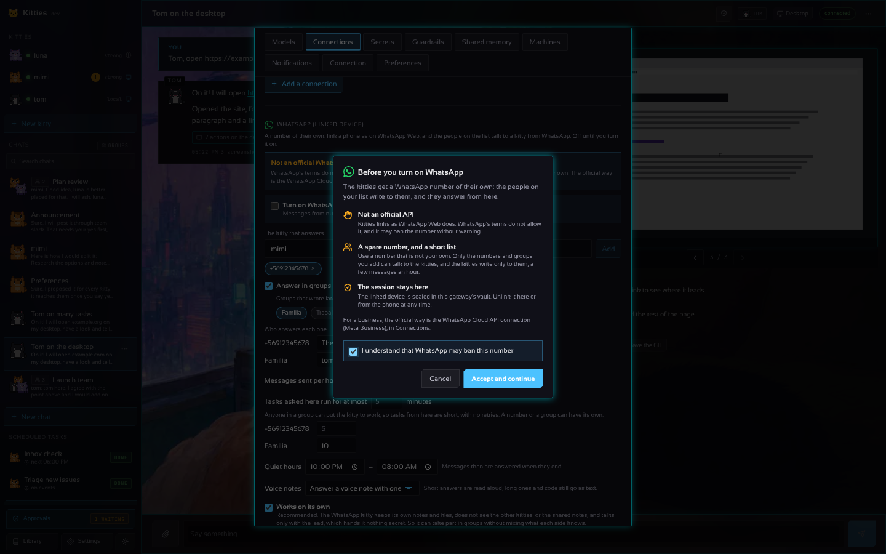
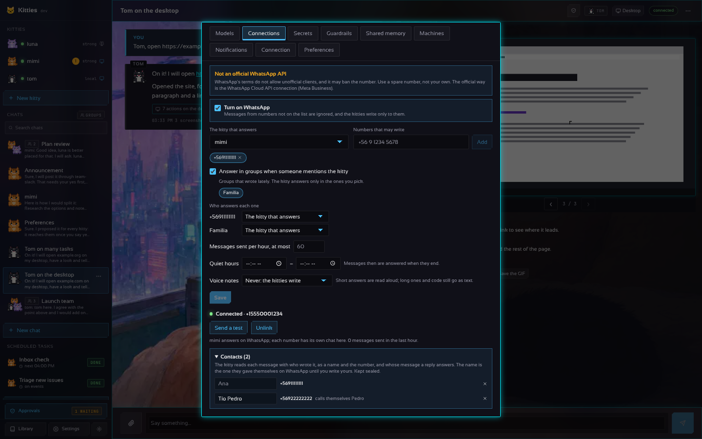
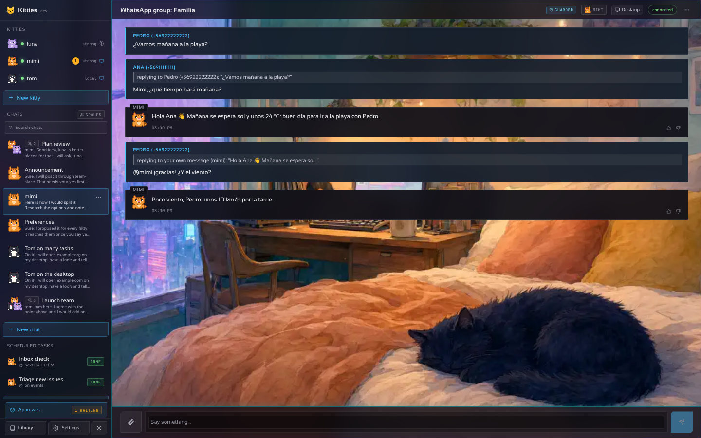
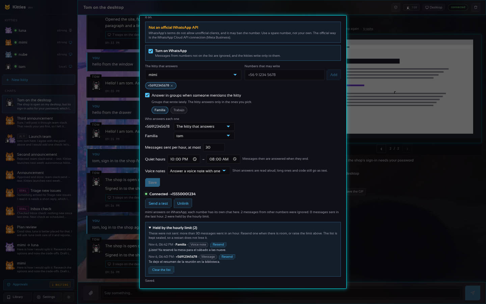
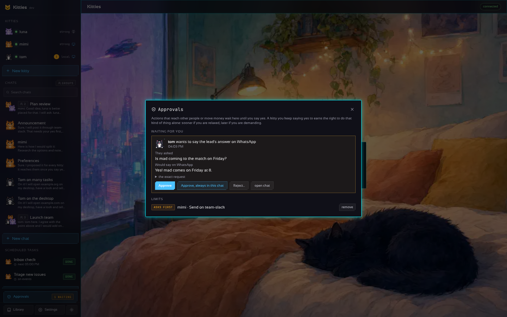
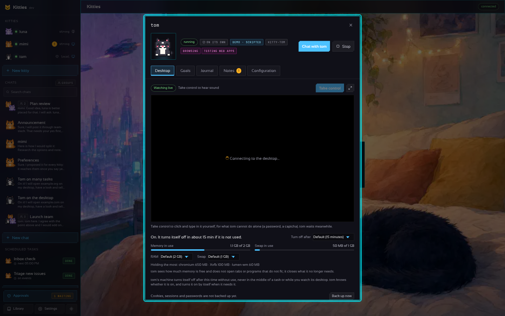

# WhatsApp: a number of the kitties' own

[En español](WHATSAPP.es.md)

Kitties can link to a WhatsApp number the way WhatsApp Web does: as a **linked device** of a phone,
with a QR code shown in Settings. Then the people you put on the list write to that number and a
kitty of yours answers them, and the kitties can write to those people with the `whatsapp-web`
connector.




> [!WARNING]
> **This is not an official API.** WhatsApp's terms of service do not allow unofficial or automated
> clients, and WhatsApp may ban a number used this way, for a while or for good. Use a **spare
> number** (a second SIM, a prepaid line), never your personal one, and keep the volume low and
> personal (no bulk messages, no strangers).
>
> **The official alternative** is the [WhatsApp Business Cloud API](https://developers.facebook.com/docs/whatsapp/cloud-api)
> from Meta: the `whatsapp` connection of the catalogue (Settings, Connections, Add a connection,
> WhatsApp) sends messages with it. It needs a Meta Business account and a number registered
> there, and messages outside a 24-hour window must use approved templates; in exchange it is
> allowed and is not banned for being automated.

## Turning it on

1. Settings, **Connections**, the **WhatsApp (linked device)** section at the end.
2. Choose **the kitty that answers** (with none chosen, the [lead kitty](AUTONOMY.md#the-lead-kitty)
   answers), and add the **numbers that may write** with their country
   code (`+56 9 1234 5678`). The list starts empty: until you add someone, every message is
   ignored. Tick **Answer in groups when someone mentions the kitty** to let it talk in groups too,
   and pick the groups: the ones that wrote lately show up there (WhatsApp gives a linked device no
   list of groups until they write). With more than one kitty, **Who answers each one** gives a
   number or a group a kitty of its own; **Messages sent per hour** caps what goes out (60 when
   left empty); **Quiet hours** hold the answers until they end; **Voice notes** chooses when the
   kitties answer speaking (see below).
3. Tick **Turn on WhatsApp**. The first time, a **welcome** explains what it does and what it risks
   (not an official API, use a spare number, the session sealed in the vault, the Cloud API as the
   official way): tick **I understand that WhatsApp may ban this number**, **Accept and continue**,
   then **Save**. It is asked once: turning it off and on later does not ask again.
4. A QR code appears. On the phone of the kitties' number: WhatsApp, Settings, **Linked devices**,
   **Link a device**, and point it at the code. The code changes every few seconds; if they run out,
   **Show a new code**.
5. Once it says **Connected · +number**, **Send a test** writes to a number on the list.

The phone must stay on and online from time to time (WhatsApp unlinks a device whose phone has been
off for about two weeks). When the connection drops, **Reconnect** opens it again with the kept
session, without a new code. **Unlink** removes the device from the phone and forgets the session.

## How it works

- **One chat per number.** The first message of a number opens a chat titled `WhatsApp: <name>`
  with the chosen kitty; the next ones go to the same chat, so you see the whole conversation on the
  page too. The kitty's answer goes back to WhatsApp, with its Markdown turned into WhatsApp's own
  marks (`*bold*`, `_italics_`). A desktop task is followed: the first words go at once, then
  each line the kitty writes about what it goes on to do (`⏳ …`, a minute apart at least, the newest
  when several came meanwhile), and the result when it is done.
- **Who is who.** Every message reaches the kitty with **who wrote it**, as a name and the number
  (`Ana (+56911111111)`), so the people of a group, or of different chats, are never taken for one
  another or for you. A **reply** says whose message it answers and what it said
  (`(replying to Pedro (+56922222222): "¿vamos mañana?")`, or *your own message* when it answers the
  kitty), and an **@mention** reads as the name of who it names. The kitty is told to tell people
  apart **by the number**, never by the name, which anyone may choose for themselves. The name is
  the one **you** set in Settings › Connections › WhatsApp › **Contacts**; until you set one, the
  name they gave themselves on WhatsApp (the *push name*); with neither, the number alone. A
  message from one of **your own numbers** (Settings › Guardrails) is read as yours. The page shows
  the author over each of their messages, and a reply's quote above its text.

  

  

  Contacts are noted when they write to the kitty, or in a group on the list (even when not to the
  kitty, so a later reply to them says whose words it quotes); strangers are not. Up to 1000 are
  kept, sealed with the vault's key (`contacts.bin`); past that the ones not seen for longest go,
  never one you named. A name is one line of at most 40 characters, without brackets, parentheses,
  quotes or tags. Renaming a contact changes how the kitty reads its next messages; the earlier
  ones keep the name they came with (the number does not change). The kitties may also write to a
  contact on the list by its name (`"to": "Ana"`), when only one has it.
- **Read, and reactions.** A message is marked read (blue ticks) when the kitty starts on it. An
  answer that is only an emoji goes as a reaction to the message, and the kitties can react with
  the connector.
- **Quotes.** In a group, and in a chat where newer messages came in the meantime, the answer quotes
  the message it answers.
- **Quiet hours.** From one time to another (the gateway's clock, `TZ`), a message gets one short
  note in the kitty's language ("🌙 luna is resting until 08:00…") and its answer when they end; the
  kitties' own sends and reactions wait too. Messages waiting are kept sealed (`queue.bin`), so a
  restart does not lose them: they are answered on the next connection after the quiet hours.
- **A kitty per number or group.** Each number or group may have its own kitty; the others go to
  the kitty that answers. Moving one to another kitty starts a new chat with it.
- **An hourly limit.** Every message, voice note, file and reaction that goes out counts; past the
  limit a reply is held and a kitty's `send` fails with a clear error. It keeps the number from
  writing like a bot. Settings lists the last 50 held messages, newest first (when, to whom, what
  kind and how it started), under **Held by the hourly limit**. **Resend** sends one again when the
  limit has room (as your own send: the number or group must still be on the list, and not in the
  quiet hours) and takes it off; **Clear the list** forgets them all. The list is kept sealed with
  the vault's key (`held.bin`), so a restart does not lose it.

  
- **"typing…" while it thinks.** The chat on the phone shows the kitty typing until the answer goes.
  A message that comes while it is still busy gets a short note in the kitty's language (its soul's
  language, else the language of the message: English, Spanish or Portuguese).
- **Groups on their own list.** With groups on, the kitty answers only in the groups you picked,
  and there anyone may talk to it by @mentioning the kitties' number, answering one of its
  messages, or naming the kitty. Each group has its own chat (`WhatsApp group: <name>`), with every
  message under its author's name and number; the answer goes to the group. A mention in a group not on the list is
  ignored and counted.
- **Pictures, videos, documents and audio.** They reach the kitty as files of the chat (up to 25 MB
  each), with their caption as the text. A **voice note** is turned into text with the speech API
  (Whisper) of an `openai` or `groq` profile with a key; without one it comes as an audio file.
- **Voice notes back (text to speech).** **Voice notes** in Settings: **Never** (the default),
  **Answer a voice note with one**, or **Every answer**. The answer is read aloud with the speech
  API of an `openai` profile with a key (`gpt-4o-mini-tts`, Ogg Opus, sent as a real voice note
  with its length) and counts as one message. An answer that reads better than it sounds (longer
  than 1200 characters, or with code) still goes as text, an emoji still goes as a reaction, and
  if the speech service fails the text goes instead. Groq's speech answers only WAV, which WhatsApp
  does not play as a voice note, so it is not used for this. Each kitty may have **a voice of its
  own** (the kitty's drawer, *Voice for WhatsApp voice notes*, or `voice:` in its soul); the others
  take `speak_voice`. While an answer that goes as a voice note is on its way, the chat on the phone
  shows **recording audio…** instead of typing.
- **Stickers, locations and contacts.** A sticker comes as its picture (with its emoji), a location
  as its name and address with a map link, a shared contact as its name and numbers.
- **Files back.** A file the kitty saves to the library while it answers goes to the person (or the
  group) by itself, a picture as a picture and anything else as a document (up to 16 MB).
- **The allow list works both ways.** A message from a number that is not on it is ignored (and
  counted in Settings), without an answer; the kitties can only write to numbers on it.
- **Guarded chats.** The chats with contacts and groups are guarded: the kitty has no desktop,
  files, vault or notes about you there, and secrets and personal data are taken out of what it says.
  Your own number keeps the whole kitty once you add it to Settings › Guardrails › *Your own WhatsApp
  numbers*. Everything the bridge sends leaves without the known secrets. See
  [GUARDRAILS.md](GUARDRAILS.md).
- **The WhatsApp kitty works on its own.** The kitty that answers here (and each kitty given a
  number or a group) is, by default, a principal of its own beside the lead, so what it hears in
  groups and from contacts never mixes with what the other kitties know, and the other way round:
  - **Its own memory.** It does not see the shared notes and cannot add to them. Besides its usual
    notes it keeps notes about **people** (who is who, what a group is about): in the chats with
    contacts and groups those are the only notes it reads and writes, so it can follow a group over
    time without carrying anything of yours there. A distillation never mixes them with yours.
  - **Its own computer, in groups too.** It still browses the internet and uses its own desktop,
    files and commands in the chats with contacts and groups (nothing of yours is on it); there it
    never types vault secrets nor asks you to take control, and what it says is filtered as any
    guarded answer.
  - **Its own files.** It sees only the library files it saved; the other kitties do not see its.
    It sends only its own files too: a `file` of someone else's is refused.
  - **No other kitties.** It is never in a chat with other kitties (adding it to one is refused),
    hands no work to them, and none of them hands it work.
  - **One channel: the lead.** From its own threads it asks the lead (`ask_lead`); the lead answers
    it (`answer_kitty`) or hands it what to say or do on WhatsApp (`delegate`). Whatever the lead
    sends it goes through the guardrails first (no secret the gateway knows reaches it) with a
    reminder not to repeat anything private in a contact's chat or a group. The lead's roster says
    the kitty works on its own, and what it has to tell you reaches the lead's Reports as any
    kitty's does.
  - **Asking the lead from a group, with your yes.** In a contact's chat or a group, when only the
    lead knows the answer, the kitty may `ask_lead` too, but the question waits in **Approvals**
    (*ask the lead, from <chat>: …*) and the kitty says it will check and come back. On your yes the
    lead is asked, told that its answer will be repeated there; the kitty answers the people with it
    (filtered by the guardrails as any answer there), and that answer waits in **Approvals** too
    (*say in <chat>: …*), a second look before it leaves: on your yes it goes back to WhatsApp,
    within the list, the quiet hours and the hourly limit; on a no it stays in the chat. A no to
    the question leaves the lead out. The card shows the question and what would be said, apart.
    **Approve, always in this chat** trusts that one chat (a group you trust) for good: its next
    questions go to the lead, or its next answers go out, without asking; every other chat still
    asks. The limits list shows it, and *remove* takes it back.

     Kitties that do not
    work on their own never ask the lead from those chats.
  - **Shown as such.** The kitty's drawer shows **On its own** and the sidebar a shield next to
    its name (`independent: true` in `GET /v1/kitties`).

    

  Settings › Connections › WhatsApp › **Works on its own** (on by default; `share_with_team: true`
  in the file turns it off). **The lead never works on its own**: it leads the others. With no
  kitty chosen the lead answers, guarded as any exposed chat, and Settings suggests choosing a kitty
  of its own for WhatsApp.
- **The kitties write with the connector.** While the link is connected, `whatsapp-web` is offered
  to the kitties (those whose connections list is empty or names it):

  ```
  @connector whatsapp-web {"action": "send", "to": "+56912345678", "text": "The report is ready."}
  @connector whatsapp-web {"action": "send", "to": "Familia", "text": "Here it is.", "file": "report.pdf"}
  @connector whatsapp-web {"action": "react", "to": "+56912345678", "emoji": "👍"}
  @connector whatsapp-web {"action": "voice", "to": "+56912345678", "text": "Ready, see you at nine."}
  @connector whatsapp-web {"action": "status"}
  ```

  `to` is a number or a group on the list (its name or its id), or a contact on the list by its name; `file` is a file of the library,
  sent with `text` as its caption; `voice` sends `text` read aloud as a voice note (offered only
  when there is a speech service). `to` left out writes to whoever wrote last (or to the only number on the list). A send reaches
  other people, so like every `send` it is **held for your approval** until you trust the kitty with
  it ([AUTONOMY.md](AUTONOMY.md)). The answers to a person who wrote are not held: they asked.

## From the file

The `whatsapp:` section of `kitties.yaml` sets the same while nothing was saved from Settings (on a
server, before opening the page). Settings then keeps its own in `settings.json`.

```yaml
whatsapp:
  enabled: true                  # turning it on here is accepting the risk
  allow: ["+56 9 1234 5678"]
  kitty: mimi                    # empty: the first kitty
  groups: true
  allow_groups: ["120363012345678901@g.us"]   # the ids Settings lists (GET /v1/whatsapp, seen_groups)
  kitties: {"+1 555 000 1111": luna, "120363012345678901@g.us": tom}
  max_per_hour: 30               # 0: 60
  quiet: {from: "22:00", to: "08:00"}
  transcribe: ""                 # the openai or groq profile for voice notes; empty: the first; off: none
  voice: mirror                  # answer with voice notes: mirror (to voice notes), always, or off (the default)
  speak: ""                      # the openai profile that reads answers aloud; empty: the first; off: none
  speak_voice: nova              # its voice (alloy, nova, shimmer, …); empty: alloy
  share_with_team: false         # true: the WhatsApp kitties work with the others (default: on their own)
```

The QR code is still scanned from Settings, or read with `GET /v1/whatsapp` (`qr_png`).

## Where things are kept

| What | Where | How |
| --- | --- | --- |
| On or off, the list, the kitty, the chat of each number | `<data>/whatsapp/settings.json` | mode 0600, no secrets |
| The messages waiting for the quiet hours to end | `<data>/whatsapp/queue.bin` | **sealed** like the session; gone once they are answered |
| The messages held by the hourly limit (the last 50) | `<data>/whatsapp/held.bin` | **sealed** like the session; gone when resent or cleared |
| The contacts (number, your name for them, their push name, when last seen) | `<data>/whatsapp/contacts.bin` | **sealed** like the session; at most 1000 |
| The session of the linked device (its keys, the Signal sessions, the contacts) | `<data>/whatsapp/session.bin` | **sealed** with the vault's key (AES-256-GCM, bound to its use); never in the clear |

The session is a blob of the library's state kept in memory and sealed as a whole: the gateway uses
no SQLite file or any other plain store for it. The key is the vault's (`vault.key` beside it, or
`KITTIES_VAULT_KEY`); without a vault (a read-only data folder) WhatsApp cannot be turned on and
Settings says why. A session that cannot be opened with the key (the key changed) is not used: the
phone is linked again with a new code.

## The API

| Route | What it does |
| --- | --- |
| `GET /v1/whatsapp` | The link: `enabled`, `allow`, `kitty`, `state` (`off`, `starting`, `qr`, `qr_expired`, `connected`, `disconnected`, `logged_out`, `error`), `qr` and `qr_png` (a PNG data URL) while it waits, `phone`, `linked`, `ignored`, `seen_groups` (the groups that wrote lately), `sent_last_hour`, `held`, `held_log` (the last held messages: `id`, `at`, `to`, `name`, `kind`, `text`), `can_speak`, `risk_accepted`, `quiet`, `waiting` |
| `PUT /v1/whatsapp` | `{"enabled", "allow", "kitty", "groups", "allow_groups", "kitties", "max_per_hour", "quiet_from", "quiet_to", "voice"}`; turning it on the first time needs `"accept_risk": true` (kept as `risk_accepted` in `settings.json`) |
| `POST /v1/whatsapp/link` | New QR codes (after they expired or the phone logged the device out) |
| `POST /v1/whatsapp/reconnect` | Connects again with the kept session (no new code) |
| `POST /v1/whatsapp/unlink` | Removes the device from the phone and forgets the session |
| `POST /v1/whatsapp/test` | `{"to": "+56912345678"}` sends a short message to a number on the list |
| `DELETE /v1/whatsapp/held` | Clears the list of held messages |
| `POST /v1/whatsapp/held/{id}/resend` | Sends a held message again (404 when it is not on the list, 429 while the limit is full) |
| `GET /v1/whatsapp/contacts` | `{"contacts": [{"number", "name", "push_name", "seen"}]}`, the ones seen last first |
| `PUT /v1/whatsapp/contacts/{number}` | `{"name": "Ana"}` sets the name the kitty reads (`""` goes back to the push name); a number that never wrote may be named before it does (404 when clearing an unknown one) |
| `DELETE /v1/whatsapp/contacts/{number}` | Forgets a contact (it comes back with its push name when it writes again) |

## Under the hood

The protocol is [whatsmeow](https://github.com/tulir/whatsmeow) (MPL-2.0), the WhatsApp Web
multi-device protocol in Go. `internal/whatsapp` is the bridge (settings, list, chats, connector) and
knows nothing of the protocol (`transcribe.go` sends voice notes to `/audio/transcriptions`, and
`speak.go` reads answers aloud with `/audio/speech`);
`internal/whatsapp/wameow` is the connection, the media downloads and the in-memory store that is
exported, sealed and read back. The bridge is tested with a fake client, the store and the
connection with a fake of whatsmeow's client.
