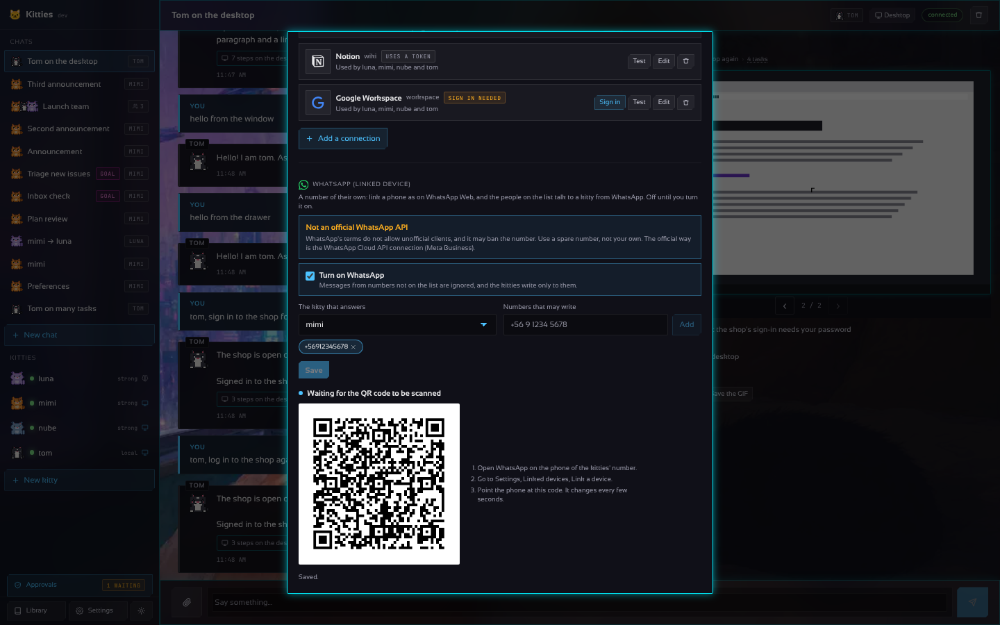

# WhatsApp: a number of the kitties' own

[En español](WHATSAPP.es.md)

Kitties can link to a WhatsApp number the way WhatsApp Web does: as a **linked device** of a phone,
with a QR code shown in Settings. Then the people you put on the list write to that number and a
kitty of yours answers them, and the kitties can write to those people with the `whatsapp-web`
connector.



> [!WARNING]
> **This is not an official API.** WhatsApp's terms of service do not allow unofficial or automated
> clients, and WhatsApp may ban a number used this way, for a while or for good. Use a **spare
> number** (a second SIM, a prepaid line), never your personal one, and keep the volume low and
> personal (no bulk messages, no strangers).
>
> **The official alternative** is the [WhatsApp Business Cloud API](https://developers.facebook.com/docs/whatsapp/cloud-api)
> from Meta: the `whatsapp` connection of the catalogue (Settings, Connections, Add a connection,
> WhatsApp) sends messages with it. It needs a Meta Business account and a number registered
> there, and messages outside a 24-hour window must use approved templates; in exchange it is
> allowed and is not banned for being automated.

## Turning it on

1. Settings, **Connections**, the **WhatsApp (linked device)** section at the end.
2. Choose **the kitty that answers**, and add the **numbers that may write** with their country
   code (`+56 9 1234 5678`). The list starts empty: until you add someone, every message is
   ignored.
3. Tick **Turn on WhatsApp**, then **I understand that WhatsApp may ban this number**, and **Save**.
4. A QR code appears. On the phone of the kitties' number: WhatsApp, Settings, **Linked devices**,
   **Link a device**, and point it at the code. The code changes every few seconds; if they run out,
   **Show a new code**.
5. Once it says **Connected · +number**, **Send a test** writes to a number on the list.

The phone must stay on and online from time to time (WhatsApp unlinks a device whose phone has been
off for about two weeks). **Unlink** removes the device from the phone and forgets the session.

## How it works

- **One chat per number.** The first message of a number opens a chat titled `WhatsApp: <name>`
  with the chosen kitty; the next ones go to the same chat, so you see the whole conversation on the
  page too. The kitty's answer goes back to WhatsApp, with its Markdown turned into WhatsApp's own
  marks (`*bold*`, `_italics_`). A desktop task is followed: the first words go at once and the
  result when it is done.
- **Only text, only one-to-one.** Groups, pictures, audio and stickers are not answered yet.
- **The allow list works both ways.** A message from a number that is not on it is ignored (and
  counted in Settings), without an answer; the kitties can only write to numbers on it.
- **The kitties write with the connector.** While the link is connected, `whatsapp-web` is offered
  to the kitties (those whose connections list is empty or names it):

  ```
  @connector whatsapp-web {"action": "send", "to": "+56912345678", "text": "The report is ready."}
  @connector whatsapp-web {"action": "status"}
  ```

  `to` left out writes to whoever wrote last (or to the only number on the list). A send reaches
  other people, so like every `send` it is **held for your approval** until you trust the kitty with
  it ([AUTONOMY.md](AUTONOMY.md)). The answers to a person who wrote are not held: they asked.

## Where things are kept

| What | Where | How |
| --- | --- | --- |
| On or off, the list, the kitty, the chat of each number | `<data>/whatsapp/settings.json` | mode 0600, no secrets |
| The session of the linked device (its keys, the Signal sessions, the contacts) | `<data>/whatsapp/session.bin` | **sealed** with the vault's key (AES-256-GCM, bound to its use); never in the clear |

The session is a blob of the library's state kept in memory and sealed as a whole: the gateway uses
no SQLite file or any other plain store for it. The key is the vault's (`vault.key` beside it, or
`KITTIES_VAULT_KEY`); without a vault (a read-only data folder) WhatsApp cannot be turned on and
Settings says why. A session that cannot be opened with the key (the key changed) is not used: the
phone is linked again with a new code.

## The API

| Route | What it does |
| --- | --- |
| `GET /v1/whatsapp` | The link: `enabled`, `allow`, `kitty`, `state` (`off`, `starting`, `qr`, `qr_expired`, `connected`, `disconnected`, `logged_out`, `error`), `qr` and `qr_png` (a PNG data URL) while it waits, `phone`, `linked`, `ignored` |
| `PUT /v1/whatsapp` | `{"enabled", "allow", "kitty"}`; turning it on needs `"accept_risk": true` |
| `POST /v1/whatsapp/link` | New QR codes (after they expired or the phone logged the device out) |
| `POST /v1/whatsapp/unlink` | Removes the device from the phone and forgets the session |
| `POST /v1/whatsapp/test` | `{"to": "+56912345678"}` sends a short message to a number on the list |

## Under the hood

The protocol is [whatsmeow](https://github.com/tulir/whatsmeow) (MPL-2.0), the WhatsApp Web
multi-device protocol in Go. `internal/whatsapp` is the bridge (settings, list, chats, connector) and
knows nothing of the protocol; `internal/whatsapp/wameow` is the connection and the in-memory store
that is exported, sealed and read back. The bridge is tested with a fake client, the store and the
connection with a fake of whatsmeow's client.
